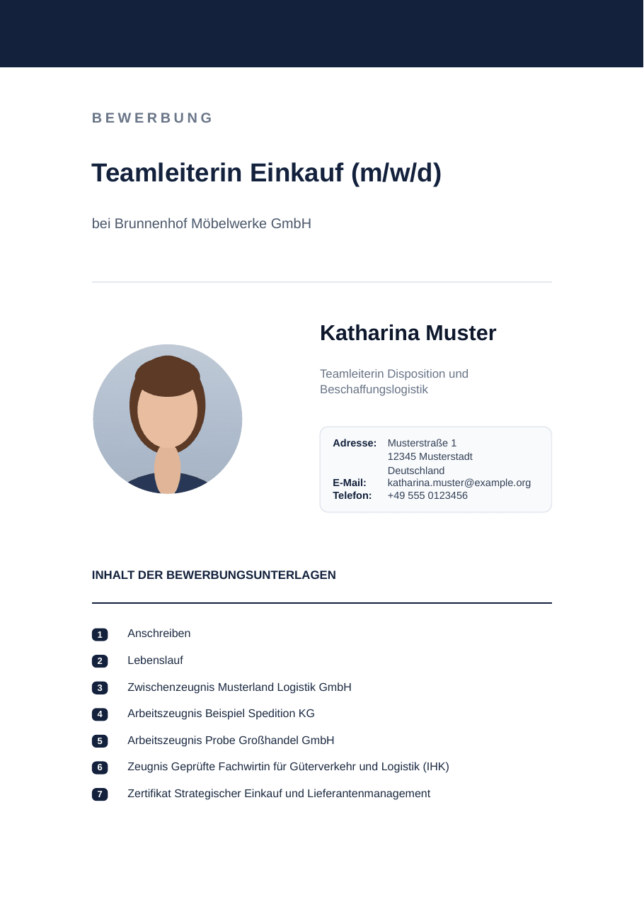

# 1 Was ist Vitafolio?

Vitafolio ist eine App für Bewerbungen, die gut aussehen. Sie ist **Open Source**: Die „Bauanleitung“ des Programms ist
öffentlich einsehbar, und jeder darf das Programm dauerhaft kostenlos nutzen.

Dieses Handbuch beschreibt die **aktuelle Version** von Vitafolio. Das können Sie damit tun:

- **Lebenslauf aus Bausteinen:** Sie tragen Ihre Daten, Stationen, Kenntnisse und Zeugnisse **einmal** im Stammprofil ein.
  Daraus entsteht Ihr Lebenslauf in 18 Designs (von Klassisch über Zeitleiste bis Aurora), als PDF oder als Word-Datei. Eine Lücken-Analyse
  weist Sie auf Lücken im Werdegang hin, und ein Assistent führt Sie Schritt für Schritt durch die Eingabe.
- **Anschreiben:** Sie schreiben Ihre Anschreiben, angelehnt an DIN 5008, mit Absender- und Empfängerfeld, Falz- und Lochmarken
  und auf Wunsch Ihrer Unterschrift.
- **Bewerbungs-Tracker und Mappe:** Eine Übersicht zeigt, wo jede Bewerbung steht, und erinnert Sie nach 14 Tagen ans
  Nachfassen. Aus Deckblatt, Anschreiben, Lebenslauf und Anlagen entsteht eine PDF-Mappe. Die Mappe, die Sie verschickt haben,
  bleibt unverändert erhalten.
- **Ratgeber und Hilfe in der App:** Ein Ratgeber stellt wenige Fragen und zeigt einen Bewerbungsplan für Ihre Lage (Kapitel 23). Eine kurze Einführung und kleine
  Hinweise auf jeder Seite erklären die App (Abschnitt 17.4).
- **KI-Hilfe, freiwillig:** Sie lassen sich Anschreiben, Kurzprofil und Stichpunkte vorschlagen oder Texte übersetzen. Das geht
  mit einem eigenen API-Key, mit einem Modell auf Ihrem Rechner (Ollama, LM Studio) oder durch Kopieren und Einfügen in
  einen KI-Chat. Name, Kontaktdaten und Anschrift ersetzt Vitafolio vorher durch Platzhalter (Kapitel 11).
- **Zwei Formen:** Vitafolio läuft als Windows-Programm oder als Docker-Container auf Ihrem Heimserver (zum Beispiel Unraid, einem
  NAS oder einem Linux-Rechner).
- **Konten und Sicherheit (Docker-Version):** Mehrere Personen haben je ein Konto. Dazu kommen Zwei-Faktor-Anmeldung,
  Aktivitätsprotokoll und ein Notfall-Zugang für den Administrator.
- **Datensicherung und Updates:** Sicherungen laufen nach Zeitplan und lassen sich herunterladen und wiederherstellen. Vitafolio
  meldet neue Versionen. Unter Windows installieren Sie sie mit einem Klick.

## 1.1 Wie Sie dieses Handbuch benutzen

Sie müssen es nicht von vorn bis hinten lesen. Suchen Sie sich Ihr Ziel aus:

| Ich möchte … | Lesen Sie |
|---|---|
| Vitafolio auf meinem Windows-PC installieren | Kapitel 2 und 3, dann 7 bis 11 sowie 16 bis 18 |
| Vitafolio auf meinem Heimserver (Docker, Unraid, NAS) betreiben | Kapitel 2 und 4, dann 5 bis 17 |
| mein Stammprofil und meinen Lebenslauf anlegen | Kapitel 8 |
| ein Anschreiben schreiben | Kapitel 9 |
| Bewerbungen nachverfolgen, Mappen und Anlagen verwalten | Kapitel 10 |
| die KI-Hilfe nutzen und wissen, was dabei weitergegeben wird | Kapitel 11 |
| mein Konto absichern (Passwort, Zwei-Faktor, Notfall-Zugang) | Kapitel 12 |
| Aussehen, Sprache und Datumsformat einstellen | Kapitel 13 |
| als Administrator Konten, Einstellungen und Protokoll verwalten | Kapitel 14 |
| meine Daten sichern oder wiederherstellen | Kapitel 15 |
| Vitafolio aktualisieren und Neuigkeiten lesen | Kapitel 16 |
| Handbuch, Version, Lizenz und Quellcode finden | Kapitel 17 |
| eine Fehlermeldung oder ein Problem lösen | Kapitel 19 |
| mich über den Datenschutz informieren | Kapitel 20 |
| wissen, wie eine Bewerbung aufgebaut ist und was hineingehört | Kapitel 22 |
| mir von Vitafolio einen Bewerbungsplan zeigen lassen | Kapitel 23 |
| fertige Mappen und meinen Lebenslauf herunterladen, auch mehrere auf einmal | Kapitel 24 |
| die Einführung und die Hinweise in der App verstehen oder neu starten | Abschnitt 17.4 |

Fachwörter werden beim ersten Auftreten erklärt. Am Ende steht in Kapitel 21 eine kurze Liste der wichtigsten Begriffe. Kapitel 22 ist ein Ratgeber zum Aufbau einer Bewerbung, Kapitel 23 beschreibt die Ratgeber-Seite der App, Kapitel 24 die Export-Seite.

# 2 Die zwei Versionen im Überblick

Es gibt Vitafolio in zwei Formen. Beide haben dieselbe Oberfläche. Sie unterscheiden sich darin, wie man sie benutzt.

| | Windows-Programm | Docker-Version |
|---|---|---|
| Wie benutzt man sie? | Wie jedes Programm: eigenes Fenster | Im Webbrowser, unter einer Adresse |
| Für wen? | eine Person an einem PC | eine oder mehrere Personen, im Heimnetz oder – mit eigenem HTTPS – von unterwegs |
| Anmeldung? | nein, das Windows-Konto schützt | ja, mit Benutzername und Passwort |
| Zwei-Faktor, Benutzerverwaltung, Protokoll? | nein | ja |
| Erreichbar von | nur diesem PC | von allen, die den Server erreichen und ein Konto haben |
| Daten liegen | in einem Ordner auf diesem PC | im Datenordner des Containers |
| Aktualisieren | mit einem Klick in der App (Kapitel 16) | von Hand: den Container aktualisieren (Kapitel 16) |

Kurz erklärt:

- **Docker** ist eine Technik, mit der ein Programm samt allem, was es braucht, in einem abgeschlossenen Paket läuft.
  Das Paket heißt **Container**. Es läuft auf jedem Rechner gleich.
- **Unraid** ist ein Betriebssystem für Heimserver. Ein **NAS** ist ein Netzwerkspeicher im Heimnetz, zum Beispiel von
  Synology. Auf beiden laufen Container.
- Der **Browser** ist das Programm, mit dem Sie Webseiten ansehen, zum Beispiel Edge, Chrome oder Firefox.

> [!HINWEIS]
> Ein Handy-Layout gibt es nicht. Vitafolio ist für Computer-Bildschirme gemacht. Die kleinste unterstützte Fensterbreite
> ist 1024 Pixel.

# 3 Das Windows-Programm installieren

## 3.1 Voraussetzungen

- Ein 64-Bit-Windows.
- Das Windows-Programm braucht die „Microsoft Edge WebView2 Runtime“. Das ist ein Baustein von Microsoft, der das
  Programmfenster darstellt. Windows 11 bringt ihn mit, einzelne Windows-10-PCs nicht. Fehlt er, sagt Ihnen Vitafolio das
  beim Start und bietet die offizielle Download-Seite an (siehe Abschnitt 19.4).
- Sie brauchen **keine Administrator-Rechte**. Vitafolio wird nur für Ihr Benutzerkonto installiert.

## 3.2 Installieren

1. Laden Sie die Setup-Datei `Vitafolio-win-Setup.exe` von der Download-Seite des Projekts herunter (der Bereich
   „Releases“ des Projekts auf GitHub).
2. Starten Sie die Datei mit einem Doppelklick.
3. Warten Sie, bis die Installation fertig ist.
4. Starten Sie Vitafolio über das Startmenü oder die Windows-Suche.

> [!HINWEIS]
> Windows zeigt beim ersten Start möglicherweise eine Warnung („SmartScreen“). Der Grund: Das Programm ist noch nicht
> digital signiert. Das ist eine Bestätigung, die ein Hersteller bei Microsoft kaufen kann. Es ist kein Hinweis auf einen
> Fehler. Wenn Sie der Quelle der Datei vertrauen, lassen Sie das Programm trotz der Warnung starten.

## 3.3 Der erste Start

Beim Start sehen Sie zuerst eine Ladeansicht mit dem Text „Der lokale Server wird gestartet …“. Danach öffnet sich die
App. Eine Anmeldung ist nicht nötig. Weiter geht es mit Kapitel 7.

Läuft Vitafolio schon und Sie starten es noch einmal, öffnet sich kein zweites Fenster. Stattdessen kommt das laufende
Fenster nach vorn.

## 3.4 Aktualisieren und entfernen

Neue Versionen meldet Vitafolio selbst und installiert sie auf Ihren Klick (Kapitel 16). Sie müssen dafür nicht jedes Mal die
Setup-Datei von Hand laden.

Deinstallieren können Sie Vitafolio wie jedes Programm in den Windows-Einstellungen unter „Apps“.

**Ihre Daten bleiben beim Deinstallieren erhalten.** Sie liegen getrennt vom Programm in einem eigenen Ordner (siehe
Kapitel 18). Installieren Sie Vitafolio später neu, finden Sie Ihre Daten wieder vor. Wollen Sie die Daten **ganz
loswerden**, löschen Sie nach dem Deinstallieren diesen Ordner: `%LOCALAPPDATA%\SushiFlux Development\Vitafolio`.

> [!HINWEIS]
> Frühere Testversionen hatten den Datenordner unter `%LOCALAPPDATA%\SushiFlux Develop\Vitafolio`. Das Programm zieht einen
> solchen Ordner beim ersten Start selbst in den neuen um. Sie müssen nichts tun.

> [!TIPP]
> Laden Sie vor einer Neuinstallation oder Deinstallation trotzdem eine Sicherung herunter und legen Sie sie **außerhalb**
> des Vitafolio-Datenordners ab (zum Beispiel in „Dokumente“). Wie das geht, steht in Kapitel 15.

# 4 Mit Docker installieren (Unraid, NAS, Linux-Server)

## 4.1 Was Sie brauchen

- Einen Rechner, auf dem Docker läuft (Unraid, ein NAS mit Container-Unterstützung oder ein Linux-Server).
- Einen Ordner für die Daten auf einem **lokalen Datenträger** des Rechners. Legen Sie ihn nicht auf eine Netzfreigabe.
  Die Datenbank von Vitafolio ist eine einzelne Datei. Dateisperren funktionieren über das Netzwerk nicht verlässlich.
  Auf Unraid ist ein Ordner auf dem Cache oder in einem Pool geeignet, zum Beispiel `/mnt/cache/appdata/vitafolio`.
- Ein Konto ist für den Start nicht nötig. Das erste Konto legen Sie im Browser an (Kapitel 5).

## 4.2 Mit Docker Compose (Linux, NAS)

**Docker Compose** liest eine kleine Textdatei, in der steht, wie der Container laufen soll.

1. Legen Sie auf dem Rechner einen Ordner für Vitafolio an, zum Beispiel `vitafolio`.
2. Legen Sie darin eine Datei `docker-compose.yml` mit diesem Inhalt an:

```
services:
  vitafolio:
    image: ghcr.io/sushiflux-development/vitafolio:latest
    container_name: vitafolio
    restart: unless-stopped
    ports:
      - "8080:8080"
    environment:
      PUID: "1000"
      PGID: "1000"
      TZ: "Europe/Berlin"
    volumes:
      - ./daten:/data
    stop_grace_period: 40s
    security_opt:
      - no-new-privileges:true
    cap_drop:
      - ALL
    cap_add:
      - CHOWN
      - DAC_OVERRIDE
      - FOWNER
      - SETUID
      - SETGID
    read_only: true
    tmpfs:
      - /tmp:rw,noexec,nosuid,size=64m
```

3. Passen Sie `PUID` und `PGID` an (siehe Abschnitt 4.5) und `TZ` an Ihre Zeitzone.
4. Starten Sie den Container in diesem Ordner mit `docker compose up -d`.
5. Öffnen Sie im Browser `http://` und die Adresse des Rechners, dann `:8080`. Beispiel: `http://192.168.1.20:8080`.

Die Zeilen ab `security_opt` sind eine Absicherung. Sie nehmen dem Container alle Sonderrechte bis auf die fünf, die er
beim Start braucht, um den Datenordner dem richtigen Benutzer zu übergeben, und machen sein Dateisystem schreibgeschützt. Im
Ordner `daten` und in `/tmp` kann er weiter schreiben. Die Zeile `image:` endet mit der Kennung `latest`. Sie bestimmt, welche
Versionen Sie bekommen (Abschnitt 16.4).

Es erscheint die Seite zur Einrichtung des ersten Kontos. Weiter mit Kapitel 5.

## 4.3 Auf Unraid

Zu Vitafolio gehört eine fertige **Unraid-Vorlage**, die Datei `vitafolio.xml` im Ordner `unraid` des Projekts auf GitHub. Sie
trägt Name, Image, Port, Datenpfad, die Einstellungen aus Abschnitt 4.4 und die Absicherung aus 4.2 schon ein. Legen Sie die
Datei in den Ordner `/boot/config/plugins/dockerMan/templates-user` Ihres Unraid-Servers. Danach wählen Sie die Vorlage beim
Anlegen eines neuen Containers (Docker, **Add Container**), prüfen die Werte und bestätigen. Die Felder der Vorlage sind:

| Feld | Inhalt |
|---|---|
| **Web UI port** | Container-Port `8080`, als Host-Port zum Beispiel ebenfalls `8080` |
| **Data folder** | Container-Pfad `/data`, Host-Pfad `/mnt/cache/appdata/vitafolio` |
| **PUID**, **PGID**, **Time zone** | `99`, `100` und Ihre Zeitzone, zum Beispiel `Europe/Berlin` (unter „Show more settings“) |
| **Allowed host names** | leer lassen, solange Sie Vitafolio über die IP-Adresse aufrufen. Sonst tragen Sie den Namen ein (siehe unten). |
| **Trusted proxies** | nur hinter einem Reverse-Proxy (Abschnitt 4.6) |

Zwei Dinge sind bei Unraid wichtig:

- **Der Datenpfad liegt auf dem Cache.** Nehmen Sie einen Pfad auf dem Cache oder einem Pool, zum Beispiel
  `/mnt/cache/appdata/vitafolio`, nicht `/mnt/user/...` und keine Netzfreigabe. Die Datenbank ist eine einzelne Datei und braucht
  verlässliche Dateisperren. Die Vorlage schlägt den Cache-Pfad deshalb vor.
- **Rufen Sie Vitafolio mit einem Namen auf, tragen Sie ihn ein.** Öffnen Sie die App zum Beispiel unter `http://tower:8080`
  statt unter der IP-Adresse, tragen Sie `tower` bei **Allowed host names** ein. Sonst weist Vitafolio die Anfrage ab (Abschnitt 4.6).
  IP-Adressen und `localhost` gehen immer.

Die Vorlage nimmt das Image `ghcr.io/sushiflux-development/vitafolio:latest`, also nur fertige Versionen. Wer Betas oder Nightlies testen
will, wählt in Unraid unter **Edit** bei **Repository** die Kennung `beta` oder `nightly` (Abschnitt 16.4).

**Ohne Vorlage** legen Sie den Container von Hand an: Öffnen Sie in Unraid die Seite **Docker** und legen Sie einen neuen Container an.

1. **Name:** `vitafolio`
2. **Repository:** `ghcr.io/sushiflux-development/vitafolio:latest`
3. **Port:** Container-Port `8080`, als Host-Port zum Beispiel ebenfalls `8080`
4. **Pfad:** Container-Pfad `/data`, Host-Pfad `/mnt/cache/appdata/vitafolio`
5. **Variablen:** `PUID` = `99`, `PGID` = `100`, `TZ` = Ihre Zeitzone
6. **Extra Parameters** (unter „Show more settings“, empfohlen): `--stop-timeout 40 --cap-drop ALL --cap-add CHOWN --cap-add DAC_OVERRIDE --cap-add FOWNER --cap-add SETUID --cap-add SETGID --security-opt no-new-privileges:true --read-only --tmpfs /tmp:rw,noexec,nosuid,size=64m`
7. Bestätigen Sie. Unraid lädt das Paket und startet den Container.
8. Öffnen Sie im Browser `http://` und die Adresse Ihres Unraid-Servers, dann `:8080`.

Die Werte 99 und 100 sind die Nummern, die Unraid für den Benutzer „nobody“ und die Gruppe „users“ verwendet.
Sie sind auch der Standard von Vitafolio.

## 4.4 Die Einstellungen im Überblick

Diese Einstellungen tragen Sie als **Umgebungsvariablen** ein. Das sind benannte Werte, die ein Container beim Start
bekommt. Sie brauchen nur die, die Sie ändern wollen.

| Variable | Bedeutung | Standard |
|---|---|---|
| `PUID`, `PGID` | Nummer des Benutzers und der Gruppe, unter denen Vitafolio läuft und denen der Datenordner gehört | 99 und 100 |
| `TZ` | Ihre Zeitzone. Sie bestimmt die Uhrzeiten des Sicherungs-Zeitplans und die Zeiten im Protokoll. | die Zeitzone des Containers, meist UTC |
| `ALLOWED_HOSTS` | Namen, unter denen Vitafolio erreichbar sein darf (siehe 4.6) | leer: nur IP-Adressen und `localhost` |
| `TRUSTED_PROXIES` | Adressen Ihres Reverse-Proxys (siehe 4.6) | leer |
| `BACKUP_DIR` | Ordner für die Sicherungen | `backups` im Datenordner |

Der Datenordner heißt im Container immer `/data`. Binden Sie dort Ihren Ordner ein, wie in den Beispielen oben.

Für besondere Fälle gibt es weitere Einstellungen. Die doppelten Unterstriche gehören zum Namen:

| Variable | Bedeutung | Standard |
|---|---|---|
| `Backups__MaxSizeMegabytes` | größte Sicherung in Megabyte, die Vitafolio anlegt oder annimmt | 16384 (16 GB) |
| `Backups__MaxFiles` | höchste Zahl an Dateien in einer Sicherung | 200000 |
| `Attachments__QuotaMegabytes` | Speicherplatz für Anlagen je Konto in Megabyte | 250 |
| `RateLimits__AiServerKeyPerDay` | Anfragen je Konto und Tag mit dem KI-Schlüssel des Servers | 50 |

> [!TIPP]
> Legen Sie die Sicherungen auf einen **anderen Datenträger** als die Daten. Setzen Sie dazu `BACKUP_DIR` auf einen Pfad,
> den Sie zusätzlich in den Container einbinden. Eine Sicherung auf demselben Laufwerk schützt nicht, wenn die Festplatte
> kaputtgeht.

## 4.5 Datenordner und Berechtigungen

Vitafolio läuft nie mit Administrator-Rechten. Der Container startet kurz als Administrator, übergibt den Datenordner dem
Benutzer aus `PUID` und `PGID` und läuft danach nur noch als dieser Benutzer. Das erledigt der Container selbst.

- Auf **Unraid** passen die Standardwerte 99 und 100.
- Auf einem **normalen Linux-Rechner** nehmen Sie Ihre eigene Benutzer- und Gruppennummer. Mit dem Befehl `id` sehen Sie
  sie. Meist sind es 1000 und 1000.
- Die Nummer `0` ist nicht erlaubt. Vitafolio startet dann nicht und sagt das im Protokoll des Containers.

## 4.6 Erreichbar machen: HTTPS und Reverse-Proxy

**Machen Sie Vitafolio nie ohne HTTPS aus dem Internet erreichbar.** **HTTPS** ist die verschlüsselte Form der
Verbindung zwischen Browser und Server. Man erkennt sie am Schloss in der Adresszeile. Ohne Verschlüsselung kann im Netz
jeder mitlesen, auch Ihr Passwort.

Vitafolio selbst spricht nur unverschlüsselt (HTTP). Die Verschlüsselung übernimmt ein vorgeschalteter Dienst, ein
**Reverse-Proxy**. Er nimmt die Anfragen aus dem Internet entgegen, verschlüsselt sie und reicht sie an Vitafolio weiter.
Richten Sie sich einen solchen Dienst ein, wenn Sie Vitafolio von außerhalb Ihres Heimnetzes benutzen wollen.

Zwei Einstellungen machen Vitafolio dafür bereit:

1. **`ALLOWED_HOSTS`**: Tragen Sie den Namen ein, unter dem Sie Vitafolio aufrufen, zum Beispiel
   `vitafolio.example.com`. Mehrere Namen trennen Sie durch Kommas. Mit `*.example.com` ist jede Unterdomain erlaubt.
   Ohne diesen Eintrag antwortet Vitafolio nur auf IP-Adressen und `localhost`. Das schützt vor einem Trick, bei dem eine
   fremde Webseite Ihren Server über ihren eigenen Namen anspricht.
2. **`TRUSTED_PROXIES`**: Tragen Sie die Adresse Ihres Reverse-Proxys ein (oder ein Netz wie `172.18.0.0/16`). Dann
   übernimmt Vitafolio vom Proxy die echte Adresse des Besuchers und die Information, dass die Verbindung verschlüsselt
   war. Ohne diesen Eintrag sehen alle Besucher aus wie der Proxy: Die Bremse gegen Passwort-Raten gilt dann für alle
   gemeinsam, das Protokoll zeigt falsche Adressen, und die Anmelde-Cookies bekommen nicht das Kennzeichen „nur über HTTPS“.

Stellen Sie außerdem sicher, dass Ihr Reverse-Proxy die Kopfzeilen `X-Forwarded-Host` und `X-Forwarded-Proto` **selbst
setzt** und Werte, die ein Besucher mitschickt, **überschreibt**. Sonst richtet sich die Prüfung des Namens nach dem, was
der Besucher behauptet, und die Cookies bekommen das Kennzeichen „nur über HTTPS“ nicht. Die meisten Reverse-Proxys
bieten dafür eine Einstellung; lesen Sie in deren Anleitung nach.

Ein Tippfehler in diesen beiden Einstellungen verhindert den Start mit einer deutschen Meldung im Protokoll. So sperrt er
niemanden unbemerkt aus.

## 4.7 Starten, stoppen, aktualisieren

- **Stoppen** Sie den Container immer normal (nicht abwürgen). Vitafolio macht beim Beenden noch eine Sicherung und
  braucht dafür bis zu 40 Sekunden.
- **Aktualisieren:** Laden Sie das neue Paket und starten Sie den Container neu (auf Unraid über „Check for Updates“ und
  „Update“ im Docker-Bereich). Die Schritte stehen in Kapitel 16. Die Datenbank passt sich beim Start selbst an die neue
  Version an. Laden Sie vorher eine Sicherung herunter (Kapitel 15).
- Starten Sie **nur einen Container pro Datenordner**.
- Zurück zu einer **älteren** Version geht nicht ohne Weiteres: Eine Sicherung aus einer neueren Version nimmt die
  App nicht an.
- Docker zeigt Ihnen, ob Vitafolio „gesund“ („healthy“) ist. Dafür fragt es alle 30 Sekunden die Seite für den
  Zustand ab.

# 5 Der erste Start: das erste Konto anlegen

Dieses Kapitel gilt für die Docker-Version. Im Windows-Programm gibt es diesen Schritt nicht.

Beim allerersten Aufruf will Vitafolio wissen, wer der Verwalter ist. Das Konto, das Sie jetzt anlegen, wird automatisch
**Administrator**. Ein Administrator verwaltet Konten und die Einstellungen der App.

1. Öffnen Sie die Adresse von Vitafolio im Browser (siehe Kapitel 4).
2. Sie sehen die Seite „Willkommen bei Vitafolio“ (siehe Abbildung 1).
3. Lesen Sie den **Einrichtungscode** aus dem Protokoll des Containers ab. Er steht dort bei jedem Start, solange es noch
   kein Konto gibt. Auf Unraid öffnen Sie dazu im Docker-Bereich das Menü des Containers „Vitafolio“ und wählen „Logs“.
   Bei Docker Compose zeigt `docker compose logs vitafolio` das Protokoll. Der Code hat 28 Zeichen in sieben Gruppen
   (`XXXX-XXXX-XXXX-XXXX-XXXX-XXXX-XXXX`). Er steht auch in der Datei `setup-token` im Datenordner.
4. Geben Sie den Einrichtungscode im Feld **Einrichtungscode** ein. Bindestriche, Leerzeichen und Groß- oder Kleinschreibung
   spielen keine Rolle.
5. Geben Sie einen **Benutzernamen** ein. Er hat 3 bis 32 Zeichen: Buchstaben, Ziffern, Punkt, Unterstrich oder
   Bindestrich. Beispiel: `mira`.
6. Geben Sie Ihren **Anzeigenamen** ein, so wie er in der App erscheinen soll. Er hat 1 bis 64 Zeichen.
7. Geben Sie ein **Passwort** mit mindestens 12 und höchstens 128 Zeichen ein. Weitere Regeln gibt es nicht. Ein langer
   Satz ist besser als ein kurzes Wort mit Sonderzeichen.
8. Geben Sie das Passwort unter „Passwort wiederholen“ noch einmal ein.
9. Klicken Sie auf **Konto anlegen**.

Sie sind danach gleich angemeldet und sehen das Hauptfenster (Kapitel 7).


Vitafolio prüft Ihre Eingaben schon beim Tippen. Ein Problem erscheint sofort unter dem Feld, zum Beispiel „Zu kurz:
5 von mindestens 12 Zeichen.“ Der Knopf sendet nichts ab, solange etwas rot markiert ist.

> [!HINWEIS]
> Der Einrichtungscode schützt Sie davor, dass ein Fremder, der die Seite zufällig vor Ihnen erreicht, das erste Konto
> anlegt und damit Administrator wird: Nur wer das Protokoll des Servers lesen kann, kennt den Code. Die Einrichtung geht
> nur einmal. Schließen Sie sie trotzdem ab, **bevor** Sie Vitafolio für andere erreichbar machen.

> [!HINWEIS]
> Notieren Sie das Passwort des Administrators an einem sicheren Ort, zum Beispiel in einem Passwort-Manager. Sollten Sie das Passwort
> des einzigen Administrators vergessen, können Sie es über den Notfall-Zugang mit einem Einmal-Code aus einer Datei im Datenordner
> zurücksetzen (siehe Abschnitt 12.6).

# 6 Anmelden und Abmelden

Dieses Kapitel gilt für die Docker-Version.

## 6.1 Anmelden

1. Öffnen Sie die Adresse von Vitafolio im Browser. Wenn Sie nicht angemeldet sind, sehen Sie die Anmeldeseite (siehe
   Abbildung 2). Links, auf einem Drittel der Breite, ist das Formular. Rechts, auf den übrigen zwei Dritteln, stehen der Name der
   App mit einem kurzen Leitsatz und die fünf Merkmale der App als schlichte Liste. Ganz unten steht die Versionsnummer.
2. Geben Sie Ihren **Benutzernamen** und Ihr **Passwort** ein.
3. Klicken Sie auf **Anmelden**.

Ist bei Ihrem Konto die Zwei-Faktor-Anmeldung eingeschaltet, folgt ein zweiter Schritt (Abschnitt 6.2).


Unten links auf der Anmeldeseite wählen Sie die Sprache: **Deutsch** oder **English**.

## 6.2 Der zweite Schritt: der Code

Die **Zwei-Faktor-Anmeldung** verlangt zum Passwort einen zweiten Nachweis. Sie richten sie in Abschnitt 12.2 ein. Der zweite
Nachweis ist ein sechsstelliger Code aus einer **Authenticator-App** auf Ihrem Handy. Er ändert sich alle 30 Sekunden.

1. Nach dem Passwort sehen Sie die Seite „Zweiter Schritt“ (siehe Abbildung 3).
2. Öffnen Sie Ihre Authenticator-App und lesen Sie den aktuellen Code ab.
3. Geben Sie ihn im Feld **Code** ein.
4. Klicken Sie auf **Bestätigen**.

Haben Sie das Handy nicht zur Hand, geben Sie stattdessen einen **Wiederherstellungscode** ein (Abschnitt 12.3). Jeder
gilt nur einmal.

Sie haben für den Code **5 Minuten und 5 Versuche**. Danach beginnen Sie wieder mit Benutzername und Passwort. Über
„Zurück zur Anmeldung“ kommen Sie früher dorthin.


## 6.3 Registrieren

Normalerweise gibt es auf der Anmeldeseite keine Möglichkeit, sich selbst ein Konto anzulegen. Konten legt der
Administrator an (Abschnitt 14.2). Schaltet der Administrator die Registrierung ein, erscheint unter dem Formular „Noch kein
Konto?“ mit dem Verweis **Registrieren**. Dort geben Sie Benutzername, Anzeigename und Passwort ein, wie in Kapitel 5.
Neue Konten sind normale Benutzer, keine Administratoren.

## 6.4 Abmelden

Klicken Sie unten in der Seitenleiste auf **Abmelden**. Der Knopf steht im Bereich mit Ihrem Namen.

Vitafolio schickt vorher noch ab, was auf dem Weg zum Speichern ist (Abschnitt 8.2). Gelingt das nicht, zum Beispiel weil
der Server gerade nicht erreichbar ist, fragt es nach: „Ihre letzten Eingaben konnten nicht gespeichert werden. Beim Abmelden wird
auch die Kopie in diesem Browser gelöscht, die Eingaben gehen dann verloren.“ Mit **Abmelden und verwerfen** melden Sie sich
trotzdem ab. Mit **Abbrechen** bleiben Sie angemeldet. Nach einem Abmelden sind alle Kopien Ihres Kontos aus dem Browser
entfernt. Das ist auf einem Rechner wichtig, den sich mehrere Personen teilen.

## 6.5 Wie lange bleibe ich angemeldet?

Solange Sie Vitafolio benutzen, bleiben Sie angemeldet. Vitafolio erneuert Ihre Anmeldung im Hintergrund, ohne dass Sie
etwas merken. Wer 30 Tage lang gar nicht vorbeischaut, muss sich neu anmelden. Außerdem werden Sie abgemeldet, wenn ein
Administrator Ihr Konto sperrt oder Ihnen ein neues Passwort setzt, wenn Sie Ihr Passwort ändern (auf allen anderen
Geräten) oder wenn eine Sicherung wiederhergestellt wird.

# 7 Das Hauptfenster und die Navigation

Nach der Anmeldung (im Windows-Programm gleich nach dem Start) sehen Sie das Hauptfenster (siehe Abbildung 4).
Es zeigt die **Übersicht**:

- **Willkommensbanner** mit Ihrem Namen und zwei Knöpfen: **Neue Bewerbung** und **Export** (Kapitel 24).
- In der Docker-Version ein **Warnhinweis**, solange die Zwei-Faktor-Anmeldung nicht aktiv ist („Die Zwei-Faktor-Anmeldung ist nicht aktiv. …“) mit dem Link **Jetzt einrichten** (Abschnitt 12.2).
- Haben Sie noch **keine Bewerbung**, steht dort **So fangen Sie an**: drei Schritte zum Anklicken (Stammprofil ausfüllen, Ratgeber durchgehen, Erste Bewerbung anlegen).
- Ist bei einer Bewerbung ein Nachfassen fällig, erscheint ein schmaler Streifen **Nachfassen fällig** mit je einer Zeile je Bewerbung (bis zu sechs, die älteste Fälligkeit zuerst). **Alle anzeigen** führt zur gefilterten Liste.
  Sind keine Nachfass-Termine fällig, fehlt der Streifen.
- **Ihre Bewerbungen:** dasselbe **Kanban-Board** wie im Tracker (Abschnitt 10.2), über die ganze Breite. Sie öffnen eine Karte, ändern den Status in den Details und sehen oder laden die Mappe
  herunter, wie dort. **Zum Bewerbungs-Tracker** führt zur ganzen Seite mit Suche und Filtern. Das Board scrollt bei einem schmalen Fenster in sich seitlich.


Links steht die **Seitenleiste**. Sie ist ein Menübaum: Jeder Punkt hat ein Symbol und einen Namen, der Punkt der offenen Seite trägt
eine dünne Linie am Rand. Die Zahlen in der Abbildung gehören zu diesen Punkten:

1. **Der Menübaum:** Ganz oben steht der Name **Vitafolio**. Darunter folgen:
   - **Übersicht:** die Startseite.
   - **Stammprofil:** Ihre Daten und Ihr Lebenslauf (Kapitel 8).
   - **Anschreiben:** Ihre Bewerbungsschreiben (Kapitel 9).
   - **Bewerbungen:** Tracker, Mappen und Anlagen (Kapitel 10).
   - **Export:** die fertigen PDF-Dateien an einem Ort (Kapitel 24).
   - Nach einer Trennlinie: **Ratgeber**, wenige Fragen, dann ein Bewerbungsplan für Ihre Lage (Kapitel 23).
   - **KI-Einstellungen** (Kapitel 11).
   - **Handbuch**, das dieses Handbuch in einem Fenster öffnet (Abschnitt 17.1).
   - **Hilfe zu dieser Seite**, das kurze Hinweise direkt an den Bedienelementen der offenen Seite zeigt (Abschnitt 17.4).
   - Bei Bedarf eine Zeile **Update verfügbar** mit der neuen Versionsnummer (Kapitel 16).
2. **Ihr Bereich:** Ganz unten bleibt immer sichtbar, was für alles gilt: **App-Administration** (nur für Administratoren der
   Docker-Version, Kapitel 14) und **Einstellungen** mit den persönlichen Einstellungen (Kapitel 12, 13, 15 und 17). Darunter stehen Ihr Name
   und Ihre Rolle (im Windows-Programm „Lokales Konto“).
3. **Der Schalter fürs Farbschema:** Er wechselt zwischen „Hell“ und „Dunkel“ (Kapitel 13). Darunter steht in der Docker-Version der kleine Knopf
   **Abmelden**.
4. **Der Knopf zum Ein- und Ausklappen:** Er steht oben neben dem Namen (siehe unten).
5. **Das Info-Symbol:** Es steht unten rechts im Bereich mit Ihrem Namen. Zeigen Sie darauf, nennt ein kleiner Text die Versionsnummer. Ein Klick öffnet die Seite
   „Über“ (Abschnitt 17.2).

Die Seitenleiste hat keine Fußzeile. Die Zeile „Mit ♥ gemacht“ und die Versionsnummer stehen auf der Seite „Über“.

Rechts sehen Sie den Arbeitsbereich mit der aktuellen Seite.

**Die Seitenleiste schmal stellen.** Brauchen Sie auf einer Seite mehr Platz, klappen Sie die Seitenleiste ein:

1. Klicken Sie oben in der Seitenleiste auf den Knopf **Seitenleiste einklappen**.
2. Die Leiste schrumpft zu einem schmalen Streifen, in dem nur noch die Symbole stehen. Die Seite daneben wird breiter.
3. Zeigen Sie mit der Maus auf ein Symbol, oder wählen Sie es mit der Tabulatortaste an. Dann steht sein Name daneben.
4. Mit einem Klick auf **Seitenleiste ausklappen** holen Sie die Leiste zurück.

Vitafolio merkt sich Ihre Wahl in diesem Browser (im Windows-Programm im Programmfenster). In der schmalen Leiste zeigt das Stammprofil seine neun Bereiche nicht
unter seinem Symbol. Klappen Sie die Leiste aus, wenn Sie den Bereich wechseln wollen.

> [!HINWEIS]
> Vitafolio sieht bewusst schlicht und leicht aus: Karten haben keinen Schatten, nur eine dünne Linie. Der aktive Menüpunkt, der gewählte Reiter und
> hervorgehobene Hinweise tragen eine dünne gerade Linie. Reiter und Auswahlknöpfe bilden eine zusammenhängende Leiste. Reicht dafür der Platz nicht,
> stehen sie untereinander als Liste. Die Rollbalken sind schmal und liegen über der Seite: Sie erscheinen nur beim Rollen oder nahe am Rand und nehmen keine Breite weg.

> [!TIPP]
> Beim ersten Start zeigt Vitafolio eine kurze **Einführung**, später auf jeder Seite einmal kleine **Hinweise**. Wie sie arbeiten und wie
> Sie sie neu starten, steht in Abschnitt 17.4.

# 8 Ihr Stammprofil und der Lebenslauf

Das **Stammprofil** ist der Ort, an dem Sie alles über sich **einmal** eintragen: Ihre Kontaktdaten, Ihre Berufserfahrung,
Ihre Ausbildung und mehr. Aus diesem Profil entsteht Ihr Lebenslauf. Das Aussehen (das **Design**) ist davon getrennt.
Sie können es jederzeit mit einem Klick wechseln, ohne etwas neu zu tippen.

Öffnen Sie das Stammprofil über **Stammprofil** in der Seitenleiste.

> [!TIPP]
> Was in einen Lebenslauf gehört, was Sie weglassen und wie Sie kürzen dürfen, steht in Kapitel 22.

## 8.1 Der Aufbau des Stammprofils

Das Stammprofil hat neun Bereiche. Jeder Bereich ist ein Baustein des Lebenslaufs. Sie wählen den Bereich in der
**Seitenleiste** links: Solange das Stammprofil offen ist, klappen die neun Bereiche unter dem Punkt **Stammprofil** auf, eingerückt an einer
dünnen Führungslinie. Der gerade geöffnete ist hervorgehoben. Die übrigen Punkte der Seitenleiste bleiben stehen. Ein Klick auf einen anderen Punkt,
zum Beispiel **Übersicht**, verlässt das Stammprofil.

| Bereich | Was Sie dort eintragen | Pflichtfelder (mit * markiert) |
|---|---|---|
| Persönliches | Name, Kontakt, Anschrift, Angaben zur Person, Links, Kurzprofil, Foto | Vorname, Nachname |
| Berufserfahrung | Stationen mit Position, Arbeitgeber, Zeitraum und Beschreibung | Position, Arbeitgeber, Beginn |
| Ausbildung, Studium & Schule | Schule, Ausbildung, Studium mit Abschluss, Zeitraum und Note | Abschluss, Einrichtung, Beginn oder Ende |
| Kenntnisse | Fachkenntnisse mit Kategorie und Stufe von 1 bis 5 | Bezeichnung |
| Sprachen | Sprache mit Niveau von A1 bis C2 oder Muttersprache | Sprache |
| Zertifikate | Weiterbildungen und Zertifikate mit Aussteller und Datum | Titel |
| Interessen & Aktivitäten | Hobbys, Ehrenamt, Mitgliedschaften, Führerschein | Bezeichnung |
| Eigene Abschnitte | Abschnitte mit eigenem Namen, zum Beispiel „Publikationen“ | Abschnittsname, Titel jedes Eintrags |
| Vorschau & Export | Design wählen, Vorschau ansehen, PDF und Word herunterladen | – |

Ein Pflichtfeld erkennen Sie am Sternchen (*) hinter dem Namen des Feldes. Alles andere ist freiwillig.

> [!HINWEIS]
> Außer Vor- und Nachname ist bei den persönlichen Daten alles freiwillig. Ob Sie ein Foto, Ihr Geburtsdatum oder Ihren
> Familienstand in den Lebenslauf aufnehmen, entscheiden Sie selbst.

Vitafolio prüft Ihre Eingaben schon beim Tippen. Ein Problem erscheint sofort unter dem Feld. Ein leeres Pflichtfeld, in das
Sie noch nichts getippt haben, bleibt ruhig, bis Sie ein Fenster mit **Speichern** abschicken (bei den persönlichen Daten:
bis Sie in einem Feld die Eingabetaste drücken). Dann zeigt Vitafolio alle Probleme auf einmal.

## 8.2 Persönliche Daten und Foto

1. Öffnen Sie in der Seitenleiste den Bereich **Persönliches** (siehe Abbildung 5).
2. Tragen Sie Vorname und Nachname ein. Beide sind nötig, bevor Vitafolio etwas speichern kann.
3. Alle anderen Felder füllen Sie nach Bedarf.
4. Schreiben Sie im Feld **Kurzprofil / Über mich** wenige prägnante Sätze über Ihre Schwerpunkte oder Ihre Motivation.

Einen Knopf **Speichern** gibt es hier nicht. Vitafolio **speichert beim Tippen**: Hören Sie kurz auf zu tippen, geht die
Eingabe nach einem Augenblick an den Server. Tippen Sie ohne Pause weiter, geschieht das spätestens alle zwei Sekunden.
Wechseln Sie den Bereich oder den Assistenten-Modus (Abschnitt 8.5), bleibt Ihre Eingabe erhalten. Verlassen Sie das
Stammprofil, schickt Vitafolio zuerst ab, was noch wartet.

### Die Anzeige zum Speichern

Rechts oben im Kasten „Persönliche Daten“ steht in einer Zeile, wie es um das Speichern steht (siehe Abbildung 5). Sie
wechselt nicht ihre Größe, nichts im Formular verrutscht:

| Anzeige | Bedeutung | Was Sie tun |
|---|---|---|
| **Gespeichert** | Der Server hat Ihre Eingabe. | Nichts. |
| **Wird gespeichert …** | Der Server hat Ihre Eingabe auch nach etwa einer Sekunde noch nicht bestätigt. Bei einem schnellen Speichern erscheint nichts. | Warten Sie kurz. |
| **Noch nicht gespeichert: Vorname und Nachname fehlen** (oder nur der Vorname oder nur der Nachname) | Pflichtangaben fehlen. | Tragen Sie sie ein. Steht noch kein Name im Profil, sehen Sie diese Anzeige schon beim Öffnen. |
| **Noch nicht gespeichert: Markierte Felder korrigieren** | Ein Feld zeigt ein Problem, zum Beispiel eine E-Mail-Adresse mit Leerzeichen. | Korrigieren Sie das markierte Feld. |
| **Noch nicht gespeichert: Eingabe unvollständig** | Eine Angabe ist noch halb fertig, zum Beispiel ein Datum. | Schreiben Sie sie zu Ende. |
| **Nicht gespeichert, neuer Versuch läuft** | Der Server war nicht erreichbar oder hat einen Fehler gemeldet. | Meist nichts, Vitafolio versucht es von selbst weiter (siehe unten). **Fehler anzeigen** zeigt die ganze Meldung. |
| **Nicht gespeichert: Der Server lehnt die Eingabe ab** | Der Server hält eine Angabe für unzulässig. | Ändern Sie die Eingabe. Vitafolio schickt denselben Stand nicht noch einmal. **Fehler anzeigen** nennt den Grund. |
| **Nicht gespeichert: Sitzung abgelaufen, Eingaben bleiben erhalten** | Sie sind nicht mehr angemeldet. | Melden Sie sich neu an. Ihre Eingaben liegen noch bereit (siehe unten). |
| **Eingaben vom 09.11.2026, 14:32 wiederhergestellt** | Vitafolio hat Eingaben zurückgeholt, die beim letzten Mal nicht mehr gespeichert werden konnten. Der Hinweis bleibt, bis Sie weitertippen. | Nichts. |

Die Zeit in der letzten Zeile steht in Ihrem Datumsformat (Kapitel 13). Der Fehlertext lässt sich vollständig kopieren
(Abschnitt 19.1). Es öffnet sich nie von allein ein Fenster, während Sie tippen.

### Wenn das Speichern nicht klappt

Ihre Eingabe geht dabei nicht verloren:

- Alles, was Sie tippen, steht **sofort zusätzlich als Kopie auf Ihrem eigenen Rechner**, noch bevor etwas an den Server geht.
  Die Kopie liegt im Speicher Ihres Browsers (im Windows-Programm im Speicher des Programmfensters). Sie wird nicht an den Server geschickt.
- Schlägt das Speichern fehl, behält Vitafolio Ihre Eingabe und **versucht es von selbst erneut**: nach 2, nach 5 und nach 15
  Sekunden, danach alle 30 Sekunden. Ist die Verbindung wieder da, versucht es sofort noch einmal.
- Hat der Server Ihre Eingabe **genau so** gespeichert, löscht Vitafolio die Kopie. Beim Abmelden werden alle Kopien Ihres
  Kontos entfernt (Abschnitt 6.4).
- Schließen Sie den Browser oder laden Sie die Seite neu, **bevor** es gespeichert war, ist die Kopie noch da. Beim nächsten
  Öffnen des Stammprofils holt Vitafolio die Eingaben zurück und speichert sie, sofern sich auf dem Server inzwischen nichts
  geändert hat. Das sagt die Anzeige „Eingaben vom … wiederhergestellt“.
- Wurde das Profil inzwischen **anderswo geändert**, zum Beispiel auf einem anderen Gerät, fragt Vitafolio nach: „Eingaben vom
  … übernehmen?“. Mit **Meine Eingaben übernehmen** ersetzen Ihre Eingaben den Stand auf dem Server. Mit **Serverstand behalten**
  behalten Sie den Stand des Servers, und die Kopie wird gelöscht. Schließen Sie die Frage mit der Taste Esc, **passiert
  nichts**: Die Kopie bleibt, und Vitafolio fragt beim nächsten Öffnen erneut.
- Verlassen Sie die Seite, obwohl etwas nicht gespeichert werden konnte, warnt Vitafolio mit „Eingaben nicht gespeichert“.
  Mit **Trotzdem verlassen** gehen Sie weg. Die Kopie bleibt auf Ihrem Rechner und wird Ihnen beim nächsten Öffnen angeboten.
  Auf dem Server liegen die Eingaben dann noch nicht. Gab es nichts, was ungespeichert blieb, fragt Vitafolio nicht.

> [!HINWEIS]
> Die Kopie enthält, was Sie getippt haben, auch Name und Anschrift, im Klartext in Ihrem Browser. Sie bleibt nur, solange etwas
> nicht gespeichert war, und wird nach dem Speichern und beim Abmelden entfernt. Auf einem Rechner, den sich mehrere Personen
> teilen, melden Sie sich deshalb nach der Arbeit ab (Docker-Version).

Zwei Felder verlangen ein bestimmtes Format:

- **Geburtsdatum:** in Ihrem Datumsformat (Kapitel 13), zum Beispiel `23.04.1990`. Sie tippen nur die Ziffern, die Trennzeichen
  setzt Vitafolio selbst. Das Datum muss es im Kalender geben.
- **Links** (Webseite, LinkedIn, GitHub, Xing): mit `http://` oder `https://` am Anfang.


**Das Foto** ist freiwillig. So laden Sie eines hoch:

1. Klicken Sie im Bereich **Bewerbungsfoto** auf **Foto hochladen**.
2. Wählen Sie ein Bild im Format JPEG, PNG oder WebP. Es darf höchstens 5 MB groß sein.

Das Bild darf höchstens 8000 Pixel je Seite und 40 Megapixel haben. Mit **Foto ändern** tauschen Sie es aus, mit
**Foto entfernen** löschen Sie es nach einer Rückfrage. Ob das Foto im Lebenslauf erscheint und in welcher Form, stellen Sie
in der Vorschau ein (Abschnitt 8.6).

## 8.3 Stationen, Ausbildung und andere Einträge

Die Bereiche Berufserfahrung, Ausbildung, Studium & Schule, Kenntnisse, Sprachen, Zertifikate, Interessen und Eigene Abschnitte funktionieren
gleich. So legen Sie einen Eintrag an:

1. Öffnen Sie den Bereich in der Seitenleiste, zum Beispiel **Berufserfahrung**.
2. Klicken Sie auf **Station hinzufügen**. In den anderen Bereichen heißt der Knopf etwas anders, zum Beispiel
   **Ausbildung hinzufügen**.
3. Füllen Sie das Fenster aus (siehe Abbildung 6). Die Pflichtfelder sind mit * markiert.
4. Klicken Sie auf **Speichern**.

Anders als die persönlichen Daten speichern diese Einträge nicht beim Tippen. Ein Eintrag im Fenster gilt erst, wenn Sie
im Fenster auf **Speichern** klicken.


Bei jedem Eintrag in der Liste finden Sie Symbole zum **Bearbeiten**, zum **Löschen** (nach einer Rückfrage) und zum
**Verschieben** nach oben oder unten (die Pfeile). Die Reihenfolge bestimmen Sie selbst: Die Reihenfolge der Liste ist die
Reihenfolge im Lebenslauf. Vitafolio sortiert nicht nach Datum. Ein neuer Eintrag steht zunächst am Ende der Liste. Schieben Sie
ihn an die gewünschte Stelle, zum Beispiel die neueste Station nach oben.

Bei den **Zeitangaben** gilt:

- Tragen Sie Monate in Ihrem Datumsformat ein (Kapitel 13), im deutschen Standard als MM.JJJJ, zum Beispiel `03.2024`. Sie
  tippen nur die Ziffern, den Punkt setzt Vitafolio selbst. Nur das Jahr, zum Beispiel `2024`, ist auch erlaubt.
- Bei der **Berufserfahrung** ist der **Beginn** ein Pflichtfeld. Das **Ende** ist freiwillig.
- Im Bereich **Ausbildung, Studium & Schule** genügt **Beginn oder Ende**. Hier tragen Sie auch Ihre Schulabschlüsse ein, zum Beispiel Realschulabschluss oder Abitur. Bei der Schule reicht deshalb das Abschlussjahr: Tragen Sie nur das Ende ein, zum Beispiel `2001`. Auch
  „Laufende Ausbildung“ genügt als Zeitangabe. Fehlt jede Zeitangabe, sagt das Feld es. Im Lebenslauf steht ein einzelnes Ende als eine Datumsangabe
  ohne Gedankenstrich, eine laufende Ausbildung ohne Beginn als „laufend“.
- Schalten Sie bei einer laufenden Station **Aktuelle Position (bis heute)** ein. Das Ende-Feld bleibt dann leer.
  Im Lebenslauf steht „heute“.

Bei **Kenntnisse** wählen Sie eine Stufe von 1 („Grundkenntnisse“) bis 5 („Experte“) oder „Keine Stufenangabe“. Bei
**Sprachen** wählen Sie das Niveau nach dem Europäischen Referenzrahmen: von A1 (Anfänger) bis C2 (annähernd
muttersprachlich) oder „Muttersprache“.

## 8.4 Die Lücken-Analyse

Personalverantwortliche achten im Lebenslauf auf eine lückenlose Zeitfolge. Vitafolio macht Sie deshalb auf Lücken
aufmerksam. Es urteilt nicht, es weist nur hin.

So funktioniert es:

- Die Analyse betrachtet **alle Stationen der Berufserfahrung und der Ausbildung** zusammen.
- Stationen, die sich überschneiden oder direkt aneinander anschließen, zählen als ein durchgehender Zeitraum.
- Eine Lücke ist ein Zeitraum von **mindestens einem vollen Kalendermonat** ohne Eintrag. Die Länge nennt Vitafolio in
  Monaten.
- Die Meldung steht oben im Bereich **Berufserfahrung** (und im Assistenten, Schritt 2).

Ist alles lückenlos, sehen Sie die Meldung „Lücken-Check bestanden“. Gibt es Lücken, sehen Sie zum Beispiel „Lücken-Analyse:
2 Lücken im zeitlichen Ablauf gefunden“.

1. Klicken Sie auf **Details & Tipps anzeigen** (siehe Abbildung 7).
2. Lesen Sie, von wann bis wann die Lücke geht und zwischen welchen beiden Stationen sie liegt.
3. Klicken Sie bei Bedarf auf **+ Berufliche Neuorientierung** oder **+ Weiterbildung & Qualifizierung**.
4. Es öffnet sich das Fenster für eine neue Station. Beginn und Ende sind schon passend eingetragen.
5. Ändern Sie den Text nach Bedarf und klicken Sie auf **Speichern**.

Erst mit **Speichern** entsteht die Station. Brechen Sie ab, bleibt die Lücke bestehen.


## 8.5 Der Assistenten-Modus

Wer zum ersten Mal einen Lebenslauf anlegt, kann sich führen lassen. Klicken Sie dazu oben rechts im Stammprofil auf
**Assistenten-Modus**. Mit **Klassische Ansicht** kehren Sie zu den Bereichen zurück. Dabei geht nichts verloren. Solange der
Assistent offen ist, ist in der Seitenleiste kein Bereich hervorgehoben. Ein Klick auf einen Bereich dort verlässt den Assistenten
und öffnet den Bereich.

Der Assistent hat fünf Schritte (siehe Abbildung 8):

1. **Stammdaten & Kontakt:** Name, Kontaktdaten, Anschrift und Kurzprofil.
2. **Berufserfahrung:** die beruflichen Stationen.
3. **Ausbildung, Studium & Schule:** Schulbildung, Berufsausbildung und Studium.
4. **Kenntnisse & Sprachen:** Fachkenntnisse und Fremdsprachen.
5. **Vorschau & Fertigstellung:** Design wählen, Vorschau prüfen, PDF herunterladen.

Mit **Weiter zum nächsten Schritt** und **Zurück** wechseln Sie zwischen den Schritten. Sie können auch direkt auf einen
Schritt oben klicken. Im letzten Schritt beendet **Assistent abschließen** den Assistenten.

Zertifikate, Interessen und eigene Abschnitte gibt es nur in der klassischen Ansicht.


## 8.6 Vorschau, Design und Export

Im Bereich **Vorschau & Export** (im Assistenten: Schritt 5) sehen Sie links die Einstellungen und rechts die Vorschau
Ihres Lebenslaufs als PDF (siehe Abbildung 9). Die Vorschau aktualisiert sich kurz nach jeder Änderung
von selbst. Mit **Vorschau aktualisieren** erzwingen Sie das.

Die Vorschau entsteht aus dem, was auf dem Server gespeichert ist. Ist beim Öffnen eine Eingabe bei den persönlichen Daten
noch unterwegs, wartet Vitafolio, bis sie gespeichert ist. Konnte sie nicht gespeichert werden, steht über der Vorschau
der Hinweis, dass sie den zuletzt gespeicherten Stand zeigt.

| Einstellung | Auswahl |
|---|---|
| Design-Vorlage | Zwölf Vorlagen. Die Auswahl ist eine aufklappbare Galerie (siehe unten). |
| Dokument-Sprache | Deutsch oder Englisch. Die Überschriften des Lebenslaufs (zum Beispiel „Berufserfahrung“ oder „Work Experience“) folgen dieser Wahl. Ihre eigenen Texte übersetzt sie nicht. Dafür gibt es die KI-Hilfe (Kapitel 11). |
| Akzentfarbe | acht Farben oder eine **eigene Farbe** (siehe unten). Beim Daraufzeigen erscheinen Name und Farbwert, zum Beispiel „Navy (#14213D)“. |
| Schriftart | 14 Schriften, die mit Vitafolio mitgeliefert werden (siehe unten). |
| Foto im Lebenslauf anzeigen | an oder aus |
| Foto-Form | Rund, Abgerundet oder Eckig |

Weil die Schriften mitgeliefert werden, sieht Ihr Lebenslauf als PDF auf jedem Rechner gleich aus, unabhängig davon, welche Schriften
dort installiert sind.

**Das Design wählen.** Über der Vorschau steht das gewählte Design als eine Zeile: ein kleines Bild der ersten Seite, der Name und
ein Satz dazu. Klicken Sie auf **Design wählen**, klappt eine Galerie aller 18 Vorlagen auf, in zwei Gruppen: **Ruhig** und **Ausdrucksstark**. Jede zeigt die erste Seite
eines Beispiel-Lebenslaufs. Ein Klick wählt die Vorlage, die Vorschau wechselt. Mit den Pfeiltasten gehen Sie von Vorlage zu Vorlage. **Zuklappen**
schließt die Galerie wieder. Ihr Inhalt bleibt dabei unverändert, nur das Aussehen wechselt.

**Gruppe „Ruhig“** (zwölf klassische und zurückhaltende Vorlagen):

| Vorlage | Sieht so aus |
|---|---|
| Klassisch | Datumsspalte links und klare Linien, übersichtlich und traditionell. |
| Modern | Helle Karte links mit Kontakt und Kenntnissen, Name in der Hauptspalte. |
| Schlicht | Nur Text in Schwarz, ohne Linien. Gut für Bewerberportale, die automatisch einlesen. Die Akzentfarbe hat hier keine Wirkung. |
| Farbspalte | Volle Spalte in Ihrer Akzentfarbe mit Name, Foto und Kenntnissen. |
| Randspalte | Großer Name, rechts eine zart getönte Spalte für Kontakt und Kenntnisse. |
| Kopfband | Farbiges Band über die ganze Breite der ersten Seite. |
| Zeitleiste | Stationen entlang einer Linie mit Punkten, das Datum über dem Titel. |
| Elegant | Alles auf der Mittelachse, gesperrter Name und feine Linien. |
| Kompakt | Enge Ränder und zwei Spalten unten, für lange Laufbahnen. |
| Kante | Schmale Farbkante am Seitenrand und ein sehr großer Name. |
| Raster | Überschriften in eigener Spalte, über jedem Abschnitt eine feine Linie. |
| Führung | Kurzprofil als farbiger Block, darunter die Kernkompetenzen. |

**Gruppe „Ausdrucksstark“** (sechs Vorlagen mit Formen und Farbflächen):

| Vorlage | Sieht so aus |
|---|---|
| Welle | Fließende Farbfläche im Kopf, das Foto sitzt auf der Kante. Eher für kreative Bewerbungen. |
| Diagonale | Schräg angeschnittene Farbfläche mit dem Namen darauf. Eher für kreative Bewerbungen. |
| Bogen | Kreissegmente und feine Ringe in der oberen Ecke. Eher für kreative Bewerbungen. |
| Facette | Zarte Dreiecke in Abtönungen entlang der Seite. Eher für kreative Bewerbungen. |
| Monogramm | Große Initialen im feinen Ring und Haarlinien, sehr ruhig. Eher für weniger förmliche Bewerbungen. |
| Aurora | Weicher Verlauf aus der Ecke, Abschnitte als gerundete Flächen. Eher für kreative Bewerbungen. |

Die ausdrucksstarken Vorlagen passen eher zu **kreativen oder weniger förmlichen Bewerbungen**. In klassischen Branchen ist eine
ruhige Vorlage meist die sicherere Wahl.

Die Vorlagen gelten für **PDF und Mappe**. Die **Word-Datei** hat immer dasselbe, einheitliche Layout, egal welche Vorlage Sie
wählen.

**Eine eigene Akzentfarbe.** Unter den acht Farbfeldern steht der Knopf **Eigene Farbe**. Er öffnet ein kleines Fenster mit
einem Farbfeld (Sättigung und Helligkeit), einem Regler für den Farbton und einem Feld **Farbwert (Hex)**. Dort tippen Sie einen Farbwert
wie `#14213D` ein. Jede vollständige Farbe gilt sofort und wird wie ein Klick auf ein Farbfeld gespeichert. Mit Esc oder einem Klick daneben
schließen Sie das Fenster. Wählen Sie wieder eines der acht Felder, ist die eigene Farbe abgewählt. Zwei Hinweise erscheinen im Fenster:

- **Zu helle Farbe:** „Diese Farbe ist hell … Überschriften sind auf dem Papier schwer zu lesen. Sie können die Farbe trotzdem verwenden.“
  Das Fenster nennt den Kontrast. Als Maßstab gilt 3 zu 1 auf Weiß. Der Knopf zeigt dann ein Warnsymbol. Die Vorlagen dunkeln
  Text in Ihrer Farbe auf weißem Papier bei Bedarf ab, damit er lesbar bleibt. Farbflächen behalten Ihre Farbe.
- **Transparenz:** Ein achtstelliger Farbwert (`#RRGGBBAA`) kann durchscheinend sein. Dann gilt: „Im PDF scheint das Papier durch,
  in Word wird die Farbe deckend dargestellt.“

**Die 14 Schriften.** Acht ohne Serifen (das sind die kleinen Querstriche an den Buchstaben): Liberation Sans, Roboto, Open Sans, Inter,
Lato, Source Sans 3, IBM Plex Sans und Work Sans. Sechs mit Serifen: Liberation Serif, Merriweather, Lora, EB Garamond, Source
Serif 4 und IBM Plex Serif. Alle sind frei lizenziert (SIL Open Font License) und liegen Vitafolio bei. Die Standardschrift ist Liberation Sans.

> [!WARNUNG]
> **Weitergeben als PDF, nicht als Word.** Im PDF sind die Schriften enthalten, es sieht überall gleich aus. Die Word-Datei enthält
> nur den Namen der Schrift. Sie sieht beim Empfänger nur dann aus wie das PDF, wenn die Schrift dort installiert ist. Sonst
> nimmt Word eine andere Schrift. Für die Weitergabe ist das PDF das verlässliche Format.


> [!HINWEIS]
> Vitafolio **merkt sich** Design, Dokument-Sprache, Akzentfarbe, Schriftart, Foto an oder aus und Foto-Form in Ihrem Konto.
> Es speichert jede Änderung selbst, nach einem kurzen Moment. Sie finden Ihre Auswahl beim nächsten Besuch wieder, auch
> nach dem Neuladen und auf einem anderen Gerät (Docker-Version). Solange noch nichts gewählt wurde, gilt Klassisch in
> Navy mit Liberation Sans, mit Foto, abgerundet, und die Dokument-Sprache folgt der Sprache der Oberfläche. Klappt das
> Speichern einmal nicht, öffnet sich eine Fehlermeldung, die Sie kopieren können. Die nächste Änderung versucht es erneut.
> Diese Auswahl gilt für die Vorschau und den Export an dieser Stelle. Für eine einzelne Bewerbung legen Sie Design und
> Sprache beim Anlegen der Bewerbung fest (Kapitel 10).


**Der Bereich „Inhalt“.** Unter den Einstellungen steht der Bereich **Inhalt**. Er zeigt, was Ihr Lebenslauf aus dem Stammprofil weglässt oder kürzt. Die **Empfehlung** von
Vitafolio (dieselben Faustregeln wie in Abschnitt 10.8) wirkt hier in der **Vorschau und im Export**, in PDF **und** Word: Es steht nur, was noch relevant ist. Ihr Stammprofil
bleibt unverändert, und der Austausch im JSON-Resume-Format (Abschnitt 8.7) ist immer vollständig.

- Eine Zeile fasst zusammen, zum Beispiel „2 Einträge ausgeblendet, 1 gekürzt“. Ist nichts betroffen, steht dort „Alles wird gezeigt.“ Mit **Aufklappen** und **Zuklappen** zeigen oder verbergen Sie die Liste darunter.
- Die Liste nennt jeden **ausgeblendeten oder gekürzten Eintrag** mit Titel, Ort, Zeitraum und dem **Grund**, zum Beispiel „Ausgeblendet. Früherer Abschluss, älter als Ihr höchster“ oder „Gekürzt. Endete vor über 10 Jahren“.
- **Einblenden** holt einen Eintrag vollständig zurück, zum Beispiel ein Zeugnis. Das gilt **dauerhaft**. Danach steht dort „Von Ihnen eingeblendet. Empfehlung: …“.
- **Wieder der Empfehlung folgen** (nur bei einem Eintrag mit Ihrer eigenen Entscheidung) nimmt Ihre Entscheidung zurück.
- **Anpassen** öffnet dasselbe Fenster wie bei einer Bewerbung (Abschnitt 10.8): jede Station und Ausbildung ausführlich, kurz oder weggelassen, Zertifikate und Abschnitte an oder aus.
- **Alles einblenden** schaltet die Empfehlung aus: Alles steht im Lebenslauf. Dort steht dann „Die Empfehlung ist aus.“, und der Knopf heißt **Empfehlung anwenden**. Damit schalten Sie sie wieder ein.

Jede Änderung wird **sofort gespeichert**, danach zeichnet sich die Vorschau neu. Eine Korrektur gilt **dauerhaft** und auch für **neue Bewerbungen**: Ein Eintrag, den Sie hier wieder
eingeblendet haben, bleibt auch im Vorschlag für eine neue Bewerbung drin.

> [!HINWEIS]
> Die Empfehlung beruht auf **Faustregeln**. Zum Beispiel schlägt Vitafolio einen Abschluss zum Ausblenden vor, der mehr als 10 Jahre zurückliegt und neben dem ein neuerer Abschluss steht (Ausnahmen: bei einem
> Berufswechsel und wenn Sie im Ratgeber „Schule“ oder „Ausbildung / Studium“ als Lage nennen). Ob ein älterer Abschluss **für die Stelle** wichtig ist, kann Vitafolio **ohne die Stelle nicht
> beurteilen**. Das entscheiden Sie. Prüfen Sie die Liste, und blenden Sie ein, was Sie zeigen wollen.

**So laden Sie Ihren Lebenslauf herunter:**

1. Wählen Sie Design, Sprache, Farbe und Schrift.
2. Klicken Sie auf **PDF herunterladen**. Sie bekommen eine Datei wie `Lebenslauf_Mira_Beispiel.pdf`.
3. Brauchen Sie eine Word-Datei, klicken Sie auf **Word herunterladen (.docx)**.

Die PDF-Datei enthält echten Text. Sie können ihn markieren, und Bewerberportale können ihn lesen.

Die **Word-Datei** hat ein einheitliches Layout, das nicht vom gewählten Design abhängt. Sie enthält den Inhalt Ihres Profils, den der Bereich
**Inhalt** zeigt (ohne Auswahl der vollständige Inhalt, einschließlich der eigenen Abschnitte). Sie ist gedacht für Fälle, in denen jemand ein bearbeitbares
Dokument verlangt.

## 8.7 Lebenslauf austauschen: JSON Resume

**JSON Resume** ist ein offenes Dateiformat für Lebensläufe, das auch andere Programme lesen. Damit holen Sie Ihre Daten
aus Vitafolio heraus oder bringen Daten von anderswo hinein. Ihr Foto ist nicht Teil dieser Datei.

Klicken Sie oben im Stammprofil auf **JSON Resume**. Es öffnet sich ein Fenster mit zwei Seiten (siehe Abbildung 10).

**Exportieren:**

1. Wählen Sie **Exportieren**.
2. Klicken Sie auf **resume.json herunterladen**.

**Importieren:**

1. Wählen Sie **Importieren**.
2. Klicken Sie auf **Datei auswählen** und wählen Sie die Datei. Oder fügen Sie den Inhalt in das Textfeld ein.
3. Entscheiden Sie, ob Sie **Bestehende Stationen und Kenntnisse ersetzen** wollen (siehe unten).
4. Klicken Sie auf **Importieren**.


Was beim Import passiert:

- **Schalter aus (Standard):** Die Einträge der Datei werden zu Ihren hinzugefügt. Nichts wird gelöscht.
- **Schalter ein:** Stationen, Ausbildung, Kenntnisse, Sprachen, Zertifikate und Interessen werden durch den Inhalt der Datei
  ersetzt. Das ist nicht rückgängig zu machen. Vitafolio fragt deshalb vorher nach. Eigene Abschnitte ersetzt es nur, wenn
  die Datei welche enthält.
- Persönliche Angaben, die in der Datei stehen, überschreiben die im Profil. Fehlt ein Name in der Datei, behält Ihr Profil
  seinen Namen.
- Haben Sie bei den persönlichen Daten Eingaben, die noch nicht gespeichert werden konnten, warnt Vitafolio, dass der Import
  sie ersetzt (Abschnitt 8.2 erklärt, wann etwas „nicht gespeichert werden konnte“).

Die Datei muss dieselben Regeln erfüllen wie die Formulare. Jede Station braucht Position, Arbeitgeber und Beginn, jeder
Ausbildungseintrag Abschluss, Einrichtung und Beginn oder Ende, jede Kenntnis, jedes Zertifikat und jedes Interesse eine Bezeichnung und jede
Sprache Sprache und Niveau. Fehlt etwas, bricht der Import ab und nennt die Stelle in der Datei, zum Beispiel `work[2].position`.
Es wird dann nichts übernommen. Eine Datei darf höchstens 5 MB groß sein und höchstens 200 Einträge je Liste enthalten.

# 9 Anschreiben

Unter **Anschreiben** schreiben und verwalten Sie Ihre Bewerbungsschreiben. Für jede Stelle legen Sie ein eigenes an. Das
Anschreiben ist **angelehnt an DIN 5008**. Das ist die deutsche Norm für den Aufbau von Geschäftsbriefen.
Was in ein Anschreiben gehört und was nicht, steht in Abschnitt 22.7.

## 9.1 Ein Anschreiben anlegen

1. Öffnen Sie **Anschreiben** in der Seitenleiste. Sie sehen Ihre Anschreiben als Karten.
2. Klicken Sie auf **Neues Anschreiben**.
3. Vitafolio legt sofort ein Anschreiben mit Beispieltexten an und öffnet es. Name, Anschrift, E-Mail und Telefon des Absenders kommen aus
   Ihrem Stammprofil.
4. Ersetzen Sie die Beispieltexte durch Ihre eigenen (Abschnitt 9.2).

Ein Knopf **Speichern** ist nicht nötig: Vitafolio speichert Ihr Anschreiben beim Tippen (Abschnitt 9.4).

Ein vorhandenes Anschreiben öffnen Sie mit einem Klick auf die Karte. **Zurück zur Übersicht** bringt Sie zur Liste. Mit dem
Papierkorb-Symbol auf der Karte löschen Sie es nach einer Rückfrage.

## 9.2 Die Felder

Der Editor hat zwei Reiter: **Inhalt** und **PDF-Vorschau**. Im ersten Reiter füllen Sie diese Felder aus
(siehe Abbildung 11 und Abbildung 12):

| Bereich | Felder |
|---|---|
| Oben | **Interner Titel*** (nur für Sie, zum Beispiel „Bewerbung Softwareentwickler bei Musterfirma“) und **Dokument-Sprache** (Deutsch oder English) |
| Empfänger | **Unternehmensname***, Abteilung, Ansprechpartner, Straße oder Postfach, Postleitzahl, **Ort***, Land (nur bei Auslandsbriefen) |
| Briefinhalt | Ort der Unterzeichnung, Datum, **Betreffzeile***, **Anrede***, **Brieftext***, Grußformel, Name unter der Unterschrift, Anlagenvermerk |
| Design & Format | Akzentfarbe, Schriftart, Schalter für die Falz- und Lochmarken |
| Unterschrift | Bild Ihrer Unterschrift (Abschnitt 9.3) |
| Absenderangaben | Name, Straße, Postleitzahl, Wohnort, E-Mail, Telefon |

Felder mit * sind Pflicht. Zum Brieftext gilt:

- Der Brieftext ist **einfacher Text** ohne Fett, Kursiv oder Listen.
- Eine **Leerzeile** beginnt einen neuen Absatz. Ein einzelner Zeilenumbruch bleibt ein Zeilenumbruch.
- Das **Datum** ist ein freies Textfeld. Schreiben Sie es so, wie es im Brief stehen soll, zum Beispiel `06.11.2026` oder
  `6. November 2026`. Beim Anlegen trägt Vitafolio das heutige Datum in Ihrem Datumsformat ein (Kapitel 13). Schreiben Sie
  das Datum als JJJJ-MM-TT, zum Beispiel `2026-11-06`, setzt Vitafolio es im PDF und in der Word-Datei in der Schreibweise der
  Dokument-Sprache.


## 9.3 Die Unterschrift

Die Unterschrift gehört zu **einem Anschreiben**, nicht zum Stammprofil. Sie laden sie für jedes Anschreiben gesondert hoch.

1. Fotografieren oder scannen Sie Ihre handschriftliche Unterschrift. Ideal ist ein Bild mit weißem oder transparentem
   Hintergrund.
2. Klicken Sie im Bereich **Unterschrift & Signatur** auf **Unterschrift hochladen**.
3. Wählen Sie die Datei. Erlaubt sind PNG und JPEG bis 2 MB.

Die Unterschrift erscheint im Brief unter der Grußformel, über Ihrem Namen. Mit **Unterschrift entfernen** nehmen Sie sie nach
einer Rückfrage wieder heraus. Ohne Unterschrift lässt Vitafolio dort Platz für eine handschriftliche.

> [!HINWEIS]
> Das Hochladen und das Entfernen der Unterschrift geschehen sofort. Sie gehören nicht zum Speichern beim Tippen.

## 9.4 Speichern, Vorschau und Export

Das Anschreiben **speichert sich beim Tippen**, genau wie die persönlichen Daten (Abschnitt 8.2). Dort steht auch, was die
Anzeigen und die Kopie auf Ihrem Rechner bedeuten. Hier die Unterschiede:

- Die Anzeige steht über dem Editor, links neben den Knöpfen **Löschen**, **Word herunterladen (.docx)** und **PDF herunterladen**.
- Statt der fehlenden Namen nennt sie die Pflichtfelder: „Noch nicht gespeichert: 1 Pflichtfeld ist leer“ oder „… 3 Pflichtfelder
  sind leer“. Pflichtfelder sind Interner Titel, Unternehmensname, Ort des Empfängers, Betreffzeile, Anrede und Brieftext. Auch
  eine halb getippte oder fehlerhafte E-Mail-Adresse des Absenders hält das Speichern an.
- Jedes Anschreiben hat seine eigene Kopie. Beim nächsten Öffnen dieses Anschreibens holt Vitafolio nicht gespeicherte
  Eingaben zurück oder fragt nach, wenn das Anschreiben inzwischen auf dem Server geändert wurde (Abschnitt 8.2). Löschen
  Sie ein Anschreiben, verschwindet auch seine Kopie.
- **Zurück zur Übersicht** schickt zuerst ab, was noch wartet. Nur wenn etwas nicht gespeichert werden konnte, fragt
  Vitafolio nach.

Dazu gilt:

- Im Reiter **PDF-Vorschau** sehen Sie den Brief, wie er gedruckt würde. **Vorschau aktualisieren** lädt ihn neu.
- Vor der Vorschau und vor dem Export speichert Vitafolio, was noch wartet. Fehlt ein Pflichtfeld oder klappt das Speichern
  nicht, geschieht weder das eine noch das andere: Die Felder zeigen das Problem, bei einem Fehler öffnet sich die ganze Meldung.
- **PDF herunterladen** und **Word herunterladen (.docx)** erzeugen die Datei. Beide stehen über dem Editor.
- Der Schalter **DIN-Falz- und Lochmarken** druckt unauffällige Striche am linken Rand. Sie helfen beim Falzen und Lochen für
  Fensterumschläge. Die Einstellung wird mit dem Anschreiben gespeichert, jedes Anschreiben merkt sich seine eigene.
- Wollen Sie das Anschreiben verlassen, obwohl Änderungen nicht gespeichert werden konnten, fragt Vitafolio nach.

Der Brief ist so aufgebaut: Oben stehen Ihr Name und Ihre Kontaktdaten. Darunter folgen eine kleine Absenderzeile über dem
Empfängerfeld, die Anschrift des Empfängers links und Ort und Datum rechts. Danach kommen Betreff, Anrede, Text, Grußformel,
Unterschrift und der Anlagenvermerk. Der Text steht linksbündig (im Flattersatz, nicht im Blocksatz) und ohne Silbentrennung. Ein langer Brief läuft
auf eine zweite Seite. Dann stehen Gruß und Unterschrift nie allein dort, der letzte Absatz geht mit.

> [!TIPP]
> Mit den Knöpfen **KI-Assistent** und **Text übersetzen** über dem Editor lassen Sie sich einen Entwurf schreiben oder den
> Brief übersetzen (Kapitel 11).

# 10 Bewerbungen verfolgen: Tracker, Mappe und Anlagen

Unter **Bewerbungen** behalten Sie alle Bewerbungen im Blick. Zu jeder Bewerbung gehört eine **Mappe** (auch **Dossier**
genannt): eine einzige PDF-Datei aus Deckblatt, Anschreiben, Lebenslauf und Anlagen.

## 10.1 Eine Bewerbung anlegen

1. Öffnen Sie **Bewerbungen** in der Seitenleiste.
2. Klicken Sie auf **Neue Bewerbung** (siehe Abbildung 13).
3. Tragen Sie **Stellenbezeichnung*** und **Unternehmen*** ein. Alles andere ist freiwillig: Standort, Gehaltsvorstellung,
   Ansprechpartner mit E-Mail und Telefon, Link zur Stellenausschreibung.
4. Wählen Sie den **Aktuellen Status**. Meist ist es „Entwurf“.
5. Wählen Sie unter **Zugeordnetes Anschreiben** eines Ihrer Anschreiben (Kapitel 9) oder „Kein Anschreiben“.
6. Legen Sie im Bereich **Bewerbungs-Dossier** das Aussehen der Mappe fest: **Lebenslauf-Design** (eine der 18 Vorlagen), **Sprache**, ob ein **Deckblatt** vorangestellt wird, und welche **Anlagen** angehängt werden. Unter **Inhalt des Lebenslaufs** steht, was aus Ihrem Stammprofil in die Mappe kommt. Bei einer neuen Bewerbung hat Vitafolio dort schon einen Vorschlag eingetragen (Abschnitt 10.8).
7. Schreiben Sie bei Bedarf **Persönliche Notizen**.
8. Klicken Sie auf **Speichern**.


Die Angaben einer Bewerbung ändern Sie später jederzeit, auch das zugeordnete Anschreiben, das Design und die Anlagen:

1. Öffnen Sie die **Details** der Bewerbung (Abschnitt 10.3).
2. Klicken Sie auf **Bearbeiten**.
3. Ändern Sie die Angaben im Fenster (siehe Abbildung 14). Es sieht aus wie beim Anlegen, nur ohne das Feld für den Status.
4. Klicken Sie auf **Speichern**.


Den **Status** ändern Sie weiterhin in den Details (Abschnitt 10.3).

## 10.2 Die Übersicht: Kanban-Board und Liste

Oben auf der Seite zählen Kästchen Ihre Bewerbungen: gesamt, Entwurf, Beworben, Gespräch, Angebot, Abgeschlossen und
„Nachfassen fällig“. Darunter finden Sie die Suche und den Statusfilter. Die Suche findet Unternehmen, Stellenbezeichnungen
und Orte. Rechts wechseln Sie die Ansicht (siehe Abbildung 15).

**Kanban-Board** (so heißt eine Tafel mit Spalten, in der jede Karte einer Bewerbung entspricht) mit sechs Spalten:

| Spalte | Bedeutung |
|---|---|
| Entwurf | Die Bewerbung ist in Vorbereitung. |
| Beworben | Die Unterlagen wurden verschickt. |
| Eingangsbestätigung | Das Unternehmen hat den Eingang bestätigt. |
| Gespräch | Ein Vorstellungsgespräch steht an oder hat stattgefunden. |
| Angebot | Sie haben ein Angebot erhalten. |
| Abgeschlossen | Absagen und zurückgezogene Bewerbungen |

In der Spalte **Abgeschlossen** zeigt jede Karte zusätzlich ihren Status: **Absage** oder **Zurückgezogen**. Zusammen mit dem
Wort steht ein eigenes Symbol, damit Sie beides nicht verwechseln.

**Listenansicht:** eine Tabelle mit Stelle und Unternehmen, Standort, Status, Datum, Anschreiben und den Aktionen
**Dossier**, **Details** und **Löschen**.

Auf einer Karte öffnen Sie mit einem Klick die Details. Fahren Sie über die Karte (oder springen Sie mit der Tabulatortaste
hin), erscheinen zwei kleine Symbole: **Dossier ansehen** und **Dossier herunterladen**.


## 10.3 Status und Verlauf

Die Details einer Bewerbung haben drei Reiter: **Bewerbungsdetails**, **Verlauf & Ereignisse** und **Bewerbungs-Dossier**
(siehe Abbildung 16).

**Den Status ändern:** Wählen Sie oben im Fenster unter **Aktueller Status** einen der sieben Status: Entwurf, Beworben,
Eingangsbestätigung, Vorstellungsgespräch, Angebot erhalten, Absage oder Zurückgezogen. Vitafolio trägt den Wechsel mit Datum
im Verlauf ein. Setzen Sie eine Bewerbung zum ersten Mal auf „Beworben“, merkt sich Vitafolio das heutige Datum als Tag der
Bewerbung.

**Ein Ereignis eintragen:** Im Reiter **Verlauf & Ereignisse** halten Sie fest, was passiert ist, zum Beispiel „1.
Vorstellungsgespräch“.

1. Geben Sie unter **Titel des Ereignisses** einen Titel ein.
2. Wählen Sie bei Bedarf unter **Zugehöriger Status** einen Status. Er dient nur der Beschriftung des Eintrags und
   ändert den Status der Bewerbung nicht.
3. Schreiben Sie bei Bedarf eine **Notiz**.
4. Klicken Sie auf **Hinzufügen**.

Mit dem Papierkorb-Symbol löschen Sie ein Ereignis nach einer Rückfrage.


## 10.4 Nachfassen

Wer sich bewirbt, wartet oft lange. Vitafolio erinnert Sie daran, nachzufragen:

- Steht eine Bewerbung seit **mehr als 14 Tagen** auf **Beworben**, gilt ein Nachfassen als fällig. Gezählt wird ab dem Tag,
  an dem Sie die Bewerbung auf „Beworben“ gesetzt haben.
- Wollen Sie früher oder später erinnert werden, tragen Sie im Feld **Nachfassen geplant am** ein eigenes Datum ein (in Ihrem
  Datumsformat, Kapitel 13, im deutschen Standard TT.MM.JJJJ, zum Beispiel `30.11.2026`; erlaubt sind die Jahre 2000 bis 2100).
  Dann gilt dieses Datum statt der 14 Tage: Ab diesem Tag ist das Nachfassen fällig, solange
  die Bewerbung auf „Beworben“ steht. Das Feld finden Sie im Fenster zum Anlegen und zum Bearbeiten. Lassen Sie es leer, gelten
  wieder die 14 Tage.
- Bewerbungen mit einem anderen Status, zum Beispiel „Eingangsbestätigung“, löst Vitafolio nicht aus.
- Fällige Bewerbungen tragen ein Uhr-Symbol. Oben auf der Seite steht ein orangefarbener Hinweis wie „Bei 2 Bewerbungen ist
  ein Nachfassen fällig“.
- Mit **Nur Nachfassen anzeigen** zeigt die Übersicht nur diese Bewerbungen. **Alle anzeigen** hebt das auf.

## 10.5 Die Mappe

Die Mappe fasst Ihre Unterlagen zu **einer** PDF-Datei zusammen, in dieser Reihenfolge:

1. **Deckblatt** (wenn Sie es angehakt haben; es ist immer genau eine Seite): Ihr Name, die Zielstelle, das Unternehmen, Ihr Foto, Ihre Kontaktdaten und
   eine Übersicht, was die Mappe enthält. Die Übersicht nennt nur, was wirklich dabei ist.
2. **Anschreiben** (wenn eines zugeordnet ist).
3. **Lebenslauf** im gewählten Design, mit dem Inhalt Ihres Stammprofils, den Sie für diese Bewerbung festgelegt haben (Abschnitt 10.8). Ohne Auswahl ist es der ganze Inhalt.
4. **Anlagen** (Abschnitt 10.7): Jede Seite jeder PDF-Anlage und jedes Bild bekommt eine eigene Seite mit dem Titel der Anlage.

Im Reiter **Bewerbungs-Dossier** der Details gibt es drei Knöpfe:

- **Dossier herunterladen (PDF)** lädt die Mappe herunter.
- **Dossier ansehen** zeigt die Mappe in einem Fenster. Ist schon ein eingefrorener Stand abgelegt (Abschnitt 10.6), sehen Sie
  zuerst diese **abgelegte Fassung**. Eine Marke über der Vorschau sagt, was Sie sehen: „Abgelegte Fassung“ oder „Heutiger
  Stand“. Mit **Heutigen Stand ansehen** erzeugt Vitafolio die Mappe neu aus Ihren aktuellen Unterlagen. Mit **Zurück zur
  abgelegten Fassung** wechseln Sie zurück. Ist noch nichts abgelegt, sehen Sie gleich den heutigen Stand (siehe
  Abbildung 17).
- **Snapshot aktualisieren** friert den Stand neu ein (Abschnitt 10.6).


Welche Anlagen üblich sind, wie viele und in welcher Reihenfolge, steht in Abschnitt 22.6.

Eine Anlage, die nicht eingebunden werden kann, kippt die Mappe nicht um. An ihrer Stelle steht eine Seite mit dem Hinweis
„Diese Anlage konnte nicht eingebunden werden“.

## 10.6 Der eingefrorene Stand (Snapshot)

Sie ändern Ihr Stammprofil immer wieder. Trotzdem sollen Sie später genau die Mappe sehen können, die Sie verschickt haben.
Deshalb gilt:

- Setzen Sie eine Bewerbung zum ersten Mal auf **Beworben** (oder legen Sie sie gleich mit diesem Status an), legt Vitafolio die Mappe als Datei im Datenordner ab. Das ist
  der **eingefrorene Stand** („Archivierter Snapshot“).
- **Dossier herunterladen** liefert danach immer diesen Stand, auch wenn Sie Ihr Profil inzwischen geändert haben. Vor einem
  Vorstellungsgespräch haben Sie damit genau das Dokument, das die Firma vorliegen hat.
- Bewerbungen, die nie auf „Beworben“ standen, liefern beim Herunterladen den aktuellen Stand.
- Fehlt eine Anlage oder ist sie nicht lesbar, legt Vitafolio **keinen** eingefrorenen Stand an, weil er festhalten soll, was
  wirklich verschickt wurde. Sie sehen einen Hinweis. Die Bewerbung selbst ist gespeichert. Prüfen Sie die Anlagen und klicken Sie auf
  **Snapshot aktualisieren**.
- Ist die Datei des eingefrorenen Stands nicht mehr vorhanden, sagt Vitafolio das und erzeugt nichts stillschweigend neu.

**Snapshot aktualisieren:** Gibt es schon einen eingefrorenen Stand, fragt Vitafolio vorher nach („Archivierten Stand
ersetzen?“). Wenn Sie bestätigen, gilt ab jetzt der aktuelle Stand Ihrer Unterlagen. Der alte Stand ist danach nicht mehr
abrufbar. Gibt es noch keinen, legt der Knopf ihn an.

## 10.7 Anlagen und Zeugnisse

**Anlagen** sind Nachweise wie Arbeitszeugnisse, Abschlüsse, Zertifikate und Arbeitsproben. Sie laden sie einmal hoch und hängen
sie dann an beliebig viele Bewerbungen.

1. Klicken Sie auf der Seite **Bewerbungen** oben auf **Anlagen & Zeugnisse** (siehe Abbildung 18).
2. Geben Sie eine **Bezeichnung** ein, zum Beispiel „Arbeitszeugnis Beispiel GmbH 2025“.
3. Wählen Sie die **Kategorie**: Arbeitszeugnis, Abschluss / Diplom, Zertifikat / Schulung, Referenzschreiben, Arbeitsprobe oder
   Sonstiges.
4. Klicken Sie auf **Datei auswählen** und wählen Sie die Datei.
5. Klicken Sie auf **Dokument speichern**.

Mit **Ansehen** öffnen Sie eine Anlage, mit **Löschen** entfernen Sie sie nach einer Rückfrage. Gelöscht wird sie auch aus
allen Bewerbungen, denen sie angehängt war.


Was Sie wissen sollten:

- Erlaubt sind **PDF, PNG, JPEG und WebP**, jeweils bis **20 MB**. Eine PDF darf bis zu 100 Seiten haben, ein Bild höchstens
  8000 Pixel je Seite und 40 Megapixel.
- Vitafolio **probiert jede Anlage beim Hochladen aus**. Eine beschädigte oder mit Passwort geschützte PDF weist es sofort
  mit einer Meldung ab. Speichern Sie die Datei dann neu, zum Beispiel über „Als PDF drucken“.
- In der Mappe erscheinen **alle Seiten** einer PDF.
- Bei der Bewerbung gibt es zu jeder Anlage eine **Empfehlung** („beilegen“ oder „eher weglassen“) mit einem Grund. Wie sie entsteht, steht in Abschnitt 10.8.
- Pro Konto stehen 250 MB für Anlagen zur Verfügung. Bei einer Docker-Installation kann der Betreiber diese Grenze ändern.
- An eine Bewerbung lassen sich höchstens 27 Anlagen hängen. Sie wählen sie beim Anlegen der Bewerbung per Haken aus.

## 10.8 Was in den Lebenslauf dieser Bewerbung kommt

Normalerweise kommt das **ganze Stammprofil** in den Lebenslauf der Mappe. Bei jeder Bewerbung können Sie das ändern, ohne Ihr Stammprofil
anzufassen. So kann dieselbe Erfahrung für zwei Stellen verschieden aussehen.

**Der Vorschlag.** Öffnen Sie das Fenster einer **neuen** Bewerbung, stellt Vitafolio aus Ihren Daten einen Vorschlag zusammen. Unter **Inhalt
des Lebenslaufs** steht dann zum Beispiel: „Vitafolio hat einen Vorschlag zusammengestellt: 2 Stationen gekürzt, 1 Zertifikat weggelassen, 3 Anlagen.“ Der
Vorschlag ist schon eingetragen, **bevor** Sie speichern. Sie sehen ihn und ändern ihn. Sobald Sie selbst etwas ändern, bleibt es Ihre Auswahl.
Gibt es nichts vorzuschlagen, bleibt der Lebenslauf vollständig. **Bestehende Bewerbungen ändern sich nie von selbst.** Nichts wird weggelassen, ohne dass
Sie es sehen und speichern.

Neben der Zeile stehen zwei Knöpfe: **Anpassen** öffnet das Fenster „Inhalt des Lebenslaufs“, **Alles vollständig** nimmt alle Auswahlen zurück,
sodass wieder das ganze Stammprofil gilt.

**Das Fenster „Inhalt des Lebenslaufs“.** Oben stehen die Berufsjahre laut Stammprofil und die Empfehlung für Ihre Stufe (Berufseinstieg, einige Jahre,
lange Berufserfahrung). Darunter:

- **Vorschlag übernehmen** setzt Auswahl und Anlagen nach dem Vorschlag. **Alles vollständig** nimmt die Auswahl zurück.
- **Angaben im Ratgeber anpassen** führt zur Ratgeber-Seite (Kapitel 23). Haben Sie in der Bewerbung noch Eingaben, fragt Vitafolio vorher nach.
- Eine **Checkliste „Was in diese Bewerbung gehört“** mit sechs Punkten: Anschreiben, Lebenslauf, Arbeitszeugnisse, Zeugnis des höchsten Abschlusses,
  Zertifikate und Foto. Jeder Punkt trägt eine Marke: **Vorhanden**, **Fehlt**, **Freiwillig** oder **Nicht nötig**, dazu einen kurzen Hinweis. Das ist
  eine Empfehlung nach gängigen Ratgebern, keine Vorgabe.
- **Berufserfahrung** und **Ausbildung:** Jeder Eintrag hat drei Stufen: **Ausführlich** zeigt alles, **Kurz** lässt die Beschreibung weg, **Weglassen** nimmt
  den Eintrag heraus. Unter dem Eintrag steht der Vorschlag mit seinem Grund, zum Beispiel „Endete vor über 10 Jahren“. Wählen Sie etwas anderes, erscheint die
  Marke **Weicht ab**.
- **Zertifikate:** Jedes hat einen Schalter. Ein bedeutet: steht im Lebenslauf, Aus bedeutet: wird weggelassen.
- **Abschnitte:** Kurzprofil, Kenntnisse, Sprachen, Interessen & Aktivitäten und Ihre eigenen Abschnitte lassen sich einzeln ein- und ausschalten.
- **Fertig** schließt das Fenster. Gespeichert wird die Auswahl mit der Bewerbung, mit **Speichern** im Bewerbungsfenster.

Die Auswahl gilt für den **Lebenslauf in der Mappe** (Vorschau, Herunterladen und der eingefrorene Stand, Abschnitt 10.6). Ein schon eingefrorener
Stand ändert sich nicht, wenn Sie später die Auswahl oder das Stammprofil ändern. Der Lebenslauf, den Sie unter **Vorschau & Export** im Stammprofil
herunterladen (PDF und Word), folgt dort seiner eigenen Auswahl (Abschnitt 8.6).

**Wie der Vorschlag entsteht.** Die Regeln sind **Faustregeln aus Ratgebern**, keine Vorgabe, und die Quellen sind sich in einigen Punkten nicht einig
(Abschnitte 22.4 und 22.6). Wo eine Regel unsicher ist, schlägt Vitafolio „ausführlich“ oder „beilegen“ vor. Maßstab ist Ihre **Berufserfahrung**, nicht
Ihr Alter: Das Geburtsdatum liest Vitafolio dafür nie.

- **Berufsjahre:** Vitafolio rechnet sie aus Ihren Stationen. Überschneidungen zählen einmal, Praktika und Nebenjobs zählen nicht mit. Nennen Sie im Ratgeber
  Ihre Jahre (Kapitel 23), gilt Ihre Zahl. **Die Antworten des Ratgebers haben Vorrang:** Situation, Jahre, Vorhaben und Land gehen in den Vorschlag ein.
- **Stufen:** Ohne Berufsjahre gilt Berufseinstieg, ebenso wenn Sie „Schule“, „Ausbildung oder Studium“ oder die erste Stelle als Vorhaben nennen. 1 bis 9 Jahre
  heißen „einige Jahre“, ab 10 Jahren „lange Berufserfahrung“. Das sind eigene Festlegungen. Ein Ratgeber nennt dafür keine Zahlen.

| Was | Faustregel für den Vorschlag |
|---|---|
| **Stationen** | Berufseinstieg: nichts wird gekürzt. Sonst: die drei neuesten ausführlich; was vor mehr als 10 Jahren endete, kurz; Praktika und Nebenjobs, die vor mehr als 5 Jahren endeten, weglassen |
| **Berufswechsel** | Die fünf neuesten Stationen ausführlich, Praktika und Nebenjobs erst nach 10 Jahren weglassen, frühere Abschlüsse bleiben. Was für das neue Ziel zählt, kann Vitafolio ohne das Ziel nicht erraten |
| **Wiedereinstieg** | Das Alter einer Station wird vom Beginn der Pause an gerechnet, nicht von heute. So bleiben Stationen vor der Pause sichtbar |
| **Ausbildung** | Der höchste Abschluss ausführlich, die Schule kurz. Ab 10 Jahren Berufserfahrung: frühere Abschlüsse kurz und eine Schule unterhalb des höchsten Abschlusses weglassen. Außerdem, unabhängig von der Stufe: ein Abschluss, der mehr als 10 Jahre zurückliegt und neben dem ein neuerer steht, wird zum Weglassen vorgeschlagen (nicht beim Berufswechsel und nicht, wenn Sie im Ratgeber „Schule“ oder „Ausbildung / Studium“ nennen) |
| **Zertifikate** | Ausgestellt vor mehr als 10 Jahren: weglassen. Ohne Ausstellungsdatum bleibt es. Beim Berufseinstieg und beim Berufswechsel bleibt alles |
| **Kenntnisse, Sprachen, Interessen** | Bleiben immer vollständig. Die Quellen sprechen nur von Relevanz für die Stelle, und die kennt Vitafolio nicht |

Ob ein älterer Abschluss **für die Stelle** wichtig ist, kann Vitafolio ohne die Stelle nicht beurteilen. Deshalb ist die Regel nur eine Faustregel. Mit der Stufe „Ausführlich“ holen Sie einen Abschluss zurück.

**Ihre dauerhaften Entscheidungen zählen mit.** Was Sie im Stammprofil unter **Vorschau & Export**, Bereich **Inhalt** (Abschnitt 8.6), dauerhaft entschieden haben, geht in den Vorschlag einer neuen Bewerbung ein: Ein dort wieder eingeblendeter Eintrag bleibt auch hier drin. Haben Sie dort die Empfehlung ausgeschaltet („Alles einblenden“), ist eine neue Bewerbung vollständig.

Praktika und Nebenjobs erkennt Vitafolio an Beschäftigungsart und Stellenbezeichnung. Auch bei den Ausbildungen erkennt es die Stufe eines Abschlusses
am Titel. Das ist eine Schätzung. Prüfen Sie den Vorschlag deshalb immer.

**Der Vorschlag für Anlagen.** Im Bewerbungsfenster steht über der Liste der Anlagen der Knopf **Vorschlag übernehmen**. Unter jeder Anlage steht eine
Empfehlung mit Grund, zum Beispiel „Empfehlung: beilegen. Eines der drei neuesten Arbeitszeugnisse“ oder „Empfehlung: eher weglassen. Schulzeugnis; mit
Berufserfahrung meist nicht nötig“. Das Häkchen setzen Sie selbst. Weicht es von der Empfehlung ab, erscheint die Marke **Weicht ab**.

| Anlage | Faustregel |
|---|---|
| Arbeitszeugnisse | Höchstens die drei neuesten (StepStone) |
| Abschlusszeugnisse | Nur das des höchsten Abschlusses |
| Zertifikate | Werden vorgeschlagen, wenn sie zur Stelle passen |
| Schulzeugnisse | Berufseinstieg: die letzten beiden (BA). Bei etwa zwei Jahren Erfahrung nur, wenn weder Abschluss noch Arbeitszeugnis da ist. Danach nicht. Grundschulzeugnisse nie. Hier sind die Quellen uneinig (Abschnitt 22.6) |
| Arbeitsproben, Sonstiges | Keine Empfehlung |

Vitafolio erkennt die Art einer Anlage an ihrem **Titel** (zum Beispiel „Abitur“ oder „Arbeitszeugnis“). Geben Sie Anlagen deshalb aussagekräftige
Titel (Abschnitt 10.7). Die Reihenfolge der Empfehlung ist die empfohlene Reihenfolge in der Mappe. Das ist eine Orientierung. Sie entscheiden.

# 11 KI-Hilfe

Vitafolio kann beim Schreiben helfen: ein Anschreiben entwerfen, eine Stellenanzeige auswerten, ein Kurzprofil formulieren,
Stichpunkte verbessern und Texte übersetzen. Die KI-Hilfe ist **freiwillig**. Alles andere funktioniert auch ohne sie.

**KI** steht für Künstliche Intelligenz. Gemeint sind Sprachprogramme, die Texte vorschlagen können. Vitafolio gibt Ihnen
immer nur einen **Vorschlag**. Sie sehen ihn zuerst und übernehmen ihn erst, wenn Sie auf den Übernehmen-Knopf klicken.

## 11.1 Die drei Wege

Sie entscheiden, wie Vitafolio zur KI kommt:

| Weg | So funktioniert er | Was Sie brauchen |
|---|---|---|
| **Kopieren & Einfügen** (Voreinstellung) | Vitafolio baut die fertige Anfrage. Sie kopieren sie in einen KI-Chat, den Sie schon nutzen, und fügen die Antwort zurück ein. | Kein API-Key, keine Kosten durch Vitafolio. Ein KI-Chat, zum Beispiel im Browser. |
| **Eigener API-Key** | Vitafolio schickt die Anfrage selbst an OpenAI, Anthropic (Claude) oder Google Gemini und zeigt das Ergebnis sofort. | Ein **API-Key**: ein Zugangsschlüssel, ähnlich einem Passwort, den Sie beim Anbieter bekommen. Der Anbieter rechnet direkt mit Ihnen ab. |
| **Lokales Modell** | Vitafolio spricht mit einem Programm auf Ihrem eigenen Rechner oder im Heimnetz: **Ollama** oder **LM Studio**. | Das Programm mit einem installierten Modell. Es kostet nichts, braucht aber einen leistungsfähigen Rechner. Ihre Texte verlassen Ihr Netz nicht. |

Dazu gibt es in der Anbieterliste noch „Eigener Endpunkt (OpenAI-kompatibel, z. B. vLLM)“ für Dienste, die dieselbe Sprache
sprechen wie OpenAI.

## 11.2 Die KI einrichten

1. Klicken Sie in der Seitenleiste auf **KI-Einstellungen**.
2. Wählen Sie unter **KI-Anbieter** Ihren Weg (siehe Abbildung 19).
3. Tragen Sie je nach Anbieter ein:
   - **Modell:** Bei OpenAI, Anthropic und Gemini können Sie das Feld leer lassen. Dann nimmt Vitafolio das Standardmodell des
     Anbieters. Bei Ollama, LM Studio und dem eigenen Endpunkt müssen Sie den Namen des Modells eintragen, das Sie
     installiert haben.
   - **Basis-URL / Server-Adresse:** nur bei Ollama, LM Studio und dem eigenen Endpunkt. Vitafolio füllt die üblichen Adressen
     vor: `http://localhost:11434` für Ollama und `http://localhost:1234/v1` für LM Studio.
   - **API-Schlüssel:** bei den Cloud-Anbietern und dem eigenen Endpunkt. Haben Sie ihn gespeichert, steht „Schlüssel ist sicher
     verschlüsselt hinterlegt“. Den Schlüssel selbst zeigt Vitafolio nie wieder an. Lassen Sie das Feld leer, bleibt der
     gespeicherte Schlüssel bestehen.
4. Klicken Sie auf **Verbindung testen**. Hatten Sie Änderungen noch nicht gespeichert, speichert Vitafolio sie vorher.
5. Klicken Sie auf **Einstellungen speichern**.

Mit dem Schalter **Persönliche Daten durch Platzhalter schützen (Datenschutz)** steuern Sie den Datenschutz (Abschnitt 11.5). Er
ist standardmäßig an.


> [!HINWEIS]
> Im Docker-Betrieb darf eine eigene Adresse, zum Beispiel für Ollama, nur auf einen Rechner zeigen, den ein Administrator
> freigegeben hat (Abschnitt 11.7). Das Windows-Programm darf jede Adresse verwenden, auch `localhost`.

## 11.3 Die fünf Aufgaben und wo Sie sie finden

| Aufgabe | Wo Sie sie starten | Was Sie bekommen |
|---|---|---|
| **Anschreiben formulieren** | Im Anschreiben-Editor: **KI-Assistent** | Betreff, Anrede, Text und Schluss. Dazu die Stärken, die zur Stelle passen. |
| **Stellenanzeige analysieren** | In den Details einer Bewerbung: **Analysieren** | Eine Passung in Prozent, erfüllte Anforderungen, offene Punkte mit Tipps und Bewerbungstipps. Zum Übernehmen gibt es hier nichts: Sie lesen das Ergebnis. |
| **Kurzprofil formulieren** | Im Stammprofil, Bereich Persönliches: **Kurzprofil mit KI formulieren** | Ein Kurzprofil, das Sie in das Feld übernehmen. |
| **Stichpunkt optimieren** | Beim Bearbeiten einer Station der Berufserfahrung: **Stichpunkte mit KI verbessern** (aktiv, wenn die Beschreibung nicht leer ist) | Eine bessere Formulierung mit Alternativen und einer kurzen Erklärung. Steht in der Beschreibung mehr als eine Zeile, wählen Sie eine Zeile oder alle. |
| **Text übersetzen** | Im Kurzprofil: **Mit KI übersetzen**. Im Anschreiben: **Text übersetzen** | Der Text in der anderen Sprache (Deutsch oder Englisch). |

## 11.4 So arbeiten Sie mit dem Assistenten

Es öffnet sich ein Fenster (siehe Abbildung 20). Oben sehen Sie den gewählten Anbieter, mit **Ändern** kommen Sie zu den Einstellungen.
Je nach Aufgabe fragt das Fenster nach Angaben wie Zielposition, Unternehmen, Ansprechpartner, Stil und dem Text der
Stellenanzeige. Füllen Sie aus, was Sie haben.

**Mit Kopieren & Einfügen:**

1. Klicken Sie auf **1. Prompt kopieren**. Ein **Prompt** ist die Anweisung an die KI. Vitafolio kopiert sie in die
   Zwischenablage.
2. Fügen Sie sie in Ihren KI-Chat ein und schicken Sie sie ab.
3. Kopieren Sie die Antwort der KI und fügen Sie sie unter **2. KI-Antwort hier einfügen** ein.
4. Klicken Sie auf **3. Antwort auswerten & übernehmen**.
5. Prüfen Sie die Vorschau und klicken Sie auf den Übernehmen-Knopf, zum Beispiel **In Anschreiben übernehmen**.

Klappt das Kopieren nicht, zeigt Vitafolio den Text zum Markieren an.

**Mit einem eigenen Dienst:** Haben Sie einen API-Key oder ein lokales Modell eingerichtet (oder bietet der Server einen
KI-Zugang, Abschnitt 11.6), steht dort **Direkt generieren**. Ein Klick auf **Vorschlag generieren** genügt. Über den Schalter
**Weg zum Ergebnis** wechseln Sie jederzeit zu „Kopieren & Einfügen“.


Antwortet die KI nicht in der erwarteten Form, sagt Vitafolio das mit einer Meldung. Bitten Sie die KI dann, ausschließlich in dem
vorgegebenen Format zu antworten, und werten Sie die neue Antwort aus.

## 11.5 Datenschutz bei der KI-Hilfe

Hier ist wichtig, genau zu wissen, was Vitafolio schützt und was nicht.

**Was Vitafolio ersetzt.** Ist der Schalter „Persönliche Daten durch Platzhalter schützen“ an, ersetzt Vitafolio vor dem Senden
(oder vor dem Kopieren) diese Angaben aus Ihrem Stammprofil durch Platzhalter:

| Angabe | Platzhalter |
|---|---|
| Name (auch Vorname und Nachname einzeln) | `[BEWERBER_NAME]`, `[BEWERBER_VORNAME]`, `[BEWERBER_NACHNAME]` |
| E-Mail-Adresse | `[BEWERBER_EMAIL]` |
| Telefonnummer (auch in anderen Schreibweisen) | `[BEWERBER_TELEFON]` |
| Anschrift, Straße, Postleitzahl mit Ort, Ort | `[BEWERBER_ANSCHRIFT]`, `[BEWERBER_STRASSE]`, `[BEWERBER_WOHNORT]`, `[BEWERBER_ORT]` |
| Geburtsdatum und Geburtsort | `[BEWERBER_GEBURTSDATUM]`, `[BEWERBER_GEBURTSORT]` |

Das gilt für alle fünf Aufgaben. Kommt die Antwort zurück, setzt Vitafolio Ihre echten Angaben wieder ein.

**Was an die KI geht.** Der Rest geht unverändert weiter. Dazu gehören je nach Aufgabe Ihre Berufsbezeichnungen,
Arbeitgeber, Zeiträume, Ihre Beschreibungen, Ihre Ausbildung, Kenntnisse, der Text der Stellenanzeige und was Sie im
Assistenten eingeben. **Der Inhalt Ihres Lebenslaufs verlässt Vitafolio also.** Wer eine Station, einen Arbeitgeber oder
einen Satz in den Text schreibt, der Sie eindeutig erkennen lässt, bleibt trotz Platzhaltern erkennbar. Vitafolio ersetzt nur,
was es aus Ihrem Stammprofil kennt. Den Namen einer Kollegin oder einer Firma, den Sie selbst in einen Text schreiben, ersetzt es nicht.

Ist der Schalter **aus**, gehen auch Name, Kontaktdaten und Anschrift im Klartext mit.

Wohin die Anfrage geht, hängt vom Weg ab:

- **Kopieren & Einfügen:** zu dem KI-Chat, in den Sie sie einfügen.
- **API-Key:** zum gewählten Anbieter (OpenAI, Anthropic oder Google). Dessen Datenschutzbestimmungen gelten.
- **Lokales Modell:** zu dem Programm, dessen Adresse Sie eingetragen haben. Bei Ollama oder LM Studio auf Ihrem eigenen Rechner
  verlässt nichts Ihr Netz.

Die Stellenanzeige gibt Vitafolio an die KI ausdrücklich als **fremden Text zur Auswertung** weiter, nicht als Anweisung.

## 11.6 KI-Zugang des Servers (für Administratoren)

Im Docker-Betrieb kann ein Administrator **einen** KI-Zugang für alle Konten einrichten. Wer keinen eigenen eingerichtet hat,
kann dann direkt damit arbeiten. Kopieren und Einfügen geht immer. Ein eigener Dienst eines Kontos hat immer Vorrang.

1. Öffnen Sie **App-Administration** und den Reiter **Einstellungen**.
2. Suchen Sie den Bereich **KI-Zugang des Servers** (siehe Abbildung 21).
3. Schalten Sie **KI-Zugang des Servers verwenden** ein.
4. Wählen Sie Anbieter, Modell, gegebenenfalls Adresse und API-Schlüssel wie in Abschnitt 11.2.
5. Klicken Sie auf **KI-Zugang speichern**.
6. Geben Sie Ihr **Passwort** (und, falls eingeschaltet, den Zwei-Faktor-Code) noch einmal ein. Der Zugang bestimmt, wohin die
   Bewerbungsdaten aller Konten gehen und über wessen Schlüssel das läuft. Deshalb bestätigt Vitafolio ihn mit dem Passwort.

Der Schlüssel wird verschlüsselt gespeichert und nie wieder angezeigt. Damit niemand die Rechnung in die Höhe treibt, darf jedes
Konto den Server-Schlüssel höchstens **50-mal pro Tag** benutzen (Voreinstellung, der Betreiber kann sie ändern). Danach meldet Vitafolio, dass das Tageslimit erreicht ist.
Eigene Schlüssel und Kopieren & Einfügen sind nicht begrenzt.


## 11.7 Freigegebene KI-Server (nur Docker)

Ein Server, der aus dem Internet erreichbar ist, darf nicht beliebige Adressen im Heimnetz ansprechen. Sonst könnte jemand mit
einem Konto über Vitafolio Geräte in Ihrem Netz erreichen. Deshalb gilt im Docker-Betrieb:

- Eigene KI-Adressen (zum Beispiel ein Ollama im Heimnetz) funktionieren nur für Rechner, die ein Administrator **freigegeben**
  hat.
- Ohne Freigabe sind nur die öffentlichen Adressen der KI-Anbieter erreichbar.

So geben Sie einen Rechner frei:

1. Öffnen Sie **App-Administration**, Reiter **Einstellungen**, Bereich **Freigegebene KI-Server**.
2. Tragen Sie den Namen oder die IP-Adresse ein, zum Beispiel `ollama.lan`. Schreiben Sie kein `http://` und keinen Port.
3. Klicken Sie auf **Hinzufügen**.
4. Bestätigen Sie mit Ihrem Passwort.

Mit dem Symbol neben einem Eintrag entfernen Sie die Freigabe wieder, ohne Passwort. Versucht jemand eine nicht freigegebene
Adresse zu speichern, sagt Vitafolio, dass ein Administrator den Rechner eintragen kann.

# 12 Ihr Konto schützen

Dieses Kapitel gilt für die Docker-Version. Im Windows-Programm gibt es kein Konto, das man schützen müsste.

Öffnen Sie dazu in der Seitenleiste **Einstellungen** und dann den Reiter **Sicherheit**. Dort stehen drei Bereiche:
„Passwort ändern“, „Zwei-Faktor-Anmeldung“ und „Angemeldete Geräte“.

## 12.1 Das Passwort ändern

1. Geben Sie unter **Aktuelles Passwort** Ihr heutiges Passwort ein.
2. Geben Sie unter **Neues Passwort** das neue Passwort ein (12 bis 128 Zeichen).
3. Geben Sie es unter **Neues Passwort wiederholen** noch einmal ein.
4. Klicken Sie auf **Passwort ändern**.

Sie sehen die Meldung „Das Passwort wurde geändert.“ Sie bleiben auf diesem Gerät angemeldet. Auf allen anderen Geräten
werden Sie abgemeldet.

## 12.2 Die Zwei-Faktor-Anmeldung einschalten

Dafür brauchen Sie eine **Authenticator-App** auf Ihrem Handy. Das ist eine App, die alle 30 Sekunden einen neuen
sechsstelligen Code erzeugt. Installieren Sie sie, bevor Sie anfangen.

1. Klicken Sie unter „Zwei-Faktor-Anmeldung“ auf **Einrichtung starten**.
2. Es erscheint ein **QR-Code** (siehe Abbildung 22). Das ist ein Quadrat aus schwarzen und weißen Punkten, das die App mit
   der Handy-Kamera einliest.
3. Scannen Sie den QR-Code mit Ihrer Authenticator-App. Geht das nicht, tippen Sie den **Schlüssel zum Eintippen** unter
   dem Bild von Hand in die App ein. Der Knopf „Kopieren“ daneben hilft dabei.
4. Die App zeigt jetzt einen sechsstelligen Code. Geben Sie ihn im Feld **Code aus der App** ein.
5. Klicken Sie auf **Aktivieren**.


Danach zeigt Vitafolio **zehn Wiederherstellungscodes** (siehe Abbildung 23). Das sind Notfall-Codes für den Fall, dass
Sie das Handy verlieren.

1. Klicken Sie auf **Kopieren** und fügen Sie die Codes in Ihren Passwort-Manager ein, oder schreiben Sie sie auf.
2. Bewahren Sie sie sicher auf, **getrennt vom Handy**.
3. Klicken Sie auf **Fertig, Codes gespeichert**.


> [!WARNUNG]
> Die Wiederherstellungscodes werden **nur dieses eine Mal** angezeigt. Jeder Code gilt nur einmal.

Von jetzt an fragt Vitafolio bei jeder Anmeldung nach dem Code (Abschnitt 6.2).

## 12.3 Mit einem Wiederherstellungscode anmelden

Haben Sie das Handy nicht dabei, geben Sie im zweiten Schritt statt des Codes einen Wiederherstellungscode ein. Er sieht
so aus: `abcde-fghij`. Bindestrich, Leerzeichen und Groß- oder Kleinschreibung spielen keine Rolle. Der Code ist danach
verbraucht. Die übrigen Codes bleiben gültig.

## 12.4 Die Zwei-Faktor-Anmeldung ausschalten

1. Geben Sie im Bereich „Zwei-Faktor-Anmeldung“ Ihr **Aktuelles Passwort** ein.
2. Geben Sie einen **Code oder Wiederherstellungscode** ein.
3. Klicken Sie auf **Zwei-Faktor ausschalten**.

Verlangt der Administrator die Zwei-Faktor-Anmeldung für alle (Abschnitt 14.5), können Sie sie nicht ausschalten.

## 12.5 Angemeldete Geräte ansehen und beenden

Unter „Angemeldete Geräte“ steht jede Anmeldung Ihres Kontos (siehe Abbildung 24): das Gerät (zum Beispiel „Chrome ·
Windows“), die IP-Adresse, seit wann Sie dort angemeldet sind und wann es zuletzt benutzt wurde. Ihr jetziges Gerät
trägt die Markierung „Dieses Gerät“.

Erkennen Sie eine Anmeldung nicht? Beenden Sie sie:

1. Klicken Sie in der Zeile auf **Beenden**.
2. Bestätigen Sie die Frage „Sitzung beenden?“ mit **Beenden**.

Das Gerät ist sofort abgemeldet. Ändern Sie dann Ihr Passwort.


## 12.6 Passwort vergessen: der Notfall-Zugang

Hat der **einzige** Administrator sein Passwort oder den Zugriff auf die Authenticator-App verloren, gibt es einen
Notfall-Zugang. Er funktioniert nur, wenn es genau **einen** aktiven Administrator gibt. Gibt es einen zweiten, setzt dieser das
Passwort neu (Abschnitt 14.3).

Der Notfall-Zugang gibt einen Einmal-Code aus. Den Code lesen Sie aus einer Datei im Datenordner. Wer das nicht kann, kann den
Zugang auch nicht nutzen. Das ist gewollt.

1. Klicken Sie auf der Anmeldeseite auf **Passwort vergessen? (Administrator-Notfallzugang)**.
2. Klicken Sie auf **Notfall-Code erzeugen**. Vitafolio antwortet immer gleich, egal wie viele Administratoren es
   gibt: Der Code liegt jetzt bereit, falls dieses Konto den Notfall-Zugang nutzen darf.
3. Öffnen Sie im Datenordner des Servers die Datei `emergency-token`. Auf Unraid liegt sie zum Beispiel unter
   `/mnt/cache/appdata/vitafolio/emergency-token`. Der Code hat 28 Zeichen in sieben Gruppen. Im Protokoll des Containers
   steht nur, dass ein Code angefordert wurde und wo die Datei liegt, nicht der Code selbst.
4. Geben Sie den Code im Feld **Notfall-Code aus der Datei emergency-token** ein.
5. Geben Sie unter **Passwort** und **Passwort wiederholen** ein neues Passwort ein.
6. Klicken Sie auf **Passwort zurücksetzen und 2FA deaktivieren**.

Der Code gilt **15 Minuten** und **nur einmal**. Solange er gültig ist, ersetzt ihn auch ein neuer Klick auf den Knopf nicht. Läuft
die Zeit ab, fordern Sie einen neuen an. Ist der Code falsch, abgelaufen oder schon benutzt, sagt Vitafolio das mit einer Meldung.

Bei Erfolg setzt Vitafolio das Passwort neu, schaltet die Zwei-Faktor-Anmeldung aus, beendet alle bisherigen Anmeldungen und
trägt den Vorgang ins Aktivitätsprotokoll ein. Melden Sie sich danach neu an und richten Sie die Zwei-Faktor-Anmeldung bei
Bedarf wieder ein (Abschnitt 12.2).

Sie können den Code auch erzeugen lassen, ohne die Anmeldeseite zu benutzen: Legen Sie im Datenordner eine leere Datei
`emergency-reset` an und starten Sie den Container neu. Beim Start legt Vitafolio den Code in der Datei `emergency-token` ab.

# 13 Aussehen, Sprache und Datumsformat

Öffnen Sie **Einstellungen** und den Reiter **Darstellung** (siehe Abbildung 25).

- **Farbschema:** „Hell“ oder „Dunkel“. Beim allerersten Start entscheidet die Einstellung Ihres Computers einmal, danach gilt Ihre Wahl. Den Schalter finden Sie
  auch unten in der Seitenleiste, im Bereich mit Ihrem Namen.
- **Sprache:** „Deutsch“ oder „English“.
- **Datumsformat:** So tippen Sie Datumsangaben ein und so zeigt Vitafolio sie an (siehe unten).

Alles gilt sofort. In der Docker-Version wird Ihre Wahl auch in Ihrem Konto gespeichert und gilt dann auf jedem Gerät.


## 13.1 Das Datumsformat

Wählen Sie unter **Datumsformat** eine der vier Möglichkeiten. Hinter jeder steht ein Beispiel (der 23. April 1990):

| Auswahl | Schreibweise | Beispiel |
|---|---|---|
| Automatisch (nach Sprache) | In der deutschen Oberfläche wie „TT.MM.JJJJ“, sonst wie „JJJJ-MM-TT“ | `23.04.1990` oder `1990-04-23` |
| TT.MM.JJJJ | Tag, Monat, Jahr, getrennt durch Punkte | `23.04.1990` |
| JJJJ/MM/TT | Jahr, Monat, Tag, getrennt durch Schrägstriche | `1990/04/23` |
| JJJJ-MM-TT | Jahr, Monat, Tag, getrennt durch Bindestriche | `1990-04-23` |

Unter dem Feld zeigt Vitafolio ein Beispiel mit dem heutigen Tag. Die Einstellung gilt für die ganze App und steht in
Ihrem Konto. Sie wirkt an zwei Stellen:

- **Eingeben:** In jedem Datumsfeld tippen Sie nur **Ziffern**. Die Trennzeichen setzt Vitafolio selbst: Aus `23041990` wird
  `23.04.1990`. Das gilt für das Geburtsdatum, für Beginn und Ende der Stationen und Ausbildungen, für Zertifikate und für
  **Nachfassen geplant am**. Bei Monaten (zum Beispiel dem Beginn einer Station) tippen Sie nur Monat und Jahr: `03.2021` im Format
  TT.MM.JJJJ, `2021/03` oder `2021-03` in den anderen. Ein Jahr allein ist auch erlaubt. Fügen Sie ein Datum ein, das Sie kopiert haben, erkennt Vitafolio
  alle drei Schreibweisen und setzt es in Ihr Format um. Ein Datum, das es nicht gibt (etwa den 31.04.), meldet das Feld.
- **Anzeigen:** Listen, Karten und Hinweise, zum Beispiel der Zeitpunkt in „Eingaben vom … wiederhergestellt“, zeigen Daten
  in Ihrem Format.

> [!HINWEIS]
> Das Datumsformat betrifft nur die App. **PDF- und Word-Dateien** richten sich nach der **Dokument-Sprache** des jeweiligen
> Dokuments, nicht nach dieser Einstellung. Deutsche Dokumente schreiben ein ganzes Datum als `23.04.1990`, englische als
> `23 Apr 1990`. Monate stehen in beiden als `04/1990`, ein Jahr allein bleibt ein Jahr. Beim Anschreiben ist das Datum
> ein freier Text (Abschnitt 9.2).

Die Meldungen des Windows-Programms selbst (zum Beispiel beim Start) richten sich nach der Sprache Ihres Windows, nicht nach
dieser Einstellung.

# 14 App-Administration

Dieses Kapitel gilt für **Administratoren** der Docker-Version. Die App-Administration enthält alles, was die ganze App für
alle betrifft. Ihre persönlichen Einstellungen stehen getrennt davon unter „Einstellungen“. Die App-Administration finden
Sie in der Seitenleiste. Sie hat fünf Reiter: „Benutzer“, „Einstellungen“, „Updates“ (Kapitel 16), „Aktivitätsprotokoll“ und
„Datensicherung“ (Kapitel 15).

Ein Administrator verwaltet Konten und die App. Er sieht **keine Bewerbungsdaten** anderer Personen.

## 14.1 Benutzer

Der Reiter „Benutzer“ zeigt alle Konten (siehe Abbildung 26) mit Name, Rolle („Administrator“ oder „Benutzer“), Status
(„Aktiv“ oder „Gesperrt“), Zwei-Faktor („Ein“ oder „Aus“) und der letzten Anmeldung.

Am Ende jeder Zeile stehen vier Symbole. Sie zeigen beim Daraufzeigen ihren Namen. Die Zahlen in der Abbildung gehören zu diesen Punkten:

1. **Bearbeiten**: Anzeigename, Rolle und „Konto aktiv“ ändern.
2. **Neues Passwort setzen**: ein neues Passwort für diese Person vergeben.
3. **Zwei-Faktor zurücksetzen**: die Zwei-Faktor-Anmeldung dieser Person ausschalten (nur wählbar, wenn sie an ist).
4. **Löschen**: das Konto entfernen.


## 14.2 Einen neuen Benutzer anlegen

1. Klicken Sie auf **Benutzer anlegen**.
2. Geben Sie Benutzername, Anzeigename und Passwort ein, wie in Kapitel 5 (siehe Abbildung 27).
3. Wählen Sie die **Rolle**: „Benutzer“ arbeitet mit den eigenen Daten. „Administrator“ verwaltet Konten und die App.
4. Klicken Sie auf **Anlegen**.
5. Geben Sie der Person das Passwort auf einem sicheren Weg weiter. Sie kann es danach selbst ändern (Abschnitt 12.1).


## 14.3 Konten ändern, sperren und löschen

- **Sperren:** Öffnen Sie „Bearbeiten“ und schalten Sie „Konto aktiv“ aus. Ein gesperrtes Konto kann sich nicht mehr
  anmelden und ist sofort überall abgemeldet.
- **Neues Passwort setzen:** Sie sehen das alte Passwort nie. Auch hier werden alle Geräte der Person abgemeldet.
- **Zwei-Faktor zurücksetzen:** Das hilft, wenn jemand Handy und Wiederherstellungscodes verloren hat. Die Person kann die
  Zwei-Faktor-Anmeldung danach neu einrichten.
- **Löschen:** Das Konto wird mit allen Daten gelöscht, auch mit seinen Fotos, Unterschriften, Anlagen und gespeicherten Mappen.
  Das lässt sich nicht rückgängig machen. In älteren Sicherungen bleiben die Daten, bis die Aufbewahrung diese Sicherungen
  entfernt (Kapitel 20).

Zwei Schutzregeln verhindern, dass sich jemand aussperrt:

- Der **letzte aktive Administrator** kann nicht gelöscht, gesperrt oder zum Benutzer herabgestuft werden.
- Niemand kann das **eigene Konto** sperren, löschen oder sich selbst die Administrator-Rolle nehmen.

## 14.4 Gleiche Namen

Ein Benutzername ist einmalig. Dabei spielt Groß- und Kleinschreibung keine Rolle: „Mira“ und „mira“ sind derselbe Name.

## 14.5 Einstellungen: Zugang und KI

Im Reiter „Einstellungen“ gibt es zuerst den Bereich „Zugang“ mit zwei Schaltern (siehe Abbildung 28). Jede Änderung gilt sofort
für die ganze App und speichert sich selbst. Ein grüner Schalter mit „Ein“ ist an, ein roter mit „Aus“ ist aus.

- **Registrierung offen:** Ist er an, kann sich jeder, der die Seite erreicht, ein Konto anlegen. Normalerweise bleibt er
  **aus**. Konten legt dann der Administrator an.
- **Zwei-Faktor für alle verlangen:** Ist er an, muss jeder die Zwei-Faktor-Anmeldung einrichten. Wer noch keine hat,
  wird bei der nächsten Anmeldung durch die Einrichtung geführt und kann vorher nichts anderes tun. Vitafolio fragt zur
  Sicherheit nach („Zwei-Faktor für alle verlangen?“), bevor Sie ihn einschalten.


Zwei Änderungen öffnen Vitafolio weiter für Fremde: die **Registrierung einzuschalten** und die **Zwei-Faktor-Pflicht
auszuschalten**. Dazu kommt, einen KI-Server freizugeben. Bei diesen Änderungen fragt Vitafolio mit dem Fenster „Änderung bestätigen“
noch einmal nach Ihrem **Passwort** (und, falls bei Ihnen eingeschaltet, nach dem Zwei-Faktor-Code). So kann niemand mit einer
gestohlenen, noch angemeldeten Sitzung die Tür aufmachen. Verschärfungen fragen nicht nach.

Weiter unten stehen die Bereiche **KI-Zugang des Servers** (Abschnitt 11.6) und **Freigegebene KI-Server** (Abschnitt 11.7).

## 14.6 Das Aktivitätsprotokoll

Das Aktivitätsprotokoll hält fest, **wer wann was getan hat** (siehe Abbildung 29). Dazu gehören Anmeldungen und
fehlgeschlagene Anmeldungen, Abmeldungen, Änderungen an Konten und Einstellungen, die Zwei-Faktor-Anmeldung, und alles
rund um Sicherungen (auch die automatischen). In der App kann niemand Einträge ändern oder löschen.

Zu jedem Eintrag gehören die Zeit (in Ihrer Ortszeit), wer es getan hat, die Aktion, wen oder was sie betrifft, die
IP-Adresse und auf Wunsch Details (Knopf „Anzeigen“).

- Mit den Auswahlfeldern **Aktion** und **Benutzer** engen Sie die Liste ein.
- Die Liste zeigt 25 Einträge pro Seite, die neuesten zuerst. Mit den Pfeilen blättern Sie.


> [!TIPP]
> Viele „Anmeldung fehlgeschlagen“-Einträge kurz hintereinander, auch für ein Konto, das es nicht gibt, deuten auf
> jemanden hin, der Passwörter durchprobiert. Vitafolio bremst das automatisch (Abschnitt 19.2). Prüfen Sie, ob Ihr Server
> aus dem Internet erreichbar sein muss.

# 15 Datensicherung

Eine **Sicherung** ist eine Kopie Ihrer Daten. Mit ihr holen Sie Ihre Daten zurück, wenn etwas schiefgeht, zum Beispiel nach
einem versehentlichen Löschen.

Eine Sicherung ist **eine einzige Datei** (ein ZIP-Archiv). Sie enthält:

- die Datenbank mit allen Einträgen (Konten, Profile, Anschreiben, Bewerbungen, Einstellungen),
- Ihre **Dateien**: Fotos, Unterschriften, Anlagen und die gespeicherten Mappen,
- ein Inhaltsverzeichnis, mit dem Vitafolio prüft, dass nichts fehlt.

Nicht enthalten ist der Ordner mit den geheimen Schlüsseln (Abschnitt 15.5).

Sie finden die Datensicherung:

- in der **Docker-Version** in der App-Administration (nur Administratoren), Reiter „Datensicherung“,
- im **Windows-Programm** unter „Einstellungen“, Reiter „Datensicherung“.

Die Seite hat drei Teile: „Automatisch sichern“, „Die nächsten 7 Tage“ und „Sicherungen“.

## 15.1 Automatisch sichern

Hier legen Sie fest, wann Vitafolio von allein sichert (siehe Abbildung 30). Die Zahlen in der Abbildung gehören zu den Punkten der Liste darunter.


1. **Automatische Sicherung** (Hauptschalter): Schaltet **alle** automatischen Sicherungen ein oder aus. Schalten Sie ihn aus,
   wenn Sie schon ein eigenes Sicherungssystem haben, zum Beispiel die Appdata-Sicherung Ihres NAS. Sichern, Herunterladen
   und Wiederherstellen per Knopf funktionieren immer.
2. **Beim Start** und **Vor dem Beenden:** Eine Sicherung, sobald Vitafolio startet, und eine letzte, bevor es sich beendet.
   Beide sind standardmäßig an.
3. **Zeitplan:** Wählen Sie eine Art:
   - **Aus:** nur beim Start und beim Beenden.
   - **Alle … Stunden:** alle 1 bis 168 Stunden. Gezählt wird ab Mitternacht eines Montags. Bei 6 Stunden sind das also
     0, 6, 12 und 18 Uhr. Das ist die Voreinstellung.
   - **Zu festen Zeiten:** Wählen Sie die **Wochentage** (Mo bis So) und bis zu 12 **Uhrzeiten**. Mit „Uhrzeit
     hinzufügen“ kommt eine Zeile dazu, mit dem Papierkorb-Symbol fällt eine weg.
4. **Verpasste Sicherungen nachholen:** War Vitafolio zur geplanten Zeit nicht an, wird die Sicherung beim nächsten Start
   nachgeholt. Das ist besonders im Windows-Programm nützlich: Es kann nur sichern, solange es geöffnet ist.
5. **Aufbewahrung:** Hier legen Sie fest, wie viele Sicherungen bleiben:
   - **Letzte Sicherungen behalten:** die neuesten 2 bis 500 (Standard **2**: die neueste und die davor).
   - **Eine pro Tag behalten (Tage):** die erste Sicherung jedes Tages, so viele Tage lang, 0 bis 3650 (Standard **0**: keine
     täglichen Kopien).

Klicken Sie danach auf **Speichern**. „Verwerfen“ nimmt Ihre Änderungen zurück.

Was Sie wissen sollten:

- **Zwei Sicherungen sind der Standard.** So ist nach einem versehentlichen Löschen noch ein älterer Stand da. Eine neue Sicherung wird
  erst vollständig geschrieben und geprüft. Erst dann wird die älteste überzählige gelöscht. Misslingt die neue, bleiben die
  vorhandenen unangetastet.
- **Bestehende Installationen behalten ihre Werte.** Haben Sie früher eine andere Aufbewahrung gespeichert (zum Beispiel 20 und
  60), gilt sie weiter, bis Sie sie ändern.
- Die beiden Sicherheitskopien **„Vor Wiederherstellung“** und **„Vor Update“** zählen bei der Aufbewahrung nicht mit
  (Abschnitt 15.4 und Kapitel 16).
- Eine Sicherung wird **nur behalten, wenn sich seit der letzten etwas geändert hat**. Das gilt für die Datenbank **und** für
  die Dateien. So verdrängt ein leerer Stand nach einem Datenverlust nicht die guten, alten Sicherungen. Anmeldungen und
  Sitzungen zählen nicht als Änderung, nur echte Inhalte. Automatische Sicherungen erscheinen im Aktivitätsprotokoll, auch wenn
  sie übersprungen wurden („keine Änderung“) oder fehlgeschlagen sind.
- Jede Sicherung wird nach dem Anlegen vollständig zurückgelesen und geprüft. Eine fehlerhafte wird verworfen.
- Der Zeitplan rechnet in der Zeitzone des Rechners, auf dem Vitafolio läuft (im Container die Einstellung `TZ`).

## 15.2 Die Wochenvorschau

Der Bereich „Die nächsten 7 Tage“ zeigt, wann in der nächsten Woche gesichert wird (siehe Abbildung 31). Jede Zeile ist ein
Tag, jeder Strich eine geplante Sicherung, daneben stehen die genauen Uhrzeiten. Die Vorschau ändert sich live, während
Sie den Zeitplan bearbeiten. Solange Sie nicht gespeichert haben, steht dort „Vorschau, nicht gespeichert“.

Darunter stehen die Zeitzone und der Sicherungsordner.


## 15.3 Sicherungen ansehen, machen, herunterladen, hochladen, löschen

Der Bereich „Sicherungen“ zeigt alle Sicherungen, die neueste zuerst (siehe Abbildung 32). Jede hat einen Zeitpunkt, eine
**Art** und eine Größe. Sicherungen aus früheren Versionen tragen zusätzlich die Marke **„Nur Datenbank“**: Sie enthalten keine
Dateien. Die Arten sind:

| Art | Bedeutung |
|---|---|
| Beim Start | automatisch beim Start gemacht |
| Vor dem Beenden | automatisch beim Beenden gemacht |
| Nach Zeitplan | automatisch nach Ihrem Zeitplan gemacht |
| Von Hand | per Knopf „Jetzt sichern“ gemacht |
| Vor Wiederherstellung | die Sicherheitskopie, die Vitafolio vor jeder Wiederherstellung anlegt |
| Vor Update | die Sicherheitskopie, die das Windows-Programm vor einem Update anlegt |
| Hochgeladen | von Ihnen hochgeladen |

Darüber stehen drei Knöpfe (in der Abbildung nummeriert):

1. **Jetzt sichern:** macht sofort eine Sicherung. Hat sich seit der letzten nichts geändert, sagt Vitafolio das freundlich
   und legt keine neue an.
2. **Aktuellen Stand herunterladen:** macht erst eine frische Sicherung und lädt sie dann als Datei herunter.
3. **Sicherung hochladen:** nimmt eine Sicherungsdatei von Ihrem Computer entgegen.

In jeder Zeile gibt es **Herunterladen**, **Wiederherstellen** und **Löschen**.


**Herunterladen:** Die Datei heißt zum Beispiel `vitafolio-backup-2026-11-04-0200.zip`. Sie enthält die Daten **aller Konten**,
auch die geschützten Passwörter. Bewahren Sie sie sicher auf. In der Docker-Version fragt Vitafolio deshalb vorher nach
Ihrem **aktuellen Passwort** (und dem Zwei-Faktor-Code, falls bei Ihnen eingeschaltet).

**Hochladen:** Sie können eine `.zip`-Sicherung hochladen, die Sie aus Vitafolio heruntergeladen haben, oder eine ältere `.db`-Datei
aus einer früheren Version. Vitafolio prüft die Datei gründlich, bevor es sie annimmt:

- Es muss eine unbeschädigte Sicherung **dieser App** sein. Sie darf nicht aus einer neueren Version stammen.
- Die Datei darf nur die erwarteten Ordner und Dateien enthalten, und das Inhaltsverzeichnis muss genau zum Inhalt passen. Eine
  bearbeitete Sicherung wird abgewiesen.
- Es gibt eine **Obergrenze** für Größe und Zahl der Dateien. Sie legt der Betreiber fest (Voreinstellung: 16 GB und
  200 000 Dateien). Ist die Datei zu groß, nennt Vitafolio die Grenze.
- Es sind höchstens **10 hochgeladene Sicherungen** gleichzeitig möglich. Löschen Sie bei Bedarf zuerst eine.
- In der Docker-Version fragt Vitafolio auch hier nach Passwort und Code.

Danach steht die Datei als „Hochgeladen“ in der Liste. Wiederhergestellt wird erst, wenn Sie es dort auslösen. Hochgeladene
Sicherungen werden **nie automatisch gelöscht**.

**Löschen:** Mit **Löschen** entfernen Sie eine einzelne Sicherung nach einer Rückfrage (in der Docker-Version mit Passwort). Das
lässt sich nicht rückgängig machen. Die laufende App ist davon nicht betroffen.

## 15.4 Eine Sicherung wiederherstellen

Beim Wiederherstellen ersetzen Sie die jetzigen Daten durch den Stand einer Sicherung.

1. Klicken Sie in der Zeile der gewünschten Sicherung auf **Wiederherstellen**.
2. Lesen Sie, was passiert (siehe Abbildung 33).
3. Geben Sie in der Docker-Version Ihr aktuelles Passwort ein (und den Code, falls nötig).
4. Klicken Sie auf **Wiederherstellen**.


Das passiert dabei:

- Der **jetzige Stand wird vorher selbst als Sicherung gespeichert** („Vor Wiederherstellung“). Sie können ihn also
  zurückholen. Misslingt das Anlegen dieser Sicherheitskopie, wird nichts wiederhergestellt.
- Wiederhergestellt werden die Datenbank **und** die Dateien (Fotos, Unterschriften, Anlagen, Mappen). Bei einer alten Sicherung
  „Nur Datenbank“ bleiben die vorhandenen Dateien, wie sie sind. Der Dialog sagt das dazu.
- Alles, was nach der Sicherung entstanden ist, ist danach nicht mehr in der laufenden App.
- In der Docker-Version werden **alle abgemeldet** und müssen sich neu anmelden. Sie landen auf der Anmeldeseite. Im
  Windows-Programm lädt sich das Fenster neu.
- Die Einstellungen der Datensicherung selbst kommen ebenfalls aus der Sicherung.
- Die Sicherheitskopie „Vor Wiederherstellung“ bleibt erhalten, bis die Wiederherstellung **gelungen** ist. Danach wird nur die
  neueste behalten. Sie ist Ihr Rückweg.

Für kurze Zeit antwortet Vitafolio mit „Die App wird gerade gewartet“. Warten Sie einen Moment.

Misslingt die Wiederherstellung, wird der Stand von vorher automatisch zurückgeschrieben, mit Datenbank und Dateien. Sie sehen
dann eine Meldung, die den Namen der Sicherheitskopie nennt. Einzelheiten stehen im Protokoll des Servers.

## 15.5 Umzug auf einen anderen Rechner

Eine Sicherungsdatei enthält Ihre Daten, aber **nicht die geheimen Schlüssel** im Unterordner `keys` des Datenordners. Das ist
Absicht: So liegen die Schlüssel nie in derselben Datei wie die damit verschlüsselten Werte, und wer eine Sicherung in die Hände
bekommt, kann diese Werte nicht lesen. Es betrifft zwei Dinge der Docker-Version:

- die **Zwei-Faktor-Anmeldung**,
- gespeicherte **KI-Schlüssel** (API-Keys).

Spielen Sie die Sicherung in einen **neuen, leeren Datenordner** ein, ohne den Ordner `keys` mitzunehmen, passiert Folgendes:

- Die Codes aus der Authenticator-App lassen sich nicht mehr prüfen. Sie sehen die Meldung „Der Schlüssel der
  Zwei-Faktor-Anmeldung kann nicht gelesen werden. Lassen Sie sie vom Administrator zurücksetzen und richten Sie sie neu ein.“
  Die **Wiederherstellungscodes** funktionieren weiter, und ein Administrator kann die Zwei-Faktor-Anmeldung eines Kontos
  zurücksetzen (Abschnitt 14.3).
- Ein gespeicherter API-Key lässt sich nicht mehr entschlüsseln. Vitafolio meldet das ausdrücklich und sendet die Anfrage nicht
  stillschweigend ohne Schlüssel. Tragen Sie den Schlüssel in den KI-Einstellungen neu ein. Einen Schlüssel des Servers trägt
  der Administrator neu ein (Abschnitt 11.6).

Am einfachsten ist es, beim Umzug den ganzen Datenordner mitzunehmen. Bei einer Wiederherstellung im selben Datenordner auf
demselben Rechner spielt das keine Rolle.

## 15.6 Wo liegen die Sicherungen?

Im **Sicherungsordner**, den Sie in Abbildung 31 sehen. Er hat Unterordner: `recent` (die neuesten Sicherungen), `daily`
(je eine pro Tag) und `uploaded` (hochgeladene). Die Dateien heißen zum Beispiel `app-20261104-020000-scheduled.zip`
(Datum, Uhrzeit, Art). Ältere Sicherungen aus früheren Versionen enden auf `.db`.

Vitafolio löscht beim Aufräumen nur Dateien mit diesem Namensmuster. Alles andere im Ordner lässt es in Ruhe. Die
Sicherheitskopien „Vor Wiederherstellung“ und „Vor Update“ stehen außerhalb der Aufbewahrung: Sie zählen nicht mit und werden nicht
beim normalen Aufräumen gelöscht. Von jeder Art bleibt nur die neueste. Wollen Sie eine Sicherung dauerhaft behalten, laden Sie sie
herunter und legen Sie sie an einem anderen Ort ab.

# 16 Updates und Neuigkeiten

Vitafolio sagt Ihnen, wenn es eine neue Version gibt. Wie Sie sie installieren, hängt davon ab, wie Sie Vitafolio benutzen.

| | Windows-Programm | Docker-Version |
|---|---|---|
| Wer sieht den Hinweis? | die Person am PC | Administratoren |
| Wo steht die Update-Seite? | Einstellungen, Reiter „Updates“ | App-Administration, Reiter „Updates“ |
| Installation | mit einem Klick, Vitafolio erledigt den Rest | von Hand, mit den Schritten auf der Update-Seite |

## 16.1 Nach Updates suchen

Vitafolio fragt bei jedem Start bei GitHub nach (dem Ort, an dem das Projekt seine Versionen veröffentlicht), ob es eine neuere
Version gibt. Zusätzlich können Sie jederzeit selbst suchen:

1. Öffnen Sie die Update-Seite (siehe Abbildung 34): im Windows-Programm **Einstellungen**, Reiter **Updates**, in der
   Docker-Version **App-Administration**, Reiter **Updates**.
2. Klicken Sie auf **Nach Updates suchen**.
3. Lesen Sie das Ergebnis unter dem Knopf.

Die Seite zeigt die **installierte Version** und, wann zuletzt geprüft wurde. Das Ergebnis lautet:

- **„Sie nutzen die neueste Version dieses Kanals.“** Es gibt nichts zu tun.
- **„Neues Update verfügbar“** mit der Versionsnummer, dem Veröffentlichungsdatum und den Versionshinweisen. Mit **Versionshinweise
  auf GitHub ansehen** öffnen Sie die ausführliche Seite im Browser.
- Eine **Fehlermeldung**, wenn GitHub nicht erreichbar war. Sie steht vollständig da und lässt sich kopieren.

Gibt es ein Update, erscheint zusätzlich in der Seitenleiste unter den Menüpunkten eine Zeile **Update verfügbar** mit der Versionsnummer. Sie hat eine blaue Linie am linken Rand. Der
Reiter „Updates“ trägt die Markierung „Neu“. Diese Zeile sehen nur Personen, die Updates verwalten dürfen: im Windows-Programm
Sie selbst, in der Docker-Version die Administratoren.

Das Suchen per Knopf ist auf einmal alle 30 Sekunden begrenzt. Klicken Sie öfter, zeigt Vitafolio das letzte Ergebnis noch einmal
und sagt das dazu. Eine Entwicklungsversion sucht nie nach Updates.


## 16.2 Windows: Update mit einem Klick

Das Windows-Programm installiert ein Update **nie von allein**. Es wartet auf Ihren Klick. So gehen Sie vor:

1. Klicken Sie auf die Zeile **Update verfügbar** in der Seitenleiste oder auf der Update-Seite auf **Update installieren**.
2. Lesen Sie die Frage „Update auf … installieren?“. Sie erklärt, was gleich passiert.
3. Haben Sie noch Eingaben, die nicht gespeichert sind, warnt Vitafolio ausdrücklich. Eingaben in einem offenen Fenster gehen beim Neustart
   verloren. Eingaben, bei denen „Nicht gespeichert“ steht (Abschnitt 8.2), bleiben als Kopie auf diesem Rechner und sind nach dem Neustart
   wieder da. Wollen Sie sichergehen, brechen Sie ab und warten Sie, bis die Anzeige „Gespeichert“ zeigt.
4. Klicken Sie auf **Installieren**.

Danach arbeitet Vitafolio drei Schritte ab und zeigt sie in einem Fenster:

1. **Update herunterladen und prüfen.** Vitafolio vergleicht den Fingerabdruck (die Prüfsumme) des Pakets mit dem
   veröffentlichten. Stimmt er nicht, wird nichts installiert.
2. **Sicherung der Daten anlegen.** Sie heißt „Vor Update“ (siehe Kapitel 15). Misslingt sie, wird nicht installiert.
3. **Programm schließen und neu starten.** Vitafolio beendet sich, die neue Version wird eingespielt und startet.

Schließen Sie das Programm in dieser Zeit nicht selbst. Ihre Daten bleiben bei der neuen Version erhalten.

**Wenn etwas schiefgeht,** zeigt Vitafolio das Fenster „Update fehlgeschlagen“ mit der vollständigen Meldung und einem Knopf zum
Kopieren. Ihre installierte Version und Ihre Daten sind dann unverändert. Mit **Noch einmal versuchen** starten Sie neu. Eine
ältere Version wird nie installiert.

Vitafolio verweigert die Installation zum Beispiel, wenn gerade eine Sicherung läuft oder wiederhergestellt wird. Warten Sie
dann kurz. Wurde das Programm nicht mit dem Setup-Programm installiert, kann es sich nicht selbst aktualisieren. Dann lädt man
die neueste Version von der Seite der Veröffentlichungen und führt das Setup aus (Abschnitt 3.2).

> [!HINWEIS]
> Das Programm ist noch nicht digital signiert. Darum kann Windows beim ersten Start einer neuen Version wieder die
> SmartScreen-Warnung zeigen (Abschnitt 3.2).

## 16.3 Docker, Unraid und NAS: von Hand aktualisieren

Auf einem Server aktualisieren Sie den **Container**, nicht die App selbst. Vitafolio zeigt Ihnen die Schritte auf der Update-Seite:

**Auf Unraid:**

1. Öffnen Sie in Unraid den Reiter **Docker**.
2. Klicken Sie ganz unten auf der Seite auf **Check for Updates**.
3. Klicken Sie neben dem Vitafolio-Container auf **Update**. Alle Daten und Einstellungen bleiben erhalten.

**Mit Docker Compose:** Geben Sie in dem Ordner mit der Compose-Datei `docker compose pull` ein und danach `docker compose up -d`.

**Mit Docker allgemein:** Laden Sie das neue Paket mit dem Befehl, den die Update-Seite anzeigt. Er sieht so aus:
`docker pull ghcr.io/sushiflux-development/vitafolio:latest`. Neben dem Befehl steht ein Knopf zum Kopieren. Erstellen Sie den Container danach
neu.

> [!TIPP]
> Laden Sie vor jedem Update eine Sicherung herunter (Kapitel 15). Beim Start passt sich die Datenbank selbst an die neue
> Version an. Zurück zu einer älteren Version geht danach nicht ohne Weiteres.

## 16.4 Die Update-Kanäle

Ein **Kanal** legt fest, welche Art von Versionen Ihnen angeboten wird. Sie wählen ihn unten auf der Update-Seite unter **Update-Kanal**.

| Kanal | Sie bekommen | Docker-Image-Kennung |
|---|---|---|
| **Standard** (Voreinstellung, wenn Sie nichts wählen) | nur fertige Versionen („Releases“). Das ist die sicherste Wahl. | `latest` |
| **Beta** | Beta-Versionen zum Ausprobieren und außerdem alle fertigen Versionen. Betas können noch Fehler enthalten. | `beta` |
| **Nightly** | jede Änderung so schnell wie möglich und außerdem alle fertigen Versionen. Nightlies sind kaum getestet und können Fehler enthalten. | `nightly` |

Eine **Beta** ist eine Vorabversion für Tester. Ein **Nightly** („nächtlicher Bau“) ist der jüngste Stand der Entwicklung. Beide
sind nur Vorstufen der fertigen Version. Auf dem Beta-Kanal bekommen Sie keine Nightlies, auf dem Nightly-Kanal keine Betas.
Auf eine ältere Version wird nie zurückgestellt.

Läuft schon eine Beta oder ein Nightly, bleiben Sie in diesem Kanal, bis Sie etwas anderes wählen. So werfen Sie spätere fertige
Versionen nicht aus Versehen hinaus. Eine Beta erkennen Sie am **β**, ein Nightly am **α** in der Versionsanzeige (Abschnitt 17.2).

> [!WARNUNG]
> Bei Docker und Unraid reicht die Wahl auf der Update-Seite **nicht**. Sie bestimmt nur, welche Hinweise Sie sehen. Welche Version
> Docker herunterlädt, bestimmt die Kennung am Ende des Image-Namens, zum Beispiel `ghcr.io/sushiflux-development/vitafolio:beta`. Tragen Sie
> sie in Unraid unter **Edit** im Feld **Repository** ein (oder in der Compose-Datei hinter `image:`). Die Update-Seite nennt die
> Kennung, die zu Ihrem Kanal gehört. Das Windows-Programm lädt das Paket des gewählten Kanals selbst.

## 16.5 „Was ist neu“

Nach einem Update zeigt Vitafolio beim ersten Start ein Fenster **Neu in …** mit dem, was sich geändert hat (siehe Abbildung 35).
Die Hinweise sind nach Neu, Geändert, Behoben, Sicherheit und Ähnlichem gegliedert.

- Schließen Sie das Fenster mit **Verstanden**. Es kommt für diese Version nicht wieder.
- In der Docker-Version gilt das für jedes Konto einzeln.
- Das Fenster erscheint **nicht** bei der Erstinstallation, bei einem neuen Konto, bei Entwicklungsversionen und wenn es zu
  Ihrer Version keine Hinweise gibt.
- Später lesen Sie die Hinweise jederzeit nach: auf der Update-Seite mit **Neuerungen dieser Version** oder unter
  „Über“ (Abschnitt 17.2).


# 17 Hilfe und Informationen zum Programm

## 17.1 Das Handbuch in der App

Dieses Handbuch liegt Vitafolio bei. Sie lesen es, ohne die App zu verlassen:

1. Klicken Sie in der Seitenleiste auf **Handbuch**.
2. Das Handbuch öffnet sich als PDF in einem Fenster, in der Sprache der Oberfläche. Mit der Umschaltung unten wechseln Sie
   zwischen **Deutsch** und **English**.
3. Mit **In neuem Tab öffnen** und **Herunterladen** nehmen Sie es mit.

Fehlt das Handbuch in Ihrer Installation, sagt Vitafolio das und verweist auf die Seite der Veröffentlichungen. Dort finden
Sie es als Datei.

## 17.2 Über Vitafolio: Version, Lizenz und Quellcode

Die Seite **Über** finden Sie in den **Einstellungen**, Reiter **Über**. Auch das Info-Symbol unten in der Seitenleiste führt dorthin. Zeigen Sie darauf, nennt
ein kleiner Text die Versionsnummer. Die Seite nennt (siehe Abbildung 36):

- **Version:** zum Beispiel `v2026.11.12.13.557`. Das sind Jahr, Monat und die laufende Nummer, danach zwei Zähler. Steht dahinter ein **β**,
  ist es eine Beta, bei einem **α** ein Nightly. Eine fertige Version hat kein Zeichen. Ein Entwicklungsstand trägt `</>`.
- **Lizenz:** Vitafolio ist freie Software unter der **AGPL-3.0**. Sie dürfen den Quellcode lesen, ändern und weitergeben. Gibt
  jemand eine geänderte Fassung als Dienst weiter, muss er auch deren Quellcode anbieten.
- **Quellcode:** ein Link zur öffentlichen Seite des Projekts auf GitHub.
- Knöpfe für **Neuerungen dieser Version** (Abschnitt 16.5) und **Handbuch öffnen** (Abschnitt 17.1).
- Darunter die Zeile „Mit ♥ gemacht“.


## 17.3 Verwendete Komponenten

Vitafolio enthält Bausteine anderer Autorinnen und Autoren. Weiter unten auf der Seite „Über“ steht die Liste. Zu jedem Baustein
sehen Sie Name, Version und **Lizenz**. Das ist die Erlaubnis des Urhebers, den Baustein zu nutzen. Mit dem Suchfeld finden Sie
einen Baustein nach Name, Lizenz oder Verwendung. Ein Link führt zum Lizenztext.

## 17.4 Die Einführung und die Hinweise

Vitafolio erklärt sich beim Benutzen selbst, in zwei Stufen. Beide sind freiwillig und lassen sich jederzeit schließen.

**Die Einführung.** Beim ersten Start zeigt Vitafolio ein kleines Fenster „Willkommen bei Vitafolio“ mit sechs Schritten: was Vitafolio ist, das
Stammprofil, das Anschreiben, Bewerbungen und Mappe, der Ratgeber und die Hilfe. Mit **Weiter** und **Zurück** wechseln Sie die Schritte, **Überspringen** schließt die
Einführung. Auf manchen Schritten führen Knöpfe weiter, zum Beispiel **Zum Stammprofil** oder **Handbuch öffnen**. Sie öffnet sich erst, wenn kein anderes
Fenster (zum Beispiel „Neu in …“) offen ist.

**Die Hinweise.** Bei jedem ersten Besuch einer Seite zeigt Vitafolio kleine Karten direkt an den Bedienelementen, zum Beispiel an den Bereichen des
Stammprofils, an der Design-Auswahl oder an der Liste der Bewerbungen. Eine Karte sagt „Hinweis 2 von 4“ und erklärt ein Bedienelement. Mit **Weiter**
gehen Sie zum nächsten, mit **Ausblenden** schließen Sie alle. Auf der Karte stehen außerdem **Einführung zeigen** und **Handbuch öffnen**. Hinweise gibt es auf der
Übersicht, im Ratgeber, im Stammprofil (Bereiche, Berufserfahrung, Vorschau & Export), bei den Anschreiben, in der Bewerbungsübersicht und in den Einstellungen. Ein
Bedienelement, das gerade nicht auf der Seite steht (zum Beispiel eine Liste ohne Einträge), wird übersprungen. In den Assistenten gibt es keine Hinweise, weil Sie dort
mitten in einer Aufgabe sind.

**Hilfe zu dieser Seite.** In der Seitenleiste, unter **Handbuch**, steht der Knopf **Hilfe zu dieser Seite**. Er zeigt die Hinweise der offenen Seite noch einmal.
Auf einer Seite ohne Hinweise startet er die Einführung.

**Verschieben.** Verdeckt eine Karte etwas, das Sie sehen wollen, schieben Sie sie weg. Fassen Sie sie mit der Maus am Kopf und ziehen Sie. Ohne Maus
geht es mit den **Pfeiltasten** am Griff im Kopf der Karte (die Pfeiltasten bewegen in kleinen Schritten, mit gedrückter Umschalttaste in größeren). Das gilt für die Hinweiskarten und für das
Fenster der Einführung. Sobald Sie ein Fenster verschoben haben, erscheint **Position zurücksetzen**. Die Karte bleibt im sichtbaren Bereich.

**Neu starten.** Öffnen Sie **Einstellungen**, Reiter **Darstellung**, Bereich **Einführung und Hinweise**, und klicken Sie auf **Einführung und Hinweise neu starten**. Die
Einführung öffnet sich gleich, und alle Hinweise kommen wieder.

Vitafolio merkt sich nur, **dass** Sie etwas gesehen haben, und zwar **auf diesem Rechner** (im Browser, im Windows-Programm im Programmfenster), nicht in Ihrem Konto. Auf einem anderen Gerät
oder in einem anderen Browser beginnt die Einführung noch einmal.

# 18 Das Windows-Programm im Alltag

Das Windows-Programm unterscheidet sich in diesen Punkten von der Docker-Version:

- **Keine Anmeldung.** Das Windows-Konto schützt Ihre Daten. Wer an Ihrem Windows-Konto sitzt, kann Vitafolio öffnen.
  In der Seitenleiste steht „Lokales Konto“. Als Anzeigename verwendet Vitafolio Ihren Windows-Benutzernamen.
- **Kein Abmelden, keine Benutzer, kein Protokoll, keine Zwei-Faktor-Anmeldung.** Es gibt auch keine App-Administration.
- **Die Einstellungen** haben vier Reiter: „Darstellung“, „Updates“ (Kapitel 16), „Datensicherung“ (Kapitel 15) und „Über“
  (Kapitel 17).
- **Die Datensicherung** funktioniert wie in Kapitel 15, aber **ohne Passwort-Abfrage**. Sie läuft nur, solange das Programm
  geöffnet ist. Verpasstes holt es beim nächsten Start nach, wenn Sie das nicht ausgeschaltet haben.
- **Updates** installiert das Programm auf Ihren Klick (Abschnitt 16.2).
- **Beenden:** Wenn Sie das Fenster schließen, sehen Sie kurz „Wird beendet – die Datensicherung läuft …“. Warten Sie, bis
  das Fenster verschwindet. Dabei wird noch einmal gesichert. Fährt Windows herunter, während Vitafolio offen ist,
  wartet das Programm nur kurz (höchstens 5 Sekunden) auf diese letzte Sicherung.
- **Nur Ihr PC:** Das Programm ist von keinem anderen Gerät im Netzwerk erreichbar. Andere Programme auf Ihrem PC können
  nicht auf Ihre Daten zugreifen.
- **KI-Adressen:** Hier darf jede Adresse eingetragen werden, auch `localhost` für Ollama oder LM Studio auf demselben PC
  (Abschnitt 11.2).
- **Links:** Ein Link auf eine andere Webseite öffnet sich im Standardbrowser, nicht im Programmfenster.
- **Kleinste Fenstergröße:** 1024 × 700. Größe und Lage des Fensters merkt sich das Programm.

**Wo liegen Ihre Daten?** In einem Ordner auf Ihrem PC:

`%LOCALAPPDATA%\SushiFlux Development\Vitafolio`

Dieser Ordner liegt **getrennt vom Programm**. Deshalb bleiben Ihre Daten beim Deinstallieren und beim Neuinstallieren
erhalten. Frühere Testversionen legten ihn unter `%LOCALAPPDATA%\SushiFlux Develop\Vitafolio` an. Findet das Programm beim ersten
Start dort Daten und noch keinen neuen Ordner, **zieht es den alten Ordner selbst um**. Sie müssen nichts tun. Gibt es beide Ordner,
benutzt es den neuen und lässt den alten unverändert. Misslingt das Umziehen, arbeitet es vorerst mit dem alten Ordner und meldet das.

Den Ordner öffnen Sie so:

1. Drücken Sie die Windows-Taste und die Taste R gleichzeitig.
2. Geben Sie `%LOCALAPPDATA%\SushiFlux Development\Vitafolio` ein und drücken Sie die Eingabetaste.

Im Ordner liegen die Datenbank (`app.db`), die geheimen Schlüssel (`keys`), Fotos, Unterschriften, Anlagen und gespeicherte
Mappen, die Sicherungen (`backups`) und die Programm-Protokolle (`logs`). Löschen oder verändern Sie dort nichts von Hand,
solange Sie die Daten behalten wollen. Kopieren Sie den Ordner nicht, während das Programm läuft. Laden Sie stattdessen in der
App eine Sicherung herunter (Kapitel 15). Wollen Sie alle Daten **endgültig löschen**, beenden Sie Vitafolio und löschen Sie
diesen Ordner.

# 19 Probleme lösen

## 19.1 Fehlermeldungen kopieren

Vitafolio zeigt Fehlermeldungen **vollständig** und in verständlichen Worten (siehe Abbildung 37). Jede Meldung hat einen
Knopf **Kopieren**. Er kopiert die ganze Meldung mit den technischen Einzelheiten, dem Fehlercode, der Programmversion
und der Zeit. Fügen Sie den Text in Ihre Nachricht ein, wenn Sie Hilfe suchen. Mit „Details“ klappen Sie die technischen
Einzelheiten auf.


## 19.2 Häufige Probleme

| Was Sie sehen | Ursache | Was Sie tun |
|---|---|---|
| Im Browser erscheint statt der App eine kurze Textmeldung auf Englisch: „This server is not reachable under this host name. The operator can allow it with the setting ALLOWED_HOSTS.“ | Sie rufen Vitafolio unter einem Namen auf, der nicht in `ALLOWED_HOSTS` steht. | Tragen Sie den Namen in `ALLOWED_HOSTS` ein (Abschnitt 4.6) und starten Sie den Container neu. Mit der IP-Adresse des Servers geht es immer. Im Protokoll steht die Zeile „Anfrage mit nicht erlaubtem Hostnamen … abgewiesen“. |
| Unter „Persönliche Daten“ oder bei einem Anschreiben steht „Nicht gespeichert, neuer Versuch läuft“ | Der Server war nicht erreichbar oder hat einen Fehler gemeldet. Ihre Eingabe ist als Kopie auf Ihrem Rechner sicher. | Meist nichts: Vitafolio versucht es alle paar Sekunden erneut und sofort, wenn die Verbindung zurück ist. Klicken Sie auf **Fehler anzeigen**, wenn es nicht aufhört (Abschnitt 8.2). |
| „Nicht gespeichert: Sitzung abgelaufen, Eingaben bleiben erhalten“ | Ihre Anmeldung ist abgelaufen. | Melden Sie sich neu an und öffnen Sie dieselbe Seite. Vitafolio holt die Eingaben zurück (Abschnitt 8.2). |
| „Noch nicht gespeichert: …“ (Pflichtfeld, markierte Felder, Eingabe unvollständig) | Eine Angabe fehlt oder ist falsch. Vitafolio wartet damit, bis sie stimmt. | Tragen Sie die fehlende Angabe ein oder korrigieren Sie das markierte Feld. |
| „Eingaben vom … übernehmen?“ | Auf Ihrem Rechner liegt eine Kopie ungespeicherter Eingaben, aber der Stand auf dem Server wurde inzwischen geändert. | Wählen Sie **Meine Eingaben übernehmen** oder **Serverstand behalten**. Mit Esc wird später erneut gefragt (Abschnitt 8.2). |
| „Benutzername oder Passwort ist falsch.“ | Eingabe falsch. Vitafolio verrät absichtlich nicht, was davon. | Prüfen Sie beides. Achten Sie auf Tastaturbelegung und Feststelltaste. |
| „Zu viele Versuche. Bitte in … Sekunden noch einmal probieren.“ | Zu viele Anmeldungen oder Codes in kurzer Zeit von derselben Adresse. Das ist eine Schutzbremse. Standard: 10 Anmeldungen pro Minute. | Warten Sie die genannte Zeit. Hinter einem Reverse-Proxy: Prüfen Sie `TRUSTED_PROXIES` (Abschnitt 4.6), sonst zählen alle Besucher gemeinsam. |
| „Zu viele Versuche für dieses Konto – bitte 15 Minuten warten.“ | Für dieses Konto gab es zu viele falsche Passwörter oder Codes. Gezählt werden nur Fehlversuche, getrennt nach Konto und Netz des Absenders. So kann ein Fremder Ihr Konto nicht sperren. | Warten Sie 15 Minuten. Prüfen Sie, ob jemand Ihr Passwort ausprobiert (Aktivitätsprotokoll, Abschnitt 14.6). |
| „Dieses Konto ist gesperrt. Wenden Sie sich an den Administrator.“ | Ein Administrator hat das Konto gesperrt. | Bitten Sie einen Administrator, es wieder zu aktivieren (Abschnitt 14.3). |
| „Der Code ist falsch oder wurde schon verwendet.“ | Falscher Code, oder ein alter Code. | Prüfen Sie die Uhrzeit auf Ihrem Handy: Sie muss stimmen. Geben Sie den aktuellen Code ein. Oder benutzen Sie einen Wiederherstellungscode. |
| „Dieser Code wurde schon verwendet. Warten Sie auf den nächsten Code der App oder nehmen Sie einen Wiederherstellungscode.“ | Der Code war richtig, aber Sie haben ihn gerade schon benutzt. Jeder Code gilt nur einmal. | Warten Sie bis zu 30 Sekunden auf den nächsten Code der App oder nehmen Sie einen Wiederherstellungscode. |
| „Der Schlüssel der Zwei-Faktor-Anmeldung kann nicht gelesen werden. …“ | Die Sicherung wurde in einen neuen Datenordner eingespielt, ohne den Ordner `keys` (Abschnitt 15.5). | Melden Sie sich mit einem Wiederherstellungscode an oder lassen Sie die Zwei-Faktor-Anmeldung von einem Administrator zurücksetzen. |
| „Die Anmeldung ist abgelaufen. Bitte beginnen Sie noch einmal mit Benutzername und Passwort.“ | Der zweite Schritt dauerte länger als 5 Minuten oder hatte mehr als 5 Versuche. | Melden Sie sich neu an. |
| Handy und Wiederherstellungscodes verloren | – | Bitten Sie einen Administrator, Ihre Zwei-Faktor-Anmeldung zurückzusetzen (Abschnitt 14.3). Als einziger Administrator nutzen Sie den Notfall-Zugang, der auch die Zwei-Faktor-Anmeldung zurücksetzt (Abschnitt 12.6). |
| Passwort vergessen | – | Ein anderer Administrator setzt Ihnen ein neues Passwort (Abschnitt 14.3). Für den **einzigen** Administrator gibt es den Notfall-Zugang mit einem Einmal-Code aus einer Datei im Datenordner (Abschnitt 12.6). |
| „Der Notfall-Code ist falsch, abgelaufen oder wurde bereits verwendet.“ | Der Code gilt nur 15 Minuten und nur einmal. | Fordern Sie einen neuen an (Abschnitt 12.6). |
| „Die Registrierung ist geschlossen. Bitten Sie den Administrator um ein Konto.“ | Registrierung ist aus. | Lassen Sie sich ein Konto anlegen. |
| „Die Zwei-Faktor-Anmeldung muss zuerst eingerichtet werden.“ | Der Administrator verlangt sie für alle. | Richten Sie sie ein (Abschnitt 12.2). Vorher geht nichts anderes. |
| „Die KI-Antwort enthielt kein gültiges JSON. Bitte fordern Sie die KI auf, ausschließlich JSON auszugeben.“ | Die KI hat nicht im vorgegebenen Format geantwortet oder die Antwort wurde abgeschnitten. | Bitten Sie die KI, nur im vorgegebenen Format zu antworten, und werten Sie die neue Antwort aus. Oder wählen Sie ein anderes Modell (Abschnitt 11.4). |
| „Der KI-Dienst ist nicht erreichbar.“ oder „Der KI-Dienst hat nicht rechtzeitig geantwortet.“ | Falsche Adresse, das lokale Programm (zum Beispiel Ollama) läuft nicht, oder die Netzverbindung fehlt. | Prüfen Sie in den KI-Einstellungen Adresse und Modell und nutzen Sie **Verbindung testen**. Starten Sie Ollama oder LM Studio (Abschnitt 11.2). |
| „Für diesen Anbieter wird ein API-Key benötigt.“ | Bei einem Cloud-Anbieter fehlt der Schlüssel. | Tragen Sie ihn in den KI-Einstellungen ein. |
| „Diese Adresse ist auf diesem Server nicht freigegeben. …“ | Im Docker-Betrieb ist der Rechner Ihrer eigenen KI-Adresse nicht freigegeben. | Bitten Sie einen Administrator, ihn freizugeben (Abschnitt 11.7). |
| „Der gespeicherte API-Key lässt sich nicht mehr entschlüsseln …“ | Die Sicherung wurde in einen neuen Datenordner eingespielt, ohne den Ordner `keys` (Abschnitt 15.5). | Tragen Sie den Schlüssel in den KI-Einstellungen neu ein. Beim Schlüssel des Servers tut das ein Administrator. |
| „Das Tageslimit für den KI-Schlüssel des Servers ist aufgebraucht …“ | Ihr Konto hat den Server-Schlüssel heute oft genug benutzt (Abschnitt 11.6). | Warten Sie bis morgen, nutzen Sie Kopieren & Einfügen oder hinterlegen Sie einen eigenen Schlüssel. |
| „Die Anfrage wurde aus Sicherheitsgründen abgelehnt. Bitte laden Sie die Seite neu.“ | Die Seite war alt oder wurde von einer fremden Seite aufgerufen. | Laden Sie die Seite neu. |
| „Der Server ist nicht erreichbar. Prüfen Sie die Verbindung und versuchen Sie es noch einmal.“ | Vitafolio läuft nicht, oder die Verbindung ist weg. | Prüfen Sie, ob der Container läuft, und die Verbindung zum Server. |
| „Die App wird gerade gewartet (z. B. wird eine Sicherung wiederhergestellt).“ | Eine Wiederherstellung läuft. | Warten Sie einen Moment und versuchen Sie es noch einmal. |
| Beim Hochladen: „Die Datei ist keine gültige Sicherung dieser App.“ | Es ist keine Sicherungsdatei von Vitafolio, oder sie ist beschädigt. | Wählen Sie eine Datei, die Sie aus Vitafolio heruntergeladen haben. |
| Beim Hochladen: „Die Datei ist keine unveränderte Vitafolio-Sicherung: Ihr Aufbau passt nicht zu dieser App. …“ | Die Sicherung wurde bearbeitet oder stammt nicht aus dieser App. | Verwenden Sie nur Sicherungen, die die App selbst erstellt hat und die nicht bearbeitet wurden. |
| Beim Hochladen oder Wiederherstellen: „Diese Sicherung stammt aus einer neueren Version der App und kann hier nicht wiederhergestellt werden.“ | Die Sicherung wurde mit einer neueren Vitafolio-Version gemacht. | Aktualisieren Sie zuerst Vitafolio (Kapitel 16). |
| „Die Sicherung ist zu groß für diesen Server (höchstens … MB und … Dateien). Die Grenze legt der Betreiber fest.“ | Die Datei hat mehr Inhalt, als der Betreiber erlaubt. | Der Betreiber kann die Grenzen erhöhen (Abschnitt 4.4). |
| „Höchstens 10 hochgeladene Sicherungen – bitte erst eine löschen.“ | So viele hochgeladene Sicherungen gibt es schon. | Löschen Sie eine nicht mehr gebrauchte in der Liste (Abschnitt 15.3). |
| „Auf dem Datenträger ist nicht genug Platz, um diese Sicherung auszupacken. Es wurde nichts verändert.“ | Der Datenträger ist zu voll. | Schaffen Sie Platz und versuchen Sie es noch einmal. |
| „Passwort oder Code stimmt nicht. Es wurde nichts verändert.“ | Bei einer Sicherung (Herunterladen, Hochladen, Wiederherstellen, Löschen) war Ihre Bestätigung falsch. | Geben Sie Ihr aktuelles Passwort und, falls eingeschaltet, einen frischen Code ein. |
| „Die Wiederherstellung ist fehlgeschlagen. Der vorherige Stand wurde automatisch zurückgeholt …“ | Beim Wiederherstellen ging etwas schief. | Ihre Daten sind wie vorher. Die Sicherheitskopie, die die Meldung nennt, bleibt erhalten. Einzelheiten stehen im Protokoll. |
| „Diese PDF-Datei lässt sich nicht lesen. Sie ist beschädigt oder mit einem Passwort geschützt.“ | Die Anlage ist keine brauchbare PDF. | Speichern Sie die Datei neu, zum Beispiel über „Als PDF drucken“, und laden Sie sie erneut hoch. |
| „Diese PDF-Datei hat … Seiten. Erlaubt sind höchstens … Seiten je Anlage.“ | Die PDF ist zu lang. | Teilen Sie sie auf. |
| „Der Speicherplatz für Anlagen dieses Kontos ist aufgebraucht …“ | Die Anlagen des Kontos haben die Grenze erreicht (Abschnitt 10.7). | Löschen Sie nicht mehr gebrauchte Anlagen. |
| „Der Stand wurde nicht archiviert, weil mindestens eine Anlage fehlt oder nicht lesbar ist. …“ | Eine angehängte Anlage ist beschädigt oder gelöscht. | Prüfen Sie die Anlagen und klicken Sie auf **Snapshot aktualisieren** (Abschnitt 10.6). |
| „Der archivierte Stand dieser Bewerbung ist nicht mehr vorhanden. …“ | Die Datei des eingefrorenen Stands fehlt. | Mit **Snapshot aktualisieren** legen Sie einen neuen an (Abschnitt 10.6). |
| „Gerade werden zu viele Dokumente erzeugt. Bitte gleich noch einmal versuchen.“ oder „Das Erzeugen des Dokuments hat zu lange gedauert.“ | Der Server ist mit Dokumenten ausgelastet. | Warten Sie einen Moment und versuchen Sie es noch einmal. |
| „Das Update konnte nicht heruntergeladen werden …“, „… die Prüfsumme stimmt nicht …“ oder „Die Sicherung vor dem Update ist fehlgeschlagen …“ | Beim Update ist ein Schritt gescheitert. Es wurde nichts installiert. | Ihre Version und Ihre Daten sind unverändert. Prüfen Sie die Internetverbindung und versuchen Sie es noch einmal (Abschnitt 16.2). |

## 19.3 Probleme beim Start im Container

Diese Meldungen stehen im Protokoll des Containers (auf Unraid: Symbol „Logs“ beim Container). Sie sind deutsch.

| Meldung (Anfang) | Was sie bedeutet | Was Sie tun |
|---|---|---|
| „Kein Schreibzugriff auf den Datenordner …“ | Der Datenordner gehört einem anderen Benutzer. | Prüfen Sie `PUID` und `PGID` (Abschnitt 4.5) und den Ordner, den Sie eingebunden haben. |
| „Der Datenordner … ist eine Datei und kein Ordner.“ | Der Pfad zeigt auf eine Datei. | Binden Sie einen Ordner ein. |
| „PUID=0 (root) ist nicht erlaubt …“ oder „PGID=0 …“ | `PUID` oder `PGID` steht auf 0. | Setzen Sie eine normale Nummer (Unraid: 99 und 100). |
| „ALLOWED_HOSTS: … ist kein gültiger Hostname“ oder „TRUSTED_PROXIES: … ist keine gültige IP-Adresse“ | Tippfehler in der Einstellung. | Schreiben Sie nur Namen ohne `http://` und ohne Port, bzw. gültige IP-Adressen oder Netze. |
| „Datenbankprüfung (integrity_check) … fehlgeschlagen … Der Server startet nicht; nichts wurde verändert. Bitte eine Sicherung wiederherstellen.“ | Die Datenbank-Datei ist beschädigt. Vitafolio ändert in diesem Fall nichts. | Siehe unten. |

**Datenbank beschädigt:** Vitafolio startet nicht und verändert nichts. Die Sicherungsdateien liegen im Sicherungsordner
(Unterordner `recent`, `daily`, `uploaded`). Weil die App nicht startet, spielen Sie die Sicherung von Hand ein. Eine neue
Sicherung ist ein ZIP-Archiv. Eine alte aus einer früheren Version ist eine einzelne `.db`-Datei. Für den Notfall:

1. Stoppen Sie den Container.
2. Sichern Sie den ganzen Datenordner an einen anderen Ort.
3. Löschen Sie im Datenordner die Dateien `app.db`, `app.db-wal` und `app.db-shm`.
4. Bei einer **`.zip`-Sicherung:** Entpacken Sie sie in den Datenordner. Es entstehen `app.db` und die Ordner `photos`,
   `signatures`, `attachments` und `applications`. Entfernen Sie vorher die gleichnamigen Ordner im Datenordner, damit keine alten
   Dateien übrig bleiben. Den Ordner `keys` lassen Sie unberührt. Die Datei `manifest.json` brauchen Sie nicht, Sie können sie löschen.
   Bei einer **`.db`-Sicherung:** Kopieren Sie die Datei in den Datenordner und nennen Sie sie `app.db`.
5. Starten Sie den Container. Die Datenbank wird beim Start auf den neuesten Stand gebracht.

## 19.4 Probleme im Windows-Programm

| Was Sie sehen | Was Sie tun |
|---|---|
| Das Fenster „WebView2 fehlt“. Es sagt, dass Vitafolio die „Microsoft Edge WebView2 Runtime“ braucht. | Klicken Sie auf „Download-Seite öffnen“, laden Sie dort den „Evergreen Bootstrapper“ von Microsoft herunter und installieren Sie ihn. Starten Sie Vitafolio danach neu. |
| „Vitafolio konnte nicht gestartet werden“ mit dem Zusatz „Der interne Server des Programms konnte nicht gestartet werden.“ | Klicken Sie auf „Kopieren“ und heben Sie den Text auf. Zu den häufigsten Gründen gehört ein Datenordner, in den Ihr Windows-Konto nicht schreiben darf. Starten Sie das Programm neu. |
| „Die Anzeige wurde beendet“ | Der Anzeige-Teil (WebView2) wurde unerwartet beendet. Starten Sie Vitafolio neu. Ihre Daten sind nicht betroffen. |
| Windows warnt vor dem Start (SmartScreen) | Siehe Abschnitt 3.2. |
| „Das Update konnte nicht gestartet werden“ | Das Installationsprogramm für das Update ließ sich nicht starten. Ihre Version und Ihre Daten sind unverändert. Starten Sie Vitafolio wieder und versuchen Sie es erneut (Abschnitt 16.2). |

Das Programm schreibt ein Protokoll in seinen Datenordner (Unterordner `logs`). Seine Meldungen erscheinen in der
Sprache Ihres Windows: Englisch, wenn Windows Englisch ist, sonst Deutsch.

# 20 Datenschutz

Vitafolio sendet **keine Telemetriedaten oder Nutzungsstatistiken an den Hersteller**. Die App lädt auch keine Schriften,
Werbung oder Programmteile aus dem Internet nach: Alles wird von Vitafolio selbst ausgeliefert. Es gibt genau zwei Fälle, in denen
Vitafolio mit dem Internet spricht, und beide sind unten genannt: die Suche nach Updates und die KI-Hilfe, wenn Sie sie einrichten.

**Was wo gespeichert wird:**

| Was | Wo |
|---|---|
| Konten (Benutzername, Anzeigename, Rolle, Passwort) | im Datenordner. Das Passwort wird nie im Klartext gespeichert, nur als Prüfwert (Hash). Aus einem Hash lässt sich das Passwort nicht zurückrechnen. |
| Stammprofil (Stationen, Ausbildungen, Kenntnisse, Texte) | im Datenordner in der Datenbank. |
| Bewerbungsfotos und Unterschriften | im Datenordner (Ordner `photos` und `signatures`). |
| Anschreiben, Bewerbungen und Verlauf | im Datenordner in der Datenbank. |
| Anlagen und eingefrorene Mappen (PDF) | im Datenordner (Ordner `attachments` und `applications`). |
| KI-Einstellungen und API-Schlüssel | in der Datenbank. Die Schlüssel sind verschlüsselt, der Schlüssel zum Entschlüsseln liegt im Ordner `keys`. Die Oberfläche bekommt einen Schlüssel nie wieder zu sehen. |
| Ihre Wahl von Farbschema und Sprache | im Browser und in Ihrem Konto. |
| Ihre Wahl des Datumsformats | in Ihrem Konto, im Datenordner in der Datenbank. |
| Ihre Auswahl bei „Vorschau & Export“ (Design, Sprache, Farbe, Schrift, Foto, Foto-Form) | in Ihrem Konto, im Datenordner in der Datenbank. |
| Kopie von Eingaben, die noch nicht gespeichert waren (persönliche Daten, Anschreiben) | nur auf dem Rechner, an dem Sie tippen: im Speicher des Browsers, im Windows-Programm im Fensterprofil im lokalen Datenordner. Sie geht nicht an den Server. Vitafolio löscht sie, sobald der Server genau diese Eingabe hat, und beim Abmelden. |
| Zwei-Faktor-Geheimnis | verschlüsselt in der Datenbank. Die Schlüssel dazu liegen im Ordner `keys`. |
| Wiederherstellungscodes | nur als Prüfwerte, nicht im Klartext lesbar. |
| Angemeldete Geräte | Name des Browsers, IP-Adresse, Zeiten, im Datenordner. Beendete Sitzungen werden nach 30 Tagen bereinigt. |
| Aktivitätsprotokoll | im Datenordner: wer, wann, was, von welcher IP-Adresse. |
| Sicherungen | im Sicherungsordner. Sie enthalten Datenbank **und Dateien** aller Konten, aber nicht den Ordner `keys`. |
| Notfall-Code und Einrichtungscode | als Datei im Datenordner, nur für den Benutzer lesbar, unter dem Vitafolio läuft. Sie werden nach Gebrauch oder Ablauf gelöscht. |
| Windows-Programm: Fensterprofil, Fensterlage, Programm-Protokoll | im lokalen Datenordner auf Ihrem PC. |

**Cookies:** Die Docker-Version benutzt zwei kleine Textmarken (Cookies), die Ihre Anmeldung halten. Der Browser sendet sie
bei jeder Anfrage selbst mit. Skripte der Seite können sie nicht lesen (HttpOnly), und sie gehen nur an Vitafolio. Das
Windows-Programm benutzt stattdessen eine Marke, die bei jedem Start neu erzeugt wird und nur zwischen Fenster und
Programm besteht.

**Die Suche nach Updates (Abruf bei GitHub).** Vitafolio fragt beim Start und auf Ihren Klick bei GitHub (`api.github.com`) die
Liste der veröffentlichten Versionen ab. Dabei sehen GitHub die Internetadresse (IP-Adresse) des Rechners, auf dem Vitafolio läuft,
und die Tatsache der Anfrage. Persönliche Daten, Bewerbungsinhalte und Konten werden nicht mitgeschickt. Die Antwort wird bis
zu vier Stunden zwischengespeichert. Eine Entwicklungsversion fragt nie. Installieren Sie unter Windows ein Update, holt das Programm das
Paket von GitHub. Eine Einstellung, mit der sich die Abfrage abschalten lässt, gibt es nicht.

**Die KI-Hilfe.** Sie ist freiwillig. Richten Sie einen Dienst ein, geht die Anfrage an diesen Dienst: an OpenAI, Anthropic oder Google,
oder an Ihr lokales Programm. Name, Kontaktdaten und Anschrift aus Ihrem Stammprofil ersetzt Vitafolio vorher durch Platzhalter,
wenn der Schutz-Schalter an ist. **Der Inhalt Ihres Lebenslaufs und der Stellenanzeige geht an die KI.** Beim Weg „Kopieren &
Einfügen“ entscheiden Sie selbst, wohin Sie den Text einfügen. Mehr dazu in Abschnitt 11.5.

**Wer sieht was?** Ein Administrator sieht die Konten, das Aktivitätsprotokoll und die Sicherungen. Ein Administrator
sieht in der Benutzeroberfläche **keine** Bewerbungsinhalte oder Profile anderer Benutzer. Durch den Zugriff auf Sicherungsdateien
oder den Datenordner könnte er die Daten jedoch einsehen. Geben Sie die Administrator-Rolle deshalb nur an Personen, denen Sie uneingeschränkt vertrauen.

**Löschen:** Ein gelöschtes Konto verschwindet mit all seinen Bewerbungen, Anschreiben, Profilen und Dateien (Fotos,
Unterschriften, Anlagen, Mappen) aus der laufenden App. **In älteren Sicherungen existiert es weiter, bis die Aufbewahrung diese
Sicherungen entfernt.** Hochgeladene Sicherungen bleiben, bis Sie sie löschen. Wollen Sie wirklich alles löschen, entfernen Sie
auch die Sicherungsdateien und zuletzt den Datenordner.

# 21 Begriffe

| Begriff | Bedeutung |
|---|---|
| Administrator | Konto, das andere Konten und die Einstellungen der App verwaltet. Das erste Konto wird automatisch Administrator. |
| Akzentfarbe | Die Farbe, die im Lebenslauf und im Anschreiben für Überschriften und Linien benutzt wird. |
| Anlage | Nachweis, den Sie der Mappe anhängen, zum Beispiel ein Arbeitszeugnis. Erlaubt sind PDF-Dateien und Bilder. |
| API-Key | Persönlicher Zugriffsschlüssel für Cloud-KI-Dienste. Er ähnelt einem Passwort. Vitafolio speichert ihn verschlüsselt und zeigt ihn nie wieder an. |
| Authenticator-App | App auf dem Smartphone, die alle 30 Sekunden einen neuen sechsstelligen Einmalcode erzeugt. |
| Beta | Vorabversion für Tester. Sie kann noch Fehler enthalten. Erkennbar am β in der Versionsanzeige. |
| Container | Abgeschlossenes Paket, in dem ein Programm samt allem Nötigen läuft (Docker). |
| Datenordner | Ordner, in dem Datenbank, Schlüssel, Dateien und Sicherungen liegen. |
| DIN 5008 | Deutsche Norm für den Aufbau von Geschäftsbriefen. Das Anschreiben von Vitafolio ist daran angelehnt. |
| Docker | Technik, Programme in Containern zu betreiben. |
| Dossier / Mappe | Ihre Bewerbung als eine PDF-Datei: Deckblatt, Anschreiben, Lebenslauf und Anlagen. |
| Einrichtungscode | Einmaliger Code, den die Ersteinrichtung der Docker-Version verlangt. Er steht im Protokoll des Containers. |
| Eingefrorener Stand (Snapshot) | Die Mappe, wie sie beim Verschicken aussah. Vitafolio legt sie ab, wenn Sie eine Bewerbung auf „Beworben“ setzen. |
| Hash | Prüfwert eines Passworts. Aus ihm lässt sich das Passwort nicht zurückrechnen. |
| HTTPS | Verschlüsselte Verbindung zwischen Webbrowser und Server. Erkennbar am Schloss in der Adresszeile. |
| JSON Resume | Offenes Dateiformat für Lebensläufe. Damit tauschen Sie Daten mit anderen Programmen aus. |
| Kanal | Legt fest, welche Art von Versionen Sie als Update bekommen: nur fertige (Standard), außerdem Betas oder außerdem Nightlies. |
| Kanban-Board | Tafel mit Spalten, in der jede Karte eine Bewerbung ist und jede Spalte eine Stufe. |
| Nightly | Der jüngste Stand der Entwicklung, kaum getestet. Erkennbar am α in der Versionsanzeige. |
| Notfall-Code | Einmal-Code in einer Datei im Datenordner, mit dem der einzige Administrator sein Passwort zurücksetzt. Er gilt 15 Minuten. |
| Ollama / LM Studio | Programme, die KI-Modelle auf dem eigenen Rechner ausführen, ohne Cloud. |
| Open Source | Der Quelltext ist öffentlich. Jeder darf das Programm einsehen, prüfen und kostenlos nutzen. |
| Prompt | Anweisung an eine KI. Vitafolio baut sie für Sie und kann sie kopieren. |
| Pseudonymisierung | Ersetzen von Name, Kontaktdaten und Anschrift durch Platzhalter wie `[BEWERBER_NAME]`, bevor ein Text an eine KI geht. |
| Reverse-Proxy | Vorgeschalteter Dienst (zum Beispiel Nginx, Caddy, Traefik), der Anfragen verschlüsselt und an Vitafolio weiterleitet. |
| Sicherung (Backup) | Eine Datei mit Datenbank und Dateien, mit der Sie den Datenbestand wiederherstellen können. |
| Stammprofil | Der Ort, an dem Sie Ihre Daten einmal eintragen. Daraus entstehen Lebenslauf und Mappen. |
| Umgebungsvariable | Benannter Wert, den man einem Container beim Start mitgibt (zum Beispiel `PUID`, `PGID`, `TZ`). |
| Unraid / NAS | Betriebssystem für Heimserver / Netzwerkspeicher im Heimnetz. Auf beiden laufen Container. |
| WebView2 | Baustein von Microsoft, der das Fenster des Windows-Programms darstellt. |
| Wiederherstellungscode | Notfall-Code für die Anmeldung, falls das Smartphone nicht verfügbar ist. Jeder Code gilt genau einmal. |
| Zwei-Faktor-Anmeldung | Sicherheitsverfahren, bei dem zum Passwort ein zweiter Nachweis (Zahlencode aus der Authenticator-App) nötig ist. |


# 22 Ratgeber: So bauen Sie eine Bewerbung auf

Dieses Kapitel hilft Ihnen, wenn Sie lange keine Bewerbung geschrieben haben. Es sagt, was in eine Bewerbung gehört, wie ein
Lebenslauf aufgebaut ist und was Sie weglassen oder kürzen dürfen. Zu jedem Punkt steht kurz, wie Vitafolio Ihnen dabei hilft.

> [!HINWEIS]
> Für Bewerbungen gibt es **keine Vorschrift**, wie sie aussehen müssen. Es gibt Ratgeber, zum Beispiel der Bundesagentur für Arbeit
> (BA), und sie sind sich nicht immer einig. Wo sie sich widersprechen, steht das hier in einem Satz. Eine **Empfehlung** ist
> als solche gekennzeichnet. Sie ist eine Orientierung, kein Muss. Zeitangaben wie „nach zehn Jahren“ sind **Faustregeln**. Das
> ist keine Rechtsberatung.

> [!TIPP]
> Lieber geführt? Die **Ratgeber-Seite** der App stellt wenige Fragen und zeigt einen Plan für Ihre Lage (Kapitel 23). Dieses Kapitel ist der
> Nachschlagetext dazu.

## 22.1 Was zu einer Bewerbung gehört

| Bestandteil | Was es ist | Hinweis |
|---|---|---|
| **Anschreiben** | Ein Brief, in dem Sie erklären, warum Sie sich auf diese Stelle bewerben. | Nicht jeder Arbeitgeber will eines. Lesen Sie die Anzeige. Bei Online-Bewerbungen wollen manche Firmen keines mehr, prüfen Sie das vorher (BA). |
| **Lebenslauf** | Ihre Stationen in Tabellenform. | Das wichtigste Stück (Abschnitt 22.2). |
| **Zeugnisse und Nachweise** | Kopien Ihrer Zeugnisse und Zertifikate. | Abschnitt 22.6. |
| **Deckblatt** | Eine Titelseite mit Name, Stelle und Foto. | **Freiwillig.** Die BA nennt es „kein Pflichtbestandteil“, es „kann aber sinnvoll sein“. Eine andere Quelle hält es für „nicht mehr relevant“. Ist ein Deckblatt da, gehört das Foto dorthin. |
| **Dritte Seite** | Eine Seite mit Zusatzinfos, zum Beispiel einem Projekt oder einem Blog. | **Freiwillig** und unter Fachleuten umstritten. Für Berufseinsteiger ist sie laut BA eher nicht nötig. |
| **Arbeitsproben, Motivationsschreiben** | Nur, wenn der Arbeitgeber sie verlangt. | |

**Die übliche Reihenfolge** ist: Anschreiben, Lebenslauf, Zeugnisse. Die BA empfiehlt, die Unterlagen auch so anzulegen.

**Die Form heute:** Fast alle Arbeitgeber nehmen Bewerbungen digital an, per E-Mail oder über ein Online-Portal. Bei einer
Umfrage unter 852 Unternehmen im Jahr 2025 waren es alle. Eine Bewerbungsmappe aus Papier ist heute die Ausnahme. Jedes Dokument
sollte als **PDF** vorliegen. Per E-Mail schicken Sie meist ein einziges PDF, in Portalen laden Sie die Dokumente oft einzeln
hoch. Die BA nennt in einem Merkblatt aber auch eine Aufteilung in bis zu drei Dateien (Lebenslauf, alle Zeugnisse, Anschreiben). Die
Ratgeber sind sich hier nicht einig. **Empfehlung:** Richten Sie sich nach der Anzeige. Steht dort nichts, ist ein Gesamt-PDF der
übliche Weg.

**So hilft Vitafolio:** Die **Mappe** (Abschnitt 10.5) ist genau so ein Gesamt-PDF: Deckblatt (wenn Sie es wollen),
Anschreiben, Lebenslauf und Anlagen in dieser Reihenfolge. Lebenslauf und Anschreiben lassen sich auch einzeln als PDF
herunterladen (Abschnitte 8.6 und 9.4). Das Deckblatt schalten Sie bei der Bewerbung ein oder aus (Abschnitt 10.1).

## 22.2 So ist der Lebenslauf aufgebaut

Alle Quellen sind sich in diesen Punkten einig:

- Der Lebenslauf ist **tabellarisch**. Das heißt: Zeiträume stehen links, die Beschreibung rechts.
- Er ist **antichronologisch**. Das heißt: Die neueste Station steht zuerst, die älteste zuletzt. Die BA sagt: „Beginne mit dem Abschnitt, der am kürzesten zurückliegt.“
- Zeiträume stehen mit **Monat und Jahr**, zum Beispiel 03/2021 bis 08/2024. Nur das Jahr ist ungenau.
- Die Form darf sich Ihrem Weg anpassen: Je aktueller und wichtiger eine Lebensphase, desto weiter oben steht sie.

**Die üblichen Abschnitte:**

| Abschnitt | Inhalt |
|---|---|
| Persönliche Daten | Name, Anschrift, Telefon, E-Mail. Weitere Angaben: Abschnitt 22.3. |
| Kurzprofil (freiwillig) | Wenige Sätze zu Ihren Schwerpunkten. Am nützlichsten für Berufseinsteiger, Berufswechsler und Führungskräfte. |
| Berufserfahrung | Position, Arbeitgeber, Zeitraum und das Wichtigste, was Sie getan und erreicht haben. |
| Ausbildung und Studium | Abschluss, Einrichtung, Zeitraum. |
| Weiterbildung und Zertifikate | Nur, was zur Stelle passt. |
| Kenntnisse und Sprachen | Abschnitt 22.8. |
| Ehrenamt und Interessen | Nur, wenn es zur Stelle passt oder etwas über Sie zeigt (Abschnitt 22.3). |

**Die Länge:** Die BA nennt **eine bis zwei A4-Seiten**. Andere Ratgeber erlauben bei langer Berufserfahrung bis zu drei Seiten.
Berufseinsteiger kommen meist mit einer Seite aus. **Empfehlung:** Zwei Seiten sind ein guter Rahmen. Wird es länger, kürzen Sie
nach Abschnitt 22.4. **Zur Vorlage:** Für die meisten Bewerbungen ist eine ruhige Vorlage die sichere Wahl, vor allem in klassischen Branchen.
Ausdrucksstarke Vorlagen passen eher zu kreativen oder weniger förmlichen Stellen (Abschnitt 8.6). Das ist eine Empfehlung, keine Vorschrift.

**So hilft Vitafolio:** Sie tragen alles einmal im **Stammprofil** ein (Kapitel 8). Die Reihenfolge der Stationen bestimmen Sie
mit den Pfeilen selbst, sortieren Sie die neueste nach oben (Abschnitt 8.3). Das Kurzprofil schreiben Sie im Bereich
**Persönliches**, die **KI-Hilfe** kann einen Vorschlag machen (Kapitel 11). Das Eigene Abschnitte-Feld nimmt Dinge auf, die
sonst nirgends passen, zum Beispiel Projekte oder Veröffentlichungen. Ob der Lebenslauf zwei Seiten füllt, sehen Sie in der
Vorschau.

## 22.3 Was hinein darf und was nicht

Es gibt keine Vorgabe, was im Lebenslauf **nicht** stehen darf. Die Quellen sagen „üblich“ oder „freiwillig“. Das Gesetz
(Allgemeines Gleichbehandlungsgesetz) verbietet Arbeitgebern, Bewerbende wegen Geschlecht, Herkunft, Religion, Behinderung,
Alter oder sexueller Identität zu benachteiligen. Eine ausdrückliche Aussage der zuständigen Stelle, dass Foto, Geburtsdatum oder
Familienstand wegzulassen sind, **gibt es nicht**. Ob das Weglassen Ihre Chancen verbessert oder verschlechtert, ist nicht
belegt.

| Angabe | Einordnung | Was die Quellen sagen |
|---|---|---|
| **Name, Anschrift, Telefon, E-Mail** | Üblich | Gehört hinein. Nehmen Sie eine seriöse E-Mail-Adresse mit Ihrem Namen. |
| **Foto** | Freiwillig | Die BA: „kein Muss mehr“. In Deutschland ist es dennoch weit verbreitet, und manche Arbeitgeber erwarten es. Wenn, dann aktuell (höchstens ein Jahr alt). |
| **Geburtsdatum und -ort** | Üblich, aber freiwillig | Die BA zählt beides zu den persönlichen Angaben. Andere Ratgeber nennen es freiwillig, eine Pflicht gibt es nicht. |
| **Familienstand, Kinder** | Freiwillig | Die BA und andere Ratgeber: freiwillig. |
| **Staatsangehörigkeit** | Freiwillig | Die BA: freiwillig. |
| **Religion** | Nur, wenn der Arbeitgeber danach fragt | Die BA. |
| **Unterschrift, Ort und Datum am Ende** | Freiwillig | Die BA und andere: Es muss nicht sein, „setzt aber jeder“. Eine Webseite nennt die Unterschrift Pflicht, ohne ein Gesetz zu nennen. Ein Gesetz dafür wurde nicht gefunden. |
| **Beruf der Eltern, Geschwister** | Gehört nicht hinein | Die BA: nicht erforderlich. |
| **Hobbys und Interessen** | Nur, wenn sie zur Stelle passen | Zwei bis vier, mit Bezug zur Stelle oder zu Ihrer Person. „Hobbys beweisen nichts“ (BA). Ehrenämter geben Sie an. |

**Empfehlung:** Nehmen Sie nur auf, was der Stelle dient und mit dem Sie sich wohlfühlen. Fragt ein Arbeitgeber ausdrücklich nach
einer Angabe, tragen Sie sie ein.

**So hilft Vitafolio:** Außer Vor- und Nachname ist alles bei den persönlichen Daten freiwillig (Abschnitt 8.2). Was Sie leer
lassen, erscheint nicht. Das **Foto** laden Sie hoch oder nicht. Im Bereich **Vorschau & Export** schalten Sie es im Lebenslauf
ein oder aus und wählen die Form (Abschnitt 8.6). Wollen Sie gar kein Foto zeigen, entfernen Sie es im Stammprofil, dann erscheint
es nirgends. Ein Feld für die Religion gibt es nicht. Eine Unterschrift unter dem Lebenslauf setzt Vitafolio nicht; nach den
meisten Quellen ist sie nicht nötig. Beim Anschreiben können Sie eine Unterschrift hochladen (Abschnitt 9.3).

## 22.4 Was wird gekürzt?

Nicht Ihr Alter entscheidet, sondern die **Relevanz**: Was für die Stelle wichtig ist, steht ausführlich. Was lange zurückliegt oder
nichts mit der Stelle zu tun hat, wird kürzer oder fällt weg. „Kürzen heißt nicht, Erfahrung zu verstecken“ (Hays). Alle Zeiträume
in der Tabelle sind **Faustregeln** von Ratgebern, keine Vorgabe.

| Ihre Lage | Ausführlich | Kürzer oder zusammenfassen | Meist weglassen |
|---|---|---|---|
| **Berufseinstieg** | Ausbildung oder Studium, Praktika, Projekte, Ehrenamt | Schule: meist nur der Abschluss; mehrere Nebenjobs bündeln | Praktika unter sechs Wochen, wenn sie nicht zur Stelle passen |
| **Einige Jahre Erfahrung** (bis etwa 10) | Die letzten drei Stationen | Frühere Stationen kurz; Nebenjobs bündeln. Nach fünf bis zehn Jahren Berufserfahrung zählt laut Karrierebibel nur noch der höchste Abschluss mit Gesamtnote | Praktika, die älter als fünf Jahre sind und kaum Bezug haben (Karrierebibel) |
| **Lange Berufserfahrung** (10 bis 20 Jahre und mehr) | Die letzten Stationen mit Aufgaben und Erfolgen | Ältere Stationen komprimieren, bei über 20 Jahren auf Schwerpunkte und Meilensteine; bei über 30 Jahren wenige Schlüsselstationen; eine Sammelüberschrift wie „Frühere Positionen“ hilft. Schule: das Jahr des Abschlusses genügt | Schüler- und Nebenjobs, frühe Praktika, veraltete Software und Zertifikate, Aufgabenlisten aus Einstiegsjobs, frühere Abschlüsse neben einem höheren |
| **Berufswechsel** | Stationen und Weiterbildungen, die zum neuen Ziel passen; ein Kurzprofil, das den Wechsel in einem Satz erklärt | Alles ohne Bezug zum Ziel kürzer (**Empfehlung**, aus dem Grundsatz der Relevanz abgeleitet; eine eigene Quelle dafür gibt es nicht) | |
| **Wiedereinstieg** | Die Zeit der Familienphase benennen; Weiterbildung oder Ehrenamt in dieser Zeit | Ältere Stationen nach den Regeln oben | |

Bei längerer Berufserfahrung nennt Hays zwei bis höchstens drei Seiten als Rahmen. Auszeiten von mehr als zwei Monaten sollten Sie
nennen (Karrierebibel, BA, siehe Abschnitt 22.5). Zum Wiedereinstieg sind die Quellen dünn. Hier stützt sich die Tabelle auf einen
einzelnen Ratgeber.

**So hilft Vitafolio:** Bei jeder Bewerbung legen Sie fest, was aus Ihrem Stammprofil in den Lebenslauf kommt: jede Station und jede Ausbildung
**ausführlich, kurz oder weggelassen**, jedes Zertifikat und jeden Abschnitt an oder aus (Abschnitt 10.8). Bei einer neuen Bewerbung stellt Vitafolio nach den
Faustregeln dieses Abschnitts einen **Vorschlag** zusammen und nennt zu jedem Eintrag den Grund. Sie sehen ihn vor dem Speichern und ändern ihn.
Ihr Stammprofil bleibt dabei unverändert, die lange Fassung bleibt also erhalten. Dasselbe gilt für **Vorschau & Export** im Stammprofil (Abschnitt 8.6): Dort wirkt die Empfehlung in PDF und Word, und Sie korrigieren sie dauerhaft. Die **KI-Hilfe**
kann die Stichpunkte einer Station verbessern (Kapitel 11); ob das Ergebnis passt, entscheiden Sie.

## 22.5 Heikle Punkte

**Grundsatz:** Bleiben Sie ehrlich, und benennen Sie die Dinge kurz. Lücken zu verschleiern ist riskant: Falsche Angaben können nach
Ratgebern später zur Kündigung führen. (Zu den rechtlichen Folgen wurde hier nichts geprüft.)

| Situation | Was Ratgeber empfehlen | Hinweis |
|---|---|---|
| **Lücke im Lebenslauf** | Nennen Sie, was Sie in der Zeit getan haben. | Ab welcher Länge, ist **nicht einheitlich**: Die BA und StepStone nennen etwa zwei Monate als Richtwert, kritisch werde es ab etwa drei Monaten, andere Ratgeber sehen es erst ab drei bis vier Monaten so. **Empfehlung:** Erklären Sie Lücken ab etwa zwei bis drei Monaten mit einem Stichwort. |
| **Arbeitslosigkeit** | Nicht verschleiern. Schreiben Sie „arbeitssuchend“ oder „in Jobsuche“ statt „arbeitslos“ und nennen Sie Weiterbildung oder Projekte. | Drei Ratgeber sind sich hier einig. |
| **Elternzeit, Familienphase** | Einfach „Elternzeit“ oder „Familienphase“ schreiben. Details brauchen Sie nicht. | Die Ratgeber sind sich einig. |
| **Krankheit** | Keine Diagnose. Der Zeitraum genügt, zum Beispiel „Auszeit aus gesundheitlichen Gründen“. | Ob man „private Gründe“ schreibt oder die vollständige Genesung erwähnt, sehen die Ratgeber unterschiedlich. |
| **Kündigung** | Sachlich bleiben, nicht schlecht über den früheren Arbeitgeber sprechen. | Dass Sie den Grund im Lebenslauf nennen müssen, ist nicht belegt. |
| **Abgebrochenes Studium** | Sie müssen es nicht angeben. Es lohnt sich, wenn es eine Lücke erklärt oder Kenntnisse brachte. Zum Beispiel: „10/2020 – 03/2022, Bachelorstudium Informatik (nicht abgeschlossen)“. | Das sagt ein einzelner Anbieter. Keine emotionalen Begründungen. Zu einer abgebrochenen **Ausbildung** fand sich keine Quelle. |
| **Häufige Wechsel** | Nennen Sie Monat und Jahr, nie nur Jahre. | Die Ratgeber sind uneins: Ein Ratgeber erlaubt, sehr kurze Stationen unter „Orientierungsphase“ zusammenzufassen, wenn danach mindestens zwei Jahre folgen. Ein anderer rät, offen zu erklären. Beide sind Einzelmeinungen. |

**So hilft Vitafolio:** Die **Lücken-Analyse** (Abschnitt 8.4) meldet jede Lücke ab einem vollen Kalendermonat. Sie urteilt nicht, sie
weist nur hin. Das ist früher als die Ratgeber-Schwelle. Sie müssen nicht jeden Hinweis beantworten. Mit den zwei Schnellaktionen legen Sie
eine Station an, zum Beispiel „Berufliche Neuorientierung“ oder „Weiterbildung & Qualifizierung“. Für andere Gründe tragen Sie
eine eigene Station mit Beginn und Ende ein, zum Beispiel mit der Position „Elternzeit“.

## 22.6 Anlagen

**Welche Zeugnisse gehören dazu?** Faustregel: Mehr Erfahrung, weniger Zeugnisse. Relevanz und Aktualität zählen.

| Ihre Lage | Üblich |
|---|---|
| **Berufseinstieg** | Abschlusszeugnis der Ausbildung oder des Studiums (bei einer Ausbildung auch das Zeugnis des Betriebs, der Kammer und der Berufsschule); ein bis zwei Praktikumszeugnisse, wenn Berufserfahrung fehlt; relevante Zertifikate. Schulzeugnisse: siehe unten |
| **Einige Jahre Erfahrung** | Der höchste Abschluss; Arbeitszeugnisse der letzten Stationen, StepStone nennt höchstens drei aktuelle; relevante Zertifikate |
| **Lange Berufserfahrung** | Der höchste Abschluss plus ein bis zwei aktuelle Arbeitszeugnisse; ab etwa 50 höchstens drei aktuelle Arbeitszeugnisse plus aktuelle Fortbildungen (Karrierebibel) |

Weitere Hinweise:

- **Schulzeugnisse:** Die BA nennt die letzten beiden Schulzeugnisse als üblich (sie wendet sich an Schüler und Berufseinsteiger). Andere Ratgeber sagen: nur für Schulabgänger ohne Berufserfahrung, und mit Hochschulabschluss oder langer Erfahrung weglassen. **Empfehlung:** Mit Berufserfahrung weglassen.
- **Wie viele Dokumente insgesamt?** Ein Ratgeber nennt etwa fünf bis sieben Dokumente und sechs bis sieben Seiten.
- **Nie:** Zeugnisse aus der Grundschule. Führungszeugnis, Gesundheitszeugnis und Führerschein nur, wenn der Arbeitgeber sie verlangt.
- **Reihenfolge:** Die meisten Quellen (BA und andere) sagen: **die aktuellsten oben**. Ein Ratgeber rät zur umgekehrten Reihenfolge. **Empfehlung:** Die aktuellsten oben.
- **Anlagenverzeichnis:** Uneinheitlich. Eine BA-Seite hält es bei vielen Dokumenten für sinnvoll, ein BA-Merkblatt sagt, Anlagen würden heute nicht mehr einzeln aufgelistet.
- **Dateigröße:** Hier gibt der **Arbeitgeber** den Rahmen vor. Ohne Vorgabe nennen die Quellen zwei bis fünf Megabyte (MB) insgesamt, das BA-Merkblatt höchstens 2 MB. 2 MB ist der sicherste Wert. Scans reichen in Schwarz-Weiß und mit 200 Punkten pro Zoll.
- **Dateiname:** Sprechend, mit Ihrem Namen, zum Beispiel `Vorname_Nachname_Lebenslauf.pdf`.
- **E-Mail:** Seriöse Adresse mit Ihrem Namen, im Betreff die Stelle (und die Kennziffer, wenn es eine gibt). Schicken Sie sich die Mail zuerst selbst. Prüfen Sie, wie die Unterlagen in Schwarz-Weiß aussehen, denn im Personalbereich wird oft nicht in Farbe gedruckt (BA).

**So hilft Vitafolio:** Unter **Anlagen & Zeugnisse** laden Sie jedes Dokument einmal hoch (PDF, PNG, JPEG oder WebP, bis 20 MB) und
hängen es an die Bewerbungen, bei denen es passt (Abschnitt 10.7). Welche Anlagen in eine Mappe kommen, wählen Sie bei jeder
Bewerbung einzeln. Vitafolio gibt dazu eine Empfehlung nach den Faustregeln dieses Abschnitts (Abschnitt 10.8). Jede Seite einer PDF-Anlage erscheint in der Mappe. In der Ansicht **Dossier ansehen** prüfen Sie das Ergebnis.
Die Größe der heruntergeladenen Mappe sehen Sie im Dateimanager. Bei einer Vorgabe des Arbeitgebers sollten Sie sie dort
nachsehen.

## 22.7 Das Anschreiben in Kürze

Das Anschreiben ist **keine Beschreibung Ihres Werdegangs**, sondern ein Vorschlag an den Arbeitgeber: Was bringen Sie mit, was die
Stelle braucht? Der Lebenslauf zeigt die Stationen, das Anschreiben das „Warum“. Es lohnt sich also, wenn die Anzeige eines
verlangt oder ein Textfeld anbietet. Sonst reicht oft ein kurzer E-Mail-Text mit denselben Bausteinen.

**Länge:** höchstens **eine Seite**. Die BA nennt 1.600 bis 2.000 Zeichen (etwa 250 bis 300 Wörter), Ratgeber nennen 250 bis 350
Wörter. **Empfehlung:** Rund 250 bis 330 Wörter in höchstens fünf Absätzen.

| Absatz | Aufgabe | Länge |
|---|---|---|
| 1. Einstieg | Ein konkreter Bezug zur Anzeige. Ein Satz, was Sie heute tun. | 2 bis 3 Sätze |
| 2. Beweggründe | Warum Sie sich für diese Stelle entschieden haben, und ein Beleg, dass Sie schon losgegangen sind (Kurs, Zertifikat, Projekt). | 3 bis 4 Sätze |
| 3. Stärken mit Belegen | Zwei bis drei Stärken, jede mit einem Beispiel, am besten mit Zahl oder Ergebnis. | 4 bis 5 Sätze |
| 4. Passung zur Firma | Warum gerade diese Firma, und was Sie beitragen. | 2 bis 3 Sätze |
| 5. Schluss | Frühester Eintrittstermin (bei bestehender Stelle: nach der Kündigungsfrist) und die Bitte um ein Gespräch. | 2 Sätze |

**Was hineingehört:**

- Eine **Ansprechperson mit Namen** in der Anrede. „Sehr geehrte Damen und Herren“ ist nur der Notfall.
- Ein **Einstieg ohne** „Hiermit bewerbe ich mich“: Die BA nennt das langweilig.
- **Belegte Stärken:** „Belastbar, flexibel, teamfähig“ ist laut BA unbeweisbar. Nur belegbare Fakten zählen.
- Ein **sachlicher, selbstbewusster Ton**, Sie-Form, kurze Sätze.
- Das Wort **Anlagen** am Ende genügt, eine Aufzählung ist überflüssig (BA).

**Was nicht hineingehört:** der nacherzählte Lebenslauf, Entschuldigungen („obwohl mein Weg nicht klassisch ist“), eine Liste dessen, was
Ihnen noch fehlt, ein Projekt in allen Einzelheiten (ein Satz und ein Link genügen), Privates und Gesundheitliches. Ein
Gehaltswunsch steht nur drin, wenn die Anzeige danach fragt.

**Der Wechselgrund:** Wer den Beruf wechselt, sollte den Grund kurz nennen, sonst bleibt die Frage offen, die jeder stellt. Die
Ratgeber sind sich in der Richtung einig: **Nach vorn, nicht weg.** Nennen Sie, wohin Sie wollen, warum, und womit Sie das schon belegen
(Kurs, Zertifikat, Projekt). Nicht: was Sie am alten Beruf stört. Streichen Sie Gründe wie „mehr Geld“, „mehr Freizeit“ oder
„Langeweile“. Sprechen Sie nie schlecht über frühere Arbeitgeber. Schreiben Sie nur, was stimmt. Im Gespräch werden Sie danach gefragt.

Beispiel für ein „Hin zu“ (erfunden): „Ich möchte künftig verstärkt Kunden beraten. Dafür habe ich im vergangenen Jahr einen Kurs belegt und
begleite seitdem Kundengespräche in meiner Abteilung.“

**So hilft Vitafolio:** Das Anschreiben ist **angelehnt an DIN 5008** (Kapitel 9). Eine Hilfe für den Brieftext finden Sie in der
**KI-Hilfe** („KI-Assistent“ im Anschreiben, Kapitel 11). Sie liefert einen Entwurf, den Sie prüfen und mit Ihren eigenen Angaben
füllen. Ob er stimmt, entscheiden Sie. Beachten Sie Abschnitt 11.5: Was Sie der KI geben, verlässt Vitafolio.

## 22.8 Sprachen und Kenntnisse richtig angeben

**Sprachen:** Üblich ist der Europäische Referenzrahmen mit den Stufen **A1 bis C2**. StepStone nennt ihn „den europaweit
anerkannten Standard“ und rät, zusätzlich ein Wort zu schreiben, etwa „Englisch (C1, fließend)“. Ein Zertifikat ist nicht Pflicht.
Alte Schulkenntnisse auf A1-Niveau lassen Sie besser weg. Die Muttersprache nennen Sie als „Muttersprache“.

**Kenntnisse:** Ordnen Sie sie nach Kategorien. Wer eine Stufe angibt, sollte sich realistisch einschätzen. Die BA rät,
unter „Besondere Kenntnisse“ nur zu nennen, was laut Anzeige wichtig ist, zum Beispiel Programme oder einen Führerschein.

**So hilft Vitafolio:** Bei **Sprachen** wählen Sie das Niveau von A1 bis C2 oder „Muttersprache“. Bei **Kenntnissen** wählen Sie eine Kategorie und eine
Stufe von 1 („Grundkenntnisse“) bis 5 („Experte“) oder keine Stufe (Abschnitt 8.3). Die Stufe ist optional.

## 22.9 Bewerbermanagement-Systeme

Größere Firmen verwalten Bewerbungen in einem **Bewerbermanagement-System**. Das ist ein Programm, das die Bewerbungen sammelt und
sortierbar macht. Oft heißt es kurz „ATS“ (aus dem Englischen). Die Ratgeber im Netz machen dazu manchmal Angst. Das ist belegt:

- Bei einer Umfrage von 2025 unter 852 deutschen Unternehmen legten 88 Prozent Unterlagen in einem Pool für spätere Auswahl ab. Nur 1 Prozent nutzten KI zum Sortieren, 21 Prozent konnten es sich vorstellen (Bitkom).
- In einer Umfrage unter Personalverantwortlichen in Deutschland gaben 11 Prozent zu, dass von KI aussortierte Bewerbungen nie ein Mensch sieht (Indeed, 2026).
- Eine US-Befragung unter nur 25 Recruitern, durchgeführt von einem Lebenslauf-Anbieter: 92 Prozent lehnen **nicht** automatisch wegen Format, Design oder fehlender Schlüsselwörter ab. Automatische Filter betreffen Rechtliches wie Arbeitserlaubnis, Lizenzen, Mindestqualifikation und Ort. Die Stichprobe ist klein und nur aus den USA.

**Nicht geklärt** ist, wie es in Deutschland aussieht. Eine deutsche Studie zur automatischen Ablehnung wurde nicht gefunden. Ebenso
ungeklärt: ob Spalten oder Fotos manche Programme stören. Angaben wie „75 Prozent werden aussortiert“ haben keinen belegten
Ursprung. Panik ist nicht angebracht.

**Empfehlung:** Ein klares, einfaches Layout, normale Überschriften, Wörter aus der Anzeige dort, wo sie wirklich zu Ihnen passen
(keine versteckten Schlüsselwörter), und ein PDF, das als Datei lesbar ist. Eine US-Hochschule rät bei solchen Systemen zu Standardschriften und
Standardüberschriften und davon ab, Kopf- und Fußzeilen, Textfelder, Tabellen, Farben, Bilder und Grafiken zu verwenden. Das ist die
Einschätzung einer einzelnen Hochschule.

**So hilft Vitafolio:** Die PDF-Datei enthält **echten Text** (Abschnitt 8.6). Das Design **Schlicht** besteht nur aus Text in Schwarz, ohne Linien (Abschnitt 8.6). Mit **Analysieren** in den Details einer Bewerbung (Kapitel 11) sehen Sie, welche Anforderungen der Anzeige Ihre Unterlagen schon abdecken.

## 22.10 Bewerbungen im englischsprachigen Ausland

In Großbritannien heißt der Lebenslauf **CV**, in den USA und Kanada **Resume**. Ein „CV“ ist in den USA ein langes, akademisches
Dokument. Fragt ein Arbeitgeber in den USA nach einem „CV“, meint er oft ein Resume. Fragen Sie nach.

| | Deutschland | Großbritannien | USA |
|---|---|---|---|
| **Foto** | Freiwillig, verbreitet | Nicht nötig, außer bei Schauspiel und Modeln | Dazu fand sich keine Quelle |
| **Geburtsdatum, Familienstand, Staatsangehörigkeit** | Freiwillig | Soll **nicht** hinein (National Careers Service) | Dazu fand sich keine Quelle |
| **Unterschrift** | Freiwillig | In den Quellen nicht erwähnt | Dazu fand sich keine Quelle |
| **Länge** | 1 bis 2 Seiten | Bis zu 2 A4-Seiten (3 bei langer Laufbahn möglich) | Resume meist **1 Seite** für Studierende und Berufseinsteiger |
| **Zeugnisse** | Werden angehängt | Referenzen „auf Anfrage“; Zeugnisse werden laut einer Ratgeberseite nicht beigefügt | Dazu fand sich keine Quelle |
| **Kurzprofil** | Freiwillig | Persönliches Profil oben | Dazu fand sich keine Quelle |

**So hilft Vitafolio:** Stellen Sie die **Dokument-Sprache** auf **Englisch** (Abschnitte 8.6 und 9.2): Dann sind Überschriften und feste
Wörter englisch, und Daten stehen als `23 Apr 1990`. **Ihre eigenen Texte übersetzt Vitafolio nicht**, dafür gibt es die KI-Übersetzung
(Kapitel 11). Das Foto schalten Sie aus. Geburtsdatum, Familienstand und Staatsangehörigkeit lassen Sie leer. Nach den britischen Quellen werden
Zeugnisse nicht beigefügt: Wählen Sie dann bei der Bewerbung keine Anlagen aus. Das Anschreiben erstellen Sie ebenfalls mit der Sprache „English“.
Die Word-Datei hat ein einheitliches Layout (Abschnitt 8.6).

## 22.11 Eine Beispielbewerbung

Die folgenden Bilder zeigen eine Bewerbung, die mit Vitafolio entstanden ist. **Alle Angaben darin sind erfunden:** die Person, die
Arbeitgeber, die Stelle und die Zeugnisse. Es ist keine echte Bewerbung. Sie sollen zeigen, wie die Regeln aus diesem Kapitel
aussehen können. Das ist ein Beispiel und keine Vorgabe.

Die Person hat eine lange Berufserfahrung und wechselt von der Logistik in den Einkauf. Die Mappe besteht aus Deckblatt, Anschreiben, Lebenslauf und fünf Anlagen (drei Zeugnisse, ein Prüfungszeugnis und ein Zertifikat). **Abgebildet sind nur die ersten drei Teile.**



Das **Deckblatt** (Abbildung 38) ist freiwillig (Abschnitt 22.1). Es steht auf genau einer Seite und nennt die Stelle, die Person, die
Kontaktdaten und eine Übersicht über den Inhalt der Mappe.


Das **Anschreiben** (Abbildung 39) hat eine Seite und ist ein Beispiel für einen **Berufswechsel**. Achten Sie auf den Aufbau aus Abschnitt 22.7:
ein Einstieg mit Bezug zur Anzeige, die Beweggründe für den Wechsel mit einem Beleg (ein abgeschlossenes Zertifikat), Stärken mit konkreten Beispielen und
Zahlen, die Passung zur Firma und zum Schluss der Einstiegstermin und ein Satz zum Gespräch. Es erzählt den Lebenslauf nicht nach.


Der **Lebenslauf** (Abbildung 40) ist im Design **Farbspalte** gesetzt. Das ist eines von 18 Designs (Abschnitt 8.6). Hier sehen Sie die Regeln für lange Berufserfahrung aus Abschnitt 22.4: Die neueste Station steht oben,
die letzten Stationen sind ausführlich, ältere Stationen stehen kurz. Auch die Schule ist knapp gehalten.

## 22.12 Quellen und Hinweis

Dieses Kapitel gibt Orientierung. Es ist **keine Rechtsberatung** und keine amtliche Vorgabe. Maßgeblich sind die Anzeige und
die Wünsche des Arbeitgebers. Viele Ratgeber haben eigene Interessen (zum Beispiel Werbung für Bewerbungstools). Die wichtigsten
öffentlichen Seiten:

- Bundesagentur für Arbeit: [Bewerbungsunterlagen](https://www.arbeitsagentur.de/bildung/bewerbung/bewerbungsunterlagen), [Lebenslauf](https://www.arbeitsagentur.de/bildung/bewerbung/lebenslauf), [Anschreiben](https://www.arbeitsagentur.de/bildung/bewerbung/anschreiben), [Merkblatt Bewerbungscheck (PDF, Stand 10.02.2026)](https://www.arbeitsagentur.de/vor-ort/datei/handout_bewerbungscheck_ba275922.pdf), [Bewerbungskompass](https://www.arbeitsagentur.de/vor-ort/datei/bewerbungskompass-arbeitsstelle_ba272278.pdf)
- Bitkom: [Bewerbung fast überall digital (10.03.2025)](https://www.bitkom.org/Presse/Presseinformation/Bewerbung-fast-ueberall-digital-meistens-ohne-KI)
- StepStone: [Lücke im Lebenslauf](https://www.stepstone.de/magazin/artikel/luecke-im-lebenslauf), [Zeugnisse in der Online-Bewerbung](https://www.stepstone.de/magazin/artikel/zeugnisse-in-der-online-bewerbung), [Sprachkenntnisse im Lebenslauf](https://www.stepstone.de/magazin/artikel/sprachkenntnisse-im-lebenslauf), [Jobwechsel begründen](https://www.stepstone.de/magazin/artikel/jobwechsel-begruenden-wechselmotivation-im-bewerbungsgespraech)
- Karrierebibel: [Lebenslauf](https://karrierebibel.de/lebenslauf/), [Berufserfahrung im Lebenslauf](https://karrierebibel.de/berufserfahrung-im-lebenslauf), [Lücken im Lebenslauf](https://karrierebibel.de/luecken-im-lebenslauf/), [Zeugnisse](https://karrierebibel.de/bewerbung-zeugnisse/), [Bewerbungsmythen](https://karrierebibel.de/bewerbungsmythen/)
- Hays: [Lebenslauf bei langjähriger Berufserfahrung straffen](https://www.hays.de/personaldienstleister/karrierecenter/bewerbung/langjaehrige-berufserfahrung-straffen-sie-ihren-lebenslauf)
- Weitere: [get-in-it, Lebenslauf (IT)](https://www.get-in-it.de/magazin/bewerbung/tipps/lebenslauf), [Randstad, Lebenslauf ab 50](https://www.randstad.de/karriere/bewerbungsratgeber/lebenslauf/ab-50/), [ingenieur.de, kurze Verweilzeiten](https://www.ingenieur.de/karriere/bewerbung/bewerbungsgespraech-argumente-fuer-kurze-verweilzeiten/), [Profiling Institut, Berufswechsel-Bewerbung](https://www.profiling-institut.de/berufliche-neuorientierung/bewerbung/)
- Gesetz und Behörde: [§ 1 AGG](https://www.gesetze-im-internet.de/agg/__1.html), [Antidiskriminierungsstelle des Bundes, Arbeitsleben](https://www.antidiskriminierungsstelle.gov.de/DE/ueber-diskriminierung/lebensbereiche/arbeitsleben/zugang-zum-arbeitsleben/zugang-zum-arbeitsleben-node.html)
- Ausland: [National Careers Service (UK), CV sections](https://nationalcareers.service.gov.uk/careers-advice/cv-sections), [Prospects (UK), How to write a CV](https://www.prospects.ac.uk/careers-advice/cvs-and-cover-letters/how-to-write-a-cv/), [UC Berkeley Career Engagement, Resumes](https://career.berkeley.edu/prepare-for-success/resumes/)
- Umfrage und Meldung: [t3n zur Indeed-Umfrage (14.10.2026)](https://t3n.de/news/schatten-ki-personalabteilung-bewerbungen-aussortiert-1768003/), [IT Brief zur Befragung von Recruitern (19.11.2025)](https://itbrief.co.uk/story/study-reveals-ats-rarely-auto-rejects-cvs-debunks-75-myth)


# 23 Der Ratgeber in der App

In der Seitenleiste steht der Punkt **Ratgeber**. Er stellt Ihnen wenige Fragen und zeigt dann einen **Bewerbungsplan**, der zu Ihrer
Lage passt: was in die Bewerbung gehört, wie der Lebenslauf aufgebaut ist und was Sie kürzen können. Der ausführliche Nachschlagetext
dazu ist Kapitel 22. Die Seite gibt es im Windows-Programm und in der Docker-Version.

> [!HINWEIS]
> Der Ratgeber gibt **Orientierung, keine Rechtsberatung**. Für Bewerbungen gibt es keine Vorschrift, wie sie aussehen müssen. Die
> Hinweise beruhen auf Ratgebern und sind als Faustregeln gedacht. Maßgeblich sind immer die Anzeige und die Wünsche des Arbeitgebers.

## 23.1 Die Fragen

Beim ersten Besuch sehen Sie eine Startkarte: „Für jede Lage der passende Rat“. Sie nennt, was Sie erwartet: etwa eine Minute, jederzeit
abbrechbar, keine Rechtsberatung. Zwei Knöpfe stehen darauf:

- **Ratgeber starten** beginnt die Fragen.
- **Alle Situationen zum Nachlesen** zeigt die Pläne ohne Fragen (Abschnitt 23.3).

Die Fragen kommen eine nach der anderen. Oben steht „Frage 2 von 5“, dazu ein Fortschrittsbalken. Sie wählen eine große Karte
und klicken auf **Weiter**. Mit **Zurück** gehen Sie einen Schritt zurück, mit **Abbrechen** verlassen Sie die Fragen. Bei der
letzten Frage heißt der Knopf **Plan erstellen**.

| Frage | Auswahl | Wann sie kommt |
|---|---|---|
| **Wo stehen Sie gerade?** | Schule gerade abgeschlossen; Ausbildung oder Studium gerade abgeschlossen; Im Berufsleben; Wiedereinstieg nach einer Pause | immer |
| **Wie lange sind Sie schon im Berufsleben?** (beim Wiedereinstieg: „… waren Sie vor der Pause …“) | Schnellwahl (Keine, Unter 2 Jahre, 2 bis 5, 5 bis 10, 10 bis 15, Über 15 Jahre) oder eine ganze Zahl von 0 bis 60. Ungefähr genügt. | nur bei „Im Berufsleben“ und „Wiedereinstieg“ |
| **Was haben Sie vor?** | Im selben Beruf bleiben; In einen anderen Beruf wechseln | nur bei „Im Berufsleben“ und „Wiedereinstieg“ |
| **Gibt es etwas zu erklären?** | Mehrfachwahl: Nichts Besonderes; Lücke im Lebenslauf; Elternzeit; Längere Krankheit; Arbeitslosigkeit; Abgebrochene Ausbildung oder Studium; Häufige Wechsel | immer |
| **Wohin bewerben Sie sich?** | Deutschland; Großbritannien; USA | immer |

Wer gerade Schule, Ausbildung oder Studium beendet hat, bekommt nur drei Fragen (Lage, Erklärung, Land). Für ihn steht das Vorhaben fest:
die erste Stelle.

## 23.2 Der Bewerbungsplan

Nach **Plan erstellen** speichert Vitafolio Ihre Antworten **in Ihrem Konto**. Bei jedem weiteren Besuch sehen Sie den Plan gleich. Der Plan zeigt:

- **Ihre Antworten** als kleine Marken, damit Sie sehen, wovon der Plan ausgeht.
- Den Hinweis „Orientierung, keine Rechtsberatung“.
- **Blöcke**, nur mit dem, was für Sie gilt: Was in die Bewerbung gehört; Besonderheiten im Ausland (nur bei Großbritannien und USA); Aufbau des
  Lebenslaufs; Was Sie kürzen oder weglassen können; Anlagen: welche und wie viele; Worauf es beim Anschreiben ankommt; Heikle Punkte (nur
  die, die Sie angekreuzt haben); Wo finde ich meine Daten?
- Zu manchen Blöcken **Gleich umsetzen**: Knöpfe, die in die passende Stelle der App springen, zum Beispiel ins Stammprofil, zu den Anschreiben oder
  zu den Bewerbungen.
- Unten die Erklärung der Markierungen und die Quellen (Kapitel 22 nennt sie).

**Die Markierungen** sagen, wie sicher ein Hinweis ist. So wird eine Faustregel nicht für eine Vorschrift gehalten:

| Marke | Bedeutung |
|---|---|
| Quellen einig | Die Quellen sagen dasselbe. Auch das ist eine Orientierung. |
| Faustregel | Eine Zahl oder Grenze, die Ratgeber nennen. Sie gilt nicht für jeden Fall. |
| Empfehlung | Ein Vorschlag aus dem Handbuch, kein Muss. |
| Quellen uneinig | Die Quellen widersprechen sich. Beide Seiten stehen im Text. |
| Dünne Quellenlage | Es gibt nur eine oder wenige Quellen. Nehmen Sie es als eine Meinung. |
| Nicht belegt | Dazu wurde keine Quelle gefunden. Der Text sagt das offen. |
| In der App | Was Vitafolio an dieser Stelle für Sie tut. |
| Beispiel | Ein erfundenes Beispiel, keine Vorgabe. |

Oben auf der Seite stehen zwei Knöpfe: **Alle Situationen** und **Antworten ändern**. Mit **Antworten ändern** öffnen Sie die Fragen mit Ihren
bisherigen Antworten. Nach **Plan erstellen** gilt der neue Plan.

## 23.3 Alle Situationen

Zum Nachlesen, ohne Fragen: Die Übersicht zeigt zu jeder Lage einen Plan. Sie wählen oben den Reiter: Schule abgeschlossen, Ausbildung /
Studium abgeschlossen, Einige Jahre Erfahrung, Lange Berufserfahrung, Berufswechsel, Wiedereinstieg, Heikle Punkte, Großbritannien, USA. Über dem Plan
steht, von welchen **angenommenen Antworten** er ausgeht (zum Beispiel „3 Jahre Berufserfahrung, im selben Beruf, Deutschland“). Das sind erfundene
Antworten, nicht Ihre. Den Plan für Ihre eigenen Antworten bekommen Sie mit dem Assistenten. Mit **Zurück** verlassen Sie die Übersicht.

## 23.4 Wo finde ich meine Daten?

Wenn Sie Zeiträume nicht mehr genau wissen, hilft der letzte Block des Plans: Bei der Schule genügt in der Regel das Jahr des Abschlusses. Die
Daten stehen in Ihren Zeugnissen und Arbeitsverträgen. Nur für Deutschland: Die Deutsche Rentenversicherung schickt Ihnen kostenlos den
Versicherungsverlauf, eine zeitliche Übersicht aller Zeiten, die für die Rente zählen. Sie fordern ihn ohne Anmeldung per Post an oder registrieren sich im
Kundenportal. Zwei Links führen zu den Seiten der Rentenversicherung und öffnen im Browser. Ob und welche Schulzeiten darin stehen, ist nicht belegt.

## 23.5 Was mit Ihren Antworten geschieht

Ihre Antworten gehören zu Ihrem Konto. Sie steuern auch den **Vorschlag, was in eine Bewerbung kommt**
(Abschnitt 10.8). Dafür zählen Situation, Berufsjahre, Vorhaben und Land. Was Sie unter „Gibt es etwas zu erklären?“ ankreuzen, beeinflusst nur
den Plan. Sie können die Antworten jederzeit ändern.


# 24 Export: Mappen und Lebenslauf herunterladen

Unter **Export** in der Seitenleiste liegen die fertigen PDF-Dateien an einem Ort. Die Seite hat zwei Reiter: **Bewerbungen** und **Nur Lebenslauf**.

## 24.1 Der Reiter „Bewerbungen“

Der Reiter zeigt **jede Ihrer Bewerbungen** als Zeile einer Tabelle:

| Spalte | Inhalt |
|---|---|
| Kästchen | Zum Auswählen |
| Unternehmen, Stelle, Status | Wie in der Bewerbungsübersicht |
| **Dateiname** | So heißt die PDF-Datei, die Sie bekommen |
| **Stand** | **Abgelegte Fassung** oder **Heutiger Stand** |
| Knöpfe | **Ansehen** und **PDF** |

**Der Dateiname** lautet `Bewerbung_Unternehmen_Stelle.pdf`, zum Beispiel `Bewerbung_MusterGmbH_Teamleitung.pdf`. Hat die Bewerbung die Sprache Englisch,
beginnt er mit `Application_`. Im Namen bleiben nur Buchstaben und Ziffern (Umlaute auch), Bindestriche und Unterstriche. Leerzeichen und Sonderzeichen entfallen. Unternehmen und Stelle sind je auf 60
Zeichen gekürzt. So passt der Name auf jedes Gerät. Der Dateiname steht schon in der Liste, Sie sehen ihn vor dem Herunterladen.

**Der Stand** sagt, was die Datei zeigt. **Abgelegte Fassung** ist der eingefrorene Stand, der beim Verschicken galt (Abschnitt 10.6). **Heutiger Stand** ist die Mappe, frisch
aus Ihren aktuellen Unterlagen erzeugt. Das ist dieselbe Regel wie beim Herunterladen in den Details der Bewerbung.

**Eine Mappe ansehen oder herunterladen:**

1. Klicken Sie in der Zeile auf **Ansehen**, um die Mappe in einem Fenster zu sehen (wie „Dossier ansehen“, Abschnitt 10.5).
2. Klicken Sie auf **PDF**, um sie herunterzuladen. Der Knopf zeigt „Wird erstellt …“, solange die Datei entsteht.

Während eine Datei entsteht, sind alle anderen Download-Knöpfe gesperrt. So läuft immer nur ein Download.

**Mehrere auf einmal:**

1. Setzen Sie vorn in den Zeilen ein Häkchen. Mit **Alle auswählen** wählen Sie alle. Daneben steht, wie viele es sind, zum Beispiel „(3 von 12 ausgewählt)“.
2. Klicken Sie auf **Ausgewählte herunterladen (3)**.

Eine gewählte Bewerbung ergibt **eine PDF-Datei**. **Zwei oder mehr** ergeben **ein ZIP** mit je einer PDF-Datei. Ein ZIP ist ein Archiv, das mehrere Dateien in einer Datei
bündelt. Es heißt `Bewerbungen-JJJJ-MM-TT.zip` mit dem heutigen Datum (in der englischen Oberfläche `Applications-…`). Haben zwei Bewerbungen denselben Namen, hängt
Vitafolio „(2)“, „(3)“ an. Jede Datei im ZIP ist dieselbe wie beim Einzel-Download.

> [!HINWEIS]
> Es gehen **höchstens 100 Bewerbungen auf einmal**. Wählen Sie mehr, steht eine Meldung da („Zu viele ausgewählt …“) und der Knopf ist gesperrt. Wählen Sie dann einige ab.
> Viele Mappen mit Anlagen brauchen Zeit: Vitafolio erstellt sie nacheinander.

**Wenn eine Mappe nicht erstellt werden kann.** Fehlt zum Beispiel die Datei einer abgelegten Fassung, bricht Vitafolio nicht ab. Die übrigen Mappen liegen im ZIP, zusätzlich eine Textdatei
**Nicht-erstellt.txt** (englisch `Not-created.txt`), die jede fehlende Bewerbung mit dem Grund nennt. Auf der Seite erscheint die Meldung „Das ZIP ist unvollständig.“ mit der Zahl („2 von 5 Bewerbungen konnten nicht erstellt werden …“).
Sie lässt sich vollständig kopieren und mit **Schließen** wegnehmen. Scheitern **alle**, bekommen Sie eine gewöhnliche Fehlermeldung.

Haben Sie noch keine Bewerbung, steht dort „Noch keine Bewerbungen zum Exportieren“ mit dem Knopf **Neue Bewerbung**.

Vitafolio verschickt nichts selbst. Die Dateien laden Sie herunter und senden sie, wie Sie möchten (Abschnitt 22.1).

## 24.2 Der Reiter „Nur Lebenslauf“

Dieser Reiter zeigt dasselbe wie **Vorschau & Export** im Stammprofil (Abschnitt 8.6): Design, Dokument-Sprache, Farbe, Schrift, Foto, den Bereich **Inhalt**, die Vorschau und die Knöpfe
**PDF herunterladen** und **Word herunterladen (.docx)**. Es sind dieselben Einstellungen. Was Sie hier ändern, gilt auch dort.
