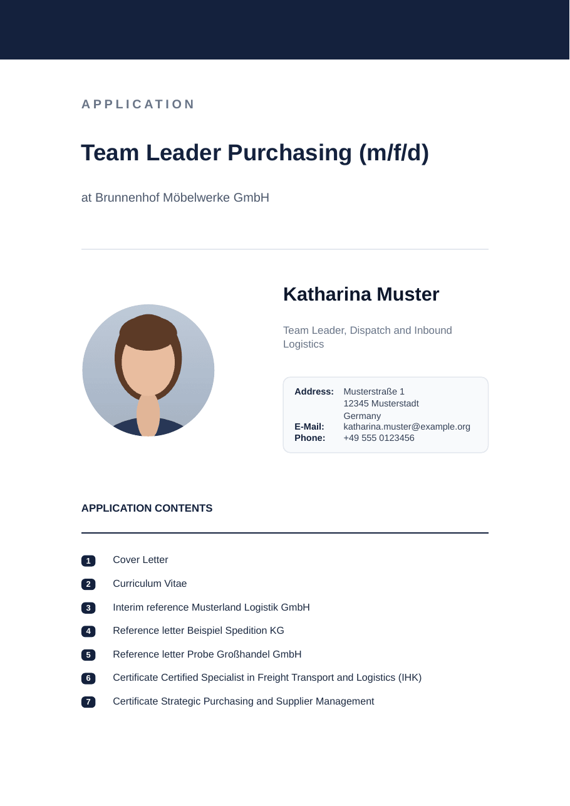
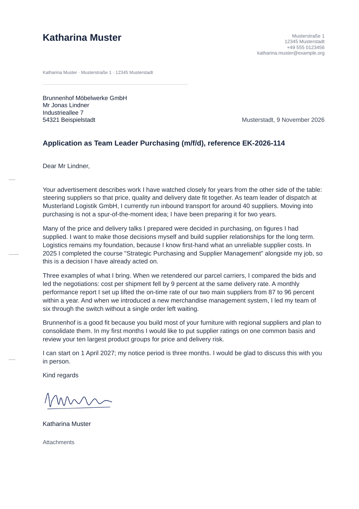
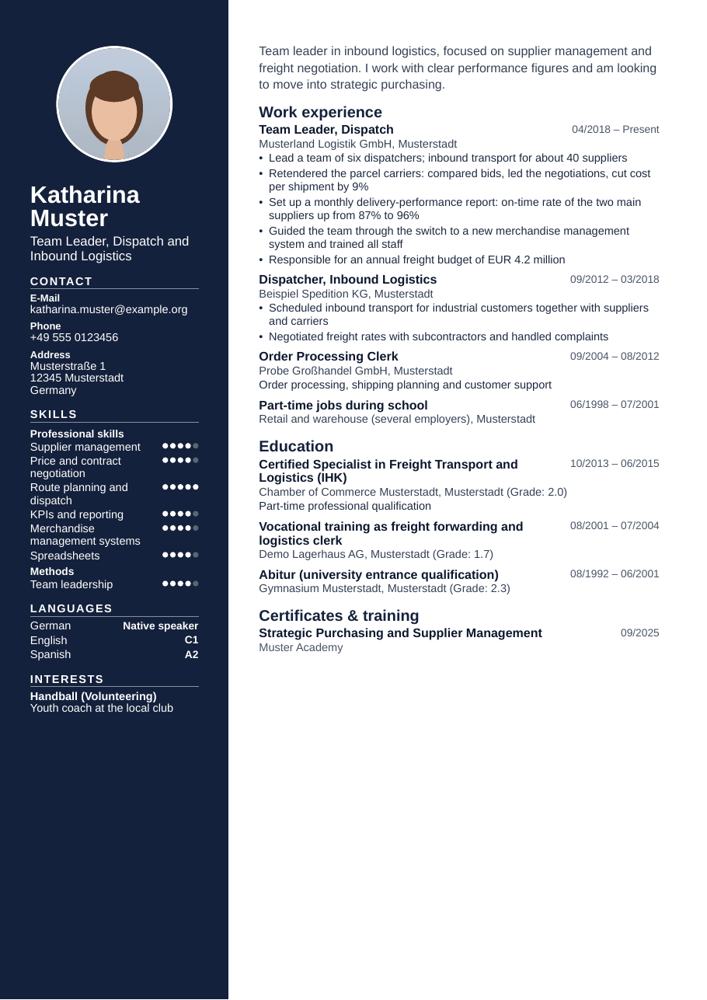

# 1 What is Vitafolio?

Vitafolio is an app for job applications that look good. It is **open source**: the "recipe" of the program is public for
everyone to inspect, and anyone may use the software for free indefinitely.

This handbook describes the **current version** of Vitafolio. Here is what you can do with it:

- **A CV built from blocks:** You enter your data, positions, skills and certificates **once** in the master profile. From it
  your CV is made in 18 designs (from Classic through Timeline to Aurora), as a PDF or as a Word file. A gap analysis points out gaps in your
  career, and a wizard guides you through the input step by step.
- **Cover letters:** You write your cover letters, modelled on DIN 5008, with sender and recipient field, fold and punch
  marks and, if you like, your signature.
- **Application tracker and dossier:** An overview shows where each application stands and reminds you to follow up after
  14 days. A PDF dossier is made from cover sheet, cover letter, CV and attachments. The dossier you sent stays unchanged.
- **Guide and help in the app:** A guide asks a few questions and shows an application plan for your situation (Chapter 23). A short introduction and small
  hints on every page explain the app (Section 17.4).
- **AI help, optional:** You can have cover letters, short profiles and bullet points suggested or texts translated. This
  works with your own API key, with a model on your own computer (Ollama, LM Studio), or by copying and pasting into an AI
  chat. Vitafolio replaces name, contact details and address with placeholders beforehand (Chapter 11).
- **Two forms:** Vitafolio runs as a Windows program or as a Docker container on your home server (for example Unraid, a NAS
  or a Linux computer).
- **Accounts and security (Docker version):** Several people each have an account. Add to that two-factor sign-in, an activity
  log and an emergency access for the administrator.
- **Backups and updates:** Backups run on a schedule and can be downloaded and restored. Vitafolio reports new versions. On
  Windows you install them with one click.

## 1.1 How to use this handbook

You do not have to read it from start to finish. Pick your goal:

| I want to … | Read |
|---|---|
| install Vitafolio on my Windows PC | Chapters 2 and 3, then 7 to 11 and 16 to 18 |
| run Vitafolio on my home server (Docker, Unraid, NAS) | Chapters 2 and 4, then 5 to 17 |
| build my master profile and CV | Chapter 8 |
| write a cover letter | Chapter 9 |
| track applications, manage dossiers and attachments | Chapter 10 |
| use the AI help and know what is passed on | Chapter 11 |
| protect my account (password, two-factor, emergency access) | Chapter 12 |
| know how an application is built and what belongs in it | Chapter 22 |
| have Vitafolio show me an application plan | Chapter 23 |
| download finished dossiers and my CV, also several at once | Chapter 24 |
| understand or restart the introduction and hints in the app | Section 17.4 |
| adjust appearance, language and date format | Chapter 13 |
| manage accounts, settings and the log as an administrator | Chapter 14 |
| back up or restore my data | Chapter 15 |
| update Vitafolio and read the news | Chapter 16 |
| find the manual, version, licence and source code | Chapter 17 |
| solve an error message or a problem | Chapter 19 |
| learn about data protection | Chapter 20 |

Technical terms are explained where they first appear. At the end, Chapter 21 contains a short list of the key terms. Chapter 22 is a guide to how an application is built, Chapter 23 describes the guide page of the app and Chapter 24 the export page.

# 2 The two versions at a glance

Vitafolio comes in two forms. Both have the same interface. They differ in how you use them.

| | Windows program | Docker version |
|---|---|---|
| How do you use it? | Like any program: its own window | In a web browser, at an address |
| For whom? | one person at one PC | one or more people, at home or – with your own HTTPS – on the road |
| Sign-in? | no, your Windows account protects it | yes, with username and password |
| Two-factor, user management, log? | no | yes |
| Reachable from | this PC only | everybody who can reach the server and has an account |
| Data lives | in a folder on this PC | in the data folder of the container |
| Updating | with one click in the app (Chapter 16) | by hand: update the container (Chapter 16) |

In short:

- **Docker** is a technique that lets a program run, together with everything it needs, in a closed package. The package
  is called a **container**. It runs the same on any computer.
- **Unraid** is an operating system for home servers. A **NAS** is a network storage device in your home network, for
  example from Synology. Containers run on both.
- The **browser** is the program you use to look at web pages, for example Edge, Chrome or Firefox.

> [!NOTE]
> There is no phone layout. Vitafolio is made for computer screens. The narrowest supported window width is 1024 pixels.

# 3 Installing the Windows program

## 3.1 Requirements

- A 64-bit Windows.
- The Windows program needs the "Microsoft Edge WebView2 Runtime". This is a building block from Microsoft that
  displays the program window. Windows 11 includes it, some Windows 10 PCs do not. If it is missing, Vitafolio tells you
  at start and offers the official download page (see Section 19.4).
- You need **no administrator rights**. Vitafolio is installed for your user account only.

## 3.2 Installing

1. Download the setup file `Vitafolio-win-Setup.exe` from the project's download page (the "Releases" area of the
   project on GitHub).
2. Start the file with a double-click.
3. Wait until the installation is finished.
4. Start Vitafolio from the Start menu or the Windows search.

> [!NOTE]
> At the first start Windows may show a warning ("SmartScreen"). The reason: the program is not digitally signed yet. A
> signature is a confirmation that a publisher can buy from Microsoft. It is not a sign of a fault. If you trust the
> source of the file, let the program start despite the warning.

## 3.3 The first start

At start you first see a loading view with the text "Starting the local server …" (in German Windows: "Der lokale Server
wird gestartet …"). Then the app opens. You do not have to sign in. Continue with Chapter 7.

If Vitafolio is already running and you start it again, no second window opens. Instead the running window comes to the
front.

## 3.4 Updating and removing

Vitafolio reports new versions itself and installs them when you click (Chapter 16). You do not have to fetch the setup file
by hand every time.

You can uninstall Vitafolio like any program in the Windows settings under "Apps".

**Your data stays when you uninstall.** It is kept apart from the program in a folder of its own (see Chapter 18). If you
install Vitafolio again later, you find your data again. If you want to **get rid of the data completely**, delete this
folder after uninstalling: `%LOCALAPPDATA%\SushiFlux Development\Vitafolio`.

> [!NOTE]
> Earlier test versions kept the data folder under `%LOCALAPPDATA%\SushiFlux Develop\Vitafolio`. The program moves such a
> folder into the new one itself at the first start. You do not have to do anything.

> [!TIP]
> Before a reinstall or an uninstall, download a backup anyway and keep it **outside** the Vitafolio data folder (for
> example in "Documents"). How to do it is in Chapter 15.

# 4 Installing with Docker (Unraid, NAS, Linux server)

## 4.1 What you need

- A computer that runs Docker (Unraid, a NAS with container support, or a Linux server).
- A folder for the data on a **local drive** of that computer. Do not put it on a network share. Vitafolio's database is a
  single file, and file locks are not reliable over the network. On Unraid, a folder on the cache or in a pool is suitable,
  for example `/mnt/cache/appdata/vitafolio`.
- You do not need an account to start. You create the first account in the browser (Chapter 5).

## 4.2 With Docker Compose (Linux, NAS)

**Docker Compose** reads a small text file that says how the container should run.

1. Create a folder for Vitafolio on the computer, for example `vitafolio`.
2. In it, create a file `docker-compose.yml` with this content:

```
services:
  vitafolio:
    image: ghcr.io/sushiflux-development/vitafolio:latest
    container_name: vitafolio
    restart: unless-stopped
    ports:
      - "8080:8080"
    environment:
      PUID: "1000"
      PGID: "1000"
      TZ: "Europe/Berlin"
    volumes:
      - ./daten:/data
    stop_grace_period: 40s
    security_opt:
      - no-new-privileges:true
    cap_drop:
      - ALL
    cap_add:
      - CHOWN
      - DAC_OVERRIDE
      - FOWNER
      - SETUID
      - SETGID
    read_only: true
    tmpfs:
      - /tmp:rw,noexec,nosuid,size=64m
```

3. Adjust `PUID` and `PGID` (see Section 4.5) and set `TZ` to your time zone.
4. Start the container in this folder with `docker compose up -d`.
5. In the browser, open `http://` and the address of the computer, then `:8080`. Example: `http://192.168.1.20:8080`.

The lines from `security_opt` on are a safeguard. They take all special rights away from the container except the five it
needs at start to hand the data folder to the right user, and they make its file system read-only. It can still write in the
folder `daten` and in `/tmp`. The line `image:` ends with the tag `latest`. It decides which versions you get (Section 16.4).

The page for creating the first account appears. Continue with Chapter 5.

## 4.3 On Unraid

Vitafolio comes with a ready-made **Unraid template**, the file `vitafolio.xml` in the folder `unraid` of the project on
GitHub. It already contains name, image, port, data path, the settings from Section 4.4 and the safeguard from 4.2. Put the
file into the folder `/boot/config/plugins/dockerMan/templates-user` of your Unraid server. Then choose the template when you
create a new container (Docker, **Add Container**), check the values and confirm. The fields of the template are:

| Field | Content |
|---|---|
| **Web UI port** | container port `8080`, as host port for example also `8080` |
| **Data folder** | container path `/data`, host path `/mnt/cache/appdata/vitafolio` |
| **PUID**, **PGID**, **Time zone** | `99`, `100` and your time zone, for example `Europe/Berlin` (under "Show more settings") |
| **Allowed host names** | leave empty as long as you open Vitafolio by IP address. Otherwise enter the name (see below). |
| **Trusted proxies** | only behind a reverse proxy (Section 4.6) |

Two things matter on Unraid:

- **The data path is on the cache.** Use a path on the cache or a pool, for example `/mnt/cache/appdata/vitafolio`, not
  `/mnt/user/...` and no network share. The database is a single file and needs reliable file locks. That is why the template
  suggests the cache path.
- **If you open Vitafolio by a name, enter it.** If you open the app for example at `http://tower:8080` instead of the IP
  address, enter `tower` under **Allowed host names**. Otherwise Vitafolio refuses the request (Section 4.6). IP addresses and
  `localhost` always work.

The template uses the image `ghcr.io/sushiflux-development/vitafolio:latest`, so finished versions only. If you want to test betas or
nightlies, choose the tag `beta` or `nightly` in Unraid under **Edit** at **Repository** (Section 16.4).

**Without the template** you create the container by hand: In Unraid open the **Docker** page and create a new container.

1. **Name:** `vitafolio`
2. **Repository:** `ghcr.io/sushiflux-development/vitafolio:latest`
3. **Port:** container port `8080`, as host port for example also `8080`
4. **Path:** container path `/data`, host path `/mnt/cache/appdata/vitafolio`
5. **Variables:** `PUID` = `99`, `PGID` = `100`, `TZ` = your time zone
6. **Extra Parameters** (under "Show more settings", recommended): `--stop-timeout 40 --cap-drop ALL --cap-add CHOWN --cap-add DAC_OVERRIDE --cap-add FOWNER --cap-add SETUID --cap-add SETGID --security-opt no-new-privileges:true --read-only --tmpfs /tmp:rw,noexec,nosuid,size=64m`
7. Confirm. Unraid downloads the package and starts the container.
8. In the browser, open `http://` and the address of your Unraid server, then `:8080`.

The values 99 and 100 are the numbers Unraid uses for the user "nobody" and the group "users". They are also the
default of Vitafolio.

## 4.4 The settings at a glance

You enter these settings as **environment variables**. These are named values that a container receives at start. You
only need the ones you want to change.

| Variable | Meaning | Default |
|---|---|---|
| `PUID`, `PGID` | number of the user and the group Vitafolio runs as and that own the data folder | 99 and 100 |
| `TZ` | your time zone. It decides the times of the backup schedule and the times in the log. | the container's time zone, usually UTC |
| `ALLOWED_HOSTS` | names under which Vitafolio may be reached (see 4.6) | empty: only IP addresses and `localhost` |
| `TRUSTED_PROXIES` | addresses of your reverse proxy (see 4.6) | empty |
| `BACKUP_DIR` | folder for the backups | `backups` inside the data folder |

Inside the container the data folder is always called `/data`. Mount your folder there, as in the examples above.

There are more settings for special cases. The double underscores are part of the name:

| Variable | Meaning | Default |
|---|---|---|
| `Backups__MaxSizeMegabytes` | largest backup in megabytes that Vitafolio makes or accepts | 16384 (16 GB) |
| `Backups__MaxFiles` | highest number of files in one backup | 200000 |
| `Attachments__QuotaMegabytes` | storage for attachments per account in megabytes | 250 |
| `RateLimits__AiServerKeyPerDay` | requests per account and day with the AI key of the server | 50 |

> [!TIP]
> Put the backups on a **different drive** than the data. To do so, set `BACKUP_DIR` to a path that you additionally mount
> into the container. A backup on the same drive does not help if the hard disk fails.

## 4.5 Data folder and permissions

Vitafolio never runs with administrator rights. The container starts briefly as administrator, hands the data folder to
the user from `PUID` and `PGID`, and from then on runs only as that user. The container does this by itself.

- On **Unraid** the default values 99 and 100 fit.
- On an **ordinary Linux computer** use your own user and group number. The command `id` shows them. Usually they are
  1000 and 1000.
- The number `0` is not allowed. Vitafolio then does not start and says so in the container's log.

## 4.6 Making it reachable: HTTPS and reverse proxy

**Never make Vitafolio reachable from the internet without HTTPS.** **HTTPS** is the encrypted form of the connection
between browser and server. You recognise it by the padlock in the address bar. Without encryption anybody on the network
can read along, including your password.

Vitafolio itself only speaks unencrypted (HTTP). Encryption is done by a service placed in front of it, a **reverse
proxy**. It accepts requests from the internet, encrypts them and passes them on to Vitafolio. Set up such a service if
you want to use Vitafolio from outside your home network.

Two settings make Vitafolio ready for this:

1. **`ALLOWED_HOSTS`**: Enter the name under which you open Vitafolio, for example `vitafolio.example.com`. Separate
   several names with commas. With `*.example.com` every sub-domain is allowed. Without this entry Vitafolio only answers
   IP addresses and `localhost`. This protects against a trick where a foreign web page addresses your server by its own
   name.
2. **`TRUSTED_PROXIES`**: Enter the address of your reverse proxy (or a network such as `172.18.0.0/16`). Vitafolio then
   takes the visitor's real address from the proxy, and the information that the connection was encrypted. Without this
   entry all visitors look like the proxy: the brake against password guessing then applies to all of them together, the
   log shows wrong addresses, and the sign-in cookies do not get the "HTTPS only" mark.

Also make sure that your reverse proxy **sets** the headers `X-Forwarded-Host` and `X-Forwarded-Proto` **itself** and
**overwrites** any values a visitor sends along. Otherwise the check of the name depends on what the visitor claims, and the
cookies do not get the "HTTPS only" mark. Most reverse proxies have a setting for this; read their manual.

A typo in these two settings stops the start with a message in the log, in German. That way it does not lock anybody out
unnoticed.

## 4.7 Starting, stopping, updating

- **Stop** the container always normally (do not kill it). At shutdown Vitafolio still makes a backup and needs up to
  40 seconds for it.
- **Updating:** Download the new package and restart the container (on Unraid via "Check for Updates" and "Update" in
  the Docker area). The steps are in Chapter 16. At start the database adapts itself to the new version. Download a backup
  first (Chapter 15).
- Start **only one container per data folder**.
- Going back to an **older** version is not simply possible: the app does not accept a backup from a newer version.
- Docker shows you whether Vitafolio is "healthy". To find out, it asks the status page every 30 seconds.

# 5 The first start: creating the first account

This chapter applies to the Docker version. The Windows program does not have this step.

At the very first visit Vitafolio wants to know who the manager is. The account you create now automatically becomes
**administrator**. An administrator manages accounts and the settings of the app.

1. Open the address of Vitafolio in the browser (see Chapter 4).
2. You see the page "Welcome to Vitafolio" (see Figure 1).
3. Read the **setup code** from the container's log. It is shown there at every start as long as there is no account yet.
   On Unraid, open the menu of the container "Vitafolio" in the Docker area and choose "Logs". With Docker Compose,
   `docker compose logs vitafolio` shows the log. The code has 28 characters in seven groups
   (`XXXX-XXXX-XXXX-XXXX-XXXX-XXXX-XXXX`). It is also in the file `setup-token` in the data folder.
4. Enter the setup code in the field **Setup code**. Hyphens, spaces and upper or lower case do not matter.
5. Enter a **username**. It has 3 to 32 characters: letters, digits, dot, underscore or hyphen. Example: `mira`.
6. Enter your **display name**, the way it should appear in the app. It has 1 to 64 characters.
7. Enter a **password** with at least 12 and at most 128 characters. There are no further rules. A long sentence is
   better than a short word with special characters.
8. Enter the password once more under "Repeat password".
9. Click **Create account**.

You are signed in right away and see the main window (Chapter 7).


Vitafolio checks your input while you type. A problem appears right below the field, for example "Too short: 5 of at
least 12 characters." The button does not send anything as long as something is marked red.

> [!NOTE]
> The setup code protects you from a stranger who happens to reach the page before you creating the first account and
> thereby becoming administrator: only somebody who can read the server's log knows the code. The setup works only once.
> Still, finish it **before** you make Vitafolio reachable for others.

> [!NOTE]
> Write the administrator's password down in a safe place, for example in a password manager. If you ever forget the password
> of the only administrator, you can reset it via the emergency access using a one-time code from a file in the data folder
> (see Section 12.6).

# 6 Signing in and out

This chapter applies to the Docker version.

## 6.1 Signing in

1. Open the address of Vitafolio in the browser. If you are not signed in, you see the sign-in page (see Figure 2). On the
   left, on one third of the width, is the form. On the right, on the other two thirds, are the name of the app with a short slogan and the five features of the app as a plain list. The version number is at the very bottom.
2. Enter your **username** and your **password**.
3. Click **Sign in**.

If two-factor sign-in is switched on for your account, a second step follows (Section 6.2).


At the bottom left of the sign-in page you choose the language: **Deutsch** or **English**.

## 6.2 The second step: the code

**Two-factor sign-in** asks for a second proof in addition to the password. You set it up in Section 12.2. The second proof
is a six-digit code from an **authenticator app** on your phone. It changes every 30 seconds.

1. After the password you see the page "Second step" (see Figure 3).
2. Open your authenticator app and read the current code.
3. Enter it in the field **Code**.
4. Click **Confirm**.

If you do not have the phone at hand, enter a **recovery code** instead (Section 12.3). Each one works only once.

You have **5 minutes and 5 attempts** for the code. After that you start again with username and password. "Back to
sign-in" takes you there sooner.


## 6.3 Registering

Normally the sign-in page offers no way to create an account yourself. The administrator creates accounts (Section 14.2).
If the administrator switches registration on, "No account yet?" appears below the form with the link **Register**. There
you enter username, display name and password, as in Chapter 5. New accounts are ordinary users, not administrators.

## 6.4 Signing out

Click **Sign out** at the bottom of the sidebar. The button is in the area with your name.

Before that, Vitafolio sends whatever is still on its way to be saved (Section 8.2). If that does not work, for example
because the server cannot be reached at the moment, it asks: "Your latest input could not be saved. Signing out also deletes
the copy in this browser, so the input will be lost." With **Sign out and discard** you sign out anyway. With **Cancel** you
stay signed in. After signing out, all copies of your account are removed from the browser. This matters on a computer that
several people share.

## 6.5 How long do I stay signed in?

As long as you use Vitafolio, you stay signed in. Vitafolio renews your sign-in in the background without you noticing.
Whoever does not visit for 30 days has to sign in again. You are also signed out when an administrator disables your
account or sets a new password for you, when you change your password (on all other devices), or when a backup is
restored.

# 7 The main window and navigation

After signing in (or right after launching the Windows program) you see the main window (see Figure 4). It
shows the **Overview**:

- A **welcome banner** with your name and two buttons: **New Application** and **Export** (Chapter 24).
- In the Docker version a **warning notice** as long as two-factor sign-in is not active ("Two-factor sign-in is not active. …") with the link **Set it up now** (Section 12.2).
- If you have **no application yet**, it says **How to get started**: three steps to click (fill in the master profile, go through the guide, create the first application).
- If a follow-up is due for an application, a slim strip **Follow-up due** appears with one line per application (up to six, the oldest due date first). **Show all** leads to the filtered list.
  If no follow-up is due, the strip is missing.
- **Your applications:** the same **Kanban board** as in the tracker (Section 10.2), across the full width. You open a card, change the status in the details and view or download the dossier,
  as there. **Go to the application tracker** leads to the whole page with search and filters. On a narrow window the board scrolls sideways inside itself.


On the left is the **sidebar**. It is a menu tree: every item has an icon and a name, and the item of the open page has a thin line at its edge. The numbers in the figure belong to these points:

1. **The menu tree:** At the very top is the name **Vitafolio**. Below it come:
   - **Overview:** the start page.
   - **Master profile:** your data and your CV (Chapter 8).
   - **Cover letters:** your application letters (Chapter 9).
   - **Applications:** tracker, dossiers and attachments (Chapter 10).
   - **Export:** the finished PDF files in one place (Chapter 24).
   - After a dividing line: **Guide**, a few questions, then an application plan for your situation (Chapter 23).
   - **AI Settings** (Chapter 11).
   - **Manual**, which opens this manual in a window (Section 17.1).
   - **Help for this page**, which shows short hints right at the controls of the open page (Section 17.4).
   - When needed, a row **Update available** with the new version number (Chapter 16).
2. **Your area:** At the very bottom, what applies to everything stays in view: **App administration** (for administrators of the Docker version only, Chapter 14) and
   **Settings** with your personal settings (Chapters 12, 13, 15 and 17). Below them are your name and your role (in the Windows program "Local account").
3. **The colour scheme switch:** It changes between "Light" and "Dark" (Chapter 13). Below it, in the Docker version, is the small button **Sign out**.
4. **The button to collapse and expand:** It is at the top, next to the name (see below).
5. **The info icon:** It is at the bottom right of the area with your name. Point at it and a small text names the version number. A click opens the "About" page
   (Section 17.2).

The sidebar has no footer. The line "Made with ♥" and the version number are on the "About" page.

On the right is the workspace with the current page.

**Making the sidebar narrow.** If a page needs more room, collapse the sidebar:

1. At the top of the sidebar, click the button **Collapse sidebar**.
2. The sidebar shrinks to a slim strip that shows only the icons. The page next to it becomes wider.
3. Point at an icon with the mouse, or select it with the Tab key. Its name then appears beside it.
4. Click **Expand sidebar** to bring the full sidebar back.

Vitafolio remembers your choice in this browser (in the Windows program, in the program window). In the slim strip the master profile does not show its nine sections
under its icon. Expand the sidebar when you want to change the section.

> [!NOTE]
> Vitafolio deliberately looks plain and light: cards have no shadow, only a thin line. The active menu item, the selected tab and highlighted notes carry
> a thin straight line. Tabs and choice buttons form one connected bar. If there is not enough room for that, they stand one below the other as a list. The scrollbars are slim and lie over the
> page: they appear only while you scroll or near the edge and take up no width.

> [!TIP]
> At the first start Vitafolio shows a short **introduction**, and later once on every page small **hints**. How they work and how to
> restart them is explained in Section 17.4.

# 8 Your master profile and the CV

The **master profile** is the place where you enter everything about yourself **once**: your contact details, your work
experience, your education and more. Your CV is built from this profile. The look (the **design**) is separate. You can
change it at any time with one click without retyping anything.

Open the master profile with **Master profile** in the sidebar.

> [!TIP]
> What belongs in a CV, what you may leave out and how to shorten it is explained in Chapter 22.

## 8.1 How the master profile is organised

The master profile has nine sections. Each section is one building block of the CV. You choose the section in the
**sidebar** on the left: as long as the master profile is open, the nine sections unfold under the item **Master profile**, indented along a thin
guide line. The one that is open is highlighted. The other items of the sidebar stay where they are. A click on another item, for example **Overview**,
leaves the master profile.

| Section | What you enter there | Required fields (marked with *) |
|---|---|---|
| Personal | name, contact, address, personal details, links, short profile, photo | first name, last name |
| Work experience | positions with job title, employer, period and description | position, employer, start |
| Education, studies & school | school, training, studies with degree, period and grade | degree, institution, start or end |
| Skills | skills with category and a level from 1 to 5 | skill name |
| Languages | language with a level from A1 to C2 or native | language |
| Certificates | training and certificates with issuer and date | title |
| Interests & activities | hobbies, volunteering, memberships, driver's licence | name |
| Custom sections | sections with a name of your own, for example "Publications" | section title, title of each entry |
| Preview & Export | choose a design, look at the preview, download PDF and Word | – |

You recognise a required field by the asterisk (*) behind the name of the field. Everything else is optional.

> [!NOTE]
> Apart from first and last name, everything in the personal details is optional. You decide whether a photo, your date of
> birth or your marital status goes into the CV.

Vitafolio checks your input while you type. A problem appears right below the field. A required field that you have not
typed into yet stays calm until you submit a window with **Save** (for the personal details: until you press Enter in a
field). Then Vitafolio shows all problems at once.

## 8.2 Personal details and photo

1. In the sidebar, open the section **Personal** (see Figure 5).
2. Enter first name and last name. Both are needed before Vitafolio can save anything.
3. Fill in the other fields as needed.
4. In the field **Bio / About me** write a few concise sentences about your strengths or your motivation.

There is no **Save** button here. Vitafolio **saves while you type**: when you stop typing for a moment, your input goes to
the server. If you keep typing without a pause, this happens every two seconds at the latest. If you switch the section or the
wizard mode (Section 8.5), your input is kept. If you leave the master profile, Vitafolio first sends whatever is still
waiting.

### The saving status

At the top right of the box "Personal details" one line tells you where saving stands (see Figure 5). It does not change its
size, so nothing in the form moves:

| Status | Meaning | What you do |
|---|---|---|
| **Saved** | The server has your input. | Nothing. |
| **Saving …** | The server has not confirmed your input after about one second. A quick save shows nothing. | Wait a moment. |
| **Not saved yet: first name and last name are missing** (or only the first name or only the last name) | Required details are missing. | Enter them. If the profile has no name yet, you see this status as soon as you open it. |
| **Not saved yet: correct the marked fields** | A field shows a problem, for example an e-mail address with a blank in it. | Correct the marked field. |
| **Not saved yet: entry incomplete** | A detail is only half finished, for example a date. | Finish it. |
| **Not saved, trying again** | The server could not be reached or reported an error. | Usually nothing, Vitafolio keeps trying by itself (see below). **Show error** shows the whole message. |
| **Not saved: the server refuses the input** | The server considers a detail invalid. | Change the input. Vitafolio does not send the same state again. **Show error** names the reason. |
| **Not saved: session expired, your input is kept** | You are no longer signed in. | Sign in again. Your input is waiting (see below). |
| **Input from 2026-11-09, 14:32 restored** | Vitafolio brought back input that could not be saved last time. The note stays until you type on. | Nothing. |

The time in the last line is shown in your date format (Chapter 13). The error text can be copied in full (Section 19.1). No
window ever opens by itself while you type.

### When saving does not work

Your input is not lost:

- Everything you type is **also stored as a copy on your own computer** at once, before anything goes to the server. The copy
  lives in the browser's storage (in the Windows program: in the storage of the program window). It is not sent to the server.
- If saving fails, Vitafolio keeps your input and **tries again by itself**: after 2, 5 and 15 seconds, then every 30
  seconds. When the connection is back, it tries again immediately.
- Once the server has stored **exactly** your input, Vitafolio deletes the copy. Signing out removes all copies of your
  account (Section 6.4).
- If you close the browser or reload the page **before** it was saved, the copy is still there. The next time you open the
  master profile, Vitafolio brings the input back and saves it, provided nothing has changed on the server in the meantime.
  The status "Input from … restored" tells you.
- If the profile was **changed elsewhere** in the meantime, for example on another device, Vitafolio asks: "Use the input
  from …?". With **Use my input**, your input replaces the data on the server. With **Keep server data**, you keep the
  server's data and the copy is deleted. If you close the question with the Esc key, **nothing happens**: the copy stays and
  Vitafolio asks again the next time you open it.
- If you leave the page although something could not be saved, Vitafolio warns you with "Input not saved". With **Leave
  anyway** you go. The copy stays on your computer and is offered to you the next time you open it. It is not on the server
  yet, though. If there was nothing unsaved, Vitafolio does not ask.

> [!NOTE]
> The copy contains what you typed, including name and address, as plain text in your browser. It stays only as long as
> something was not saved, and it is removed after saving and when you sign out. On a computer that several people share, sign
> out after your work (Docker version).

Two fields demand a specific format:

- **Date of birth:** in your date format (Chapter 13), for example `1990-04-23` in the English default or `23.04.1990`. You only
  type the digits, Vitafolio adds the separators. The date has to exist in the calendar.
- **Links** (website, LinkedIn, GitHub, Xing): starting with `http://` or `https://`.


**The photo** is optional. To upload one:

1. In the area **Application photo**, click **Upload photo**.
2. Choose an image in JPEG, PNG or WebP format. It may be at most 5 MB.

The image may be at most 8000 pixels per side and 40 megapixels. **Change photo** replaces it, **Remove photo** deletes it
after a confirmation. Whether the photo appears in the CV, and in which shape, you set in the preview (Section 8.6).

## 8.3 Positions, education and other entries

The sections Work experience, Education, studies & school, Skills, Languages, Certificates, Interests and Custom sections work the same way. To
add an entry:

1. Open the section in the sidebar, for example **Work experience**.
2. Click **Add position**. In the other sections the button is named differently, for example **Add education**.
3. Fill in the window (see Figure 6). Required fields are marked with *.
4. Click **Save**.

Unlike the personal details, these entries are not saved while you type. An entry in a window only counts once you click
**Save** in the window.


Every entry in the list has icons to **edit**, to **delete** (after a confirmation) and to **move** up or down. The order of
the list is the order in the CV, and you set it yourself with the arrows. Vitafolio does not sort by date. A new entry first
stands at the end of the list. Move it to the place you want, for example the newest position to the top.

For **dates**:

- Enter months in your date format (Chapter 13), in the English default as YYYY-MM, for example `2024-03`. You only type the
  digits, Vitafolio adds the separator. Just the year, for example `2024`, is also allowed.
- For **work experience** the **start** is required. The **end** is optional.
- In the section **Education, studies & school** **a start or an end** is enough. You also enter your school qualifications here, for example a secondary school certificate or A-levels. For school this means the year of graduation is enough: enter only the end, for example `2001`.
  "Education in progress" also counts as a period. If there is no period at all, the field says so. In the CV a single end appears as one date
  without a dash, an education in progress without a start as "ongoing".
- For a position that is still running, switch on **Current position (present)**. The end field stays empty. The CV says
  "present".

For **Skills** you choose a level from 1 ("Basic knowledge") to 5 ("Expert") or "No level specified". For **Languages** you
choose the level of the European reference framework: from A1 (beginner) to C2 (mastery) or "Native language".

## 8.4 The gap analysis

Recruiters look for an unbroken timeline in a CV. That is why Vitafolio points out gaps. It does not judge, it only points.

This is how it works:

- The analysis looks at **all positions of the work experience and of the education** together.
- Entries that overlap or follow each other directly count as one continuous period.
- A gap is a period of **at least one full calendar month** without an entry. Vitafolio gives the length in months.
- The message is at the top of the section **Work experience** (and in the wizard, step 2).

If everything is continuous you see the message "Gap check passed". If there are gaps you see, for example, "Gap analysis: 2 gaps
found in the timeline".

1. Click **Show details & tips** (see Figure 7).
2. Read from when to when the gap runs and between which two entries it lies.
3. If you like, click **+ Career reorientation** or **+ Further education & qualification**.
4. The window for a new position opens. Start and end are already filled in to fit.
5. Change the text as needed and click **Save**.

The entry only exists once you click **Save**. If you cancel, the gap remains.


## 8.5 Wizard mode

If you are writing a CV for the first time you can be guided. Click **Wizard mode** at the top right of the master profile.
**Classic view** takes you back to the sections. Nothing is lost in between. While the wizard is open, no section is
highlighted in the sidebar. A click on a section there leaves the wizard and opens the section.

The wizard has five steps (see Figure 8):

1. **Master data & contact:** name, contact details, address and short profile.
2. **Work experience:** your career stations.
3. **Education, studies & school:** school, vocational training and university.
4. **Skills & languages:** professional skills and foreign languages.
5. **Preview & finish:** choose the design, check the preview, download the PDF.

**Continue to the next step** and **Back** move between the steps. You can also click a step at the top directly. In the last
step **Finish wizard** ends the wizard.

Certificates, interests and custom sections exist only in the classic view.


## 8.6 Preview, design and export

In the section **Preview & Export** (in the wizard: step 5) you see the settings on the left and the preview of your CV as a PDF
on the right (see Figure 9). The preview refreshes by itself shortly after every change. **Refresh preview** forces it.

The preview is made from what is saved on the server. If some input in the personal details is still on its way when you open
it, Vitafolio waits until it is saved. If it could not be saved, a note above the preview says that it shows the last saved
state.

| Setting | Choices |
|---|---|
| Template design | Twelve templates. You choose from a gallery that unfolds (see below). |
| Document language | German or English. The headings of the CV (for example "Work Experience" or "Berufserfahrung") follow this choice. Your own texts are not translated. The AI help does that (Chapter 11). |
| Accent color | eight colours or a **custom colour** (see below). When you point at one, its name and colour value appear, for example "Navy (#14213D)". |
| Font | 14 fonts that come with Vitafolio (see below). |
| Show photo in resume | on or off |
| Photo shape | Round, Rounded or Square |

Because the fonts come with Vitafolio, your CV as a PDF looks the same on every computer, whatever fonts are installed there.

**Choosing the design.** Above the preview, the chosen design is shown as one line: a small picture of its first page, the name and a
sentence about it. Click **Choose design** and a gallery of all 18 templates unfolds, in two groups: **Calm** and **Expressive**. Each one shows the first page of a sample CV.
One click chooses a template and the preview changes. With the arrow keys you move from template to template. **Collapse** closes the
gallery again. Your content stays the same, only the look changes.

**Group "Calm"** (twelve classic and restrained templates):

| Template | What it looks like |
|---|---|
| Classic | Date column on the left and clear rules, tidy and traditional. |
| Modern | Pale card on the left with contact and skills, name in the main column. |
| Plain | Black text only, no rules. Suited to portals that read résumés automatically. The accent colour has no effect here. |
| Color column | A full column in your accent color with name, photo and skills. |
| Side rail | A large name, with a softly tinted column for contact and skills on the right. |
| Header band | A colored band across the full width of the first page. |
| Timeline | Stations along a line with dots, the date above each title. |
| Elegant | Everything on the center axis, a letter-spaced name and fine rules. |
| Compact | Tight margins and two columns at the bottom, for long careers. |
| Edge | A narrow color strip at the page edge and a very large name. |
| Grid | Headings in a column of their own, a fine rule above each section. |
| Executive | Summary as a colored block with core competencies below it. |

**Group "Expressive"** (six templates with shapes and color surfaces):

| Template | What it looks like |
|---|---|
| Wave | A flowing colored head area with the photo on its edge. Best for creative applications. |
| Diagonal | A slanted color plane carrying the name. Best for creative applications. |
| Arc | Circle segments and fine rings in the upper corner. Best for creative applications. |
| Facet | Delicate triangles in tints along one side. Best for creative applications. |
| Monogram | Large initials in a fine ring with hairlines, very calm. Best for less formal applications. |
| Aurora | A soft glow from one corner, sections as rounded surfaces. Best for creative applications. |

The expressive templates suit **creative or less formal applications** better. In traditional industries a calm template is usually
the safer choice.

The templates apply to the **PDF and the dossier**. The **Word file** always has the same uniform layout, whichever template you
choose.

**A custom accent colour.** Below the eight colour swatches is the button **Custom color**. It opens a small window with a colour
field (saturation and brightness), a slider for the hue and a field **Color value (hex)**. There you type a value such as `#14213D`.
Every complete colour applies at once and is saved like a click on a swatch. Esc or a click outside closes the window. If you choose
one of the eight swatches again, the custom colour is deselected. Two notes can appear in the window:

- **Colour too light:** "This color is light … Headings are hard to read on paper. You can still use the color." The window gives the
  contrast. The yardstick is 3 to 1 on white. The button then shows a warning symbol. Where needed, the templates darken text in your
  colour on white paper so that it stays readable. Filled areas keep your colour.
- **Transparency:** An eight-digit colour value (`#RRGGBBAA`) can be see-through. Then: "With transparency: in the PDF the paper shows through, in Word
  the color is drawn solid."

**The 14 fonts.** Eight without serifs (the small cross strokes at the ends of letters): Liberation Sans, Roboto, Open Sans, Inter,
Lato, Source Sans 3, IBM Plex Sans and Work Sans. Six with serifs: Liberation Serif, Merriweather, Lora, EB Garamond, Source Serif 4
and IBM Plex Serif. All are freely licensed (SIL Open Font License) and come with Vitafolio. The default font is Liberation Sans.

> [!WARNING]
> **Pass on the PDF, not the Word file.** The PDF contains the fonts, so it looks the same everywhere. The Word file contains only the
> name of the font. At the recipient's it looks like the PDF only if the font is installed there. Otherwise Word uses a different
> font. For passing on, the PDF is the reliable format.


> [!NOTE]
> Vitafolio **remembers** design, document language, accent colour, font, photo on or off and photo shape in your account.
> It saves every change by itself after a short moment. You find your choice again on your next visit, also after reloading
> and on another device (Docker version). As long as nothing has been chosen yet, you get Classic in Navy with Liberation
> Sans, with photo, rounded, and the document language follows the language of the interface. If saving fails once, an
> error message opens that you can copy. The next change tries again. This choice applies to the preview and the export at
> this place. For a single application you set design and language when you create the application (Chapter 10).

**The area "Content".** Below the settings is the area **Content**. It shows what your CV leaves out or shortens from the master profile. Vitafolio's **suggestion**
(the same rules of thumb as in Section 10.8) works here in the **preview and in the export**, in PDF **and** Word: only what is still relevant appears. Your master profile
stays unchanged, and the exchange in the JSON Resume format (Section 8.7) is always complete.

- One line sums it up, for example "2 entries left out, 1 shortened". If nothing is affected, it says "Everything is shown." With **Expand** and **Collapse** you show or hide the list below it.
- The list names every **entry that is left out or shortened** with title, place, period and the **reason**, for example "Left out. Earlier degree, older than your highest" or "Shortened. Ended more than 10 years ago".
- **Show** brings an entry back in full, for example a certificate. This applies **permanently**. Afterwards it says "Shown by you. Suggestion: …".
- **Follow the suggestion again** (only for an entry with a decision of your own) takes your decision back.
- **Adjust** opens the same window as for an application (Section 10.8): every position and education in full, short or left out, certificates and sections on or off.
- **Show everything** switches the suggestion off: everything is in the CV. The line then says "The suggestion is off." and the button is called **Apply suggestion**. With it you switch the suggestion on again.

Every change is **saved at once**, then the preview is drawn again. A correction applies **permanently** and also to **new applications**: an entry that you have shown again here
also stays in the suggestion for a new application.

> [!NOTE]
> The suggestion is based on **rules of thumb**. For example, Vitafolio suggests hiding a degree that lies more than 10 years back and next to which there is a newer one (exceptions: when changing
> careers and when you name "school" or "training / studies" as your situation in the guide). Whether an older degree matters **for the job** is something Vitafolio **cannot judge
> without the job**. That is up to you. Check the list and show what you want to show.

**To download your CV:**

1. Choose design, language, colour and font.
2. Click **Download PDF**. You get a file such as `Resume_Mira_Beispiel.pdf`.
3. If you need a Word file, click **Download Word (.docx)**.

The PDF file contains real text. You can select it, and application portals can read it.

The **Word file** has one uniform layout that does not depend on the chosen design. It contains the content of your profile that the area
**Content** shows (without a selection the complete content, including the custom sections). It is meant for cases where somebody asks for an editable document.

## 8.7 Exchanging your CV: JSON Resume

**JSON Resume** is an open file format for CVs that other programs can read too. With it you take your data out of Vitafolio
or bring data in from elsewhere. Your photo is not part of this file.

Click **JSON Resume** at the top of the master profile. A window with two sides opens (see Figure 10).

**Exporting:**

1. Choose **Export**.
2. Click **Download resume.json**.

**Importing:**

1. Choose **Import**.
2. Click **Choose file** and select the file. Or paste the content into the text field.
3. Decide whether you want to switch on **Replace existing stations and skills** (see below).
4. Click **Import**.


What happens during the import:

- **Switch off (default):** The entries of the file are added to yours. Nothing is deleted.
- **Switch on:** Positions, education, skills, languages, certificates and interests are replaced by the content of the file.
  This cannot be undone. Vitafolio therefore asks first. It replaces custom sections only if the file contains some.
- Personal details that are in the file overwrite those in the profile. If the file has no name, your profile keeps its name.
- If you have input in the personal details that could not be saved yet, Vitafolio warns you that the import replaces it
  (Section 8.2 explains when something "could not be saved").

The file has to follow the same rules as the forms. Every position needs a job title, employer and start, every education
entry a degree, institution and a start or an end, every skill, certificate and interest a name, and every language a language and level. If something
is missing, the import stops and names the place in the file, for example `work[2].position`. Nothing is taken over then. A
file may be at most 5 MB and contain at most 200 entries per list.

# 9 Cover letters

Under **Cover letters** you write and manage your application letters. You create a separate one for every job. The
cover letter is **modelled on DIN 5008**. This is the German standard for the layout of business letters.
What belongs in a cover letter and what does not is explained in Section 22.7.

## 9.1 Creating a cover letter

1. Open **Cover letters** in the sidebar. You see your letters as cards.
2. Click **New Cover Letter**.
3. Vitafolio immediately creates a letter with sample texts and opens it. Name, address, e-mail and phone of the sender
   come from your master profile.
4. Replace the sample texts with your own (Section 9.2).

A **Save** button is not needed: Vitafolio saves your cover letter while you type (Section 9.4).

You open an existing letter with a click on its card. **Back to Overview** takes you to the list. The trash icon on a card
deletes it after a confirmation.

## 9.2 The fields

The editor has two tabs: **Content** and **PDF Preview**. In the first tab you fill in these fields (see
Figure 11 and Figure 12):

| Area | Fields |
|---|---|
| Top | **Internal Title*** (for you only, for example "Software Engineer Application at ExampleCorp") and **Document Language** (Deutsch or English) |
| Recipient | **Company Name / Organization***, department, contact person, street or P.O. box, postal code, **City***, country (only for letters abroad) |
| Letter content | location of signing, date, **Subject line***, **Salutation***, **Letter body***, closing, printed name below the signature, attachments note |
| Design & Format | accent colour, font, switch for the fold and punch marks |
| Signature | image of your signature (Section 9.3) |
| Sender information | name, street, postal code, city, e-mail, phone |

Fields with * are required. For the letter body:

- The body is **plain text** without bold, italics or lists.
- An **empty line** starts a new paragraph. A single line break stays a line break.
- The **date** is a free text field. Write it the way it should appear in the letter, for example `06.11.2026` or
  `November 6, 2026`. When you create the letter, Vitafolio enters today's date in your date format (Chapter 13). If you write
  the date as YYYY-MM-DD, for example `2026-11-06`, Vitafolio puts it into the spelling of the document language in the PDF
  and in the Word file.


## 9.3 The signature

The signature belongs to **one cover letter**, not to the master profile. You upload it separately for each letter.

1. Photograph or scan your handwritten signature. A picture with a white or transparent background is ideal.
2. In the area **Signature**, click **Upload Signature**.
3. Choose the file. PNG and JPEG up to 2 MB are allowed.

The signature appears in the letter below the closing, above your name. **Remove Signature** takes it out after a
confirmation. Without a signature Vitafolio leaves space for a handwritten one.

> [!NOTE]
> Uploading and removing the signature happen right away. They are not part of the saving while you type.

## 9.4 Saving, preview and export

The cover letter **saves while you type**, just like the personal details (Section 8.2). That section also explains what the
status messages and the copy on your computer mean. The differences:

- The status stands above the editor, to the left of the buttons **Delete**, **Download Word (.docx)** and **Download PDF**.
- Instead of the missing names it names the required fields: "Not saved yet: 1 required field is empty" or "… 3 required
  fields are empty". Required fields are Internal Title, Company Name, the recipient's City, Subject line, Salutation and
  Letter body. A half-typed or faulty e-mail address of the sender also holds saving back.
- Every cover letter has its own copy. The next time you open this letter, Vitafolio brings back input that was not saved
  or asks if the letter has been changed on the server in the meantime (Section 8.2). If you delete a letter, its copy goes
  too.
- **Back to Overview** first sends whatever is still waiting. Only if something could not be saved does Vitafolio ask.

Also:

- In the tab **PDF Preview** you see the letter as it would be printed. **Refresh Preview** reloads it.
- Before the preview and before an export, Vitafolio saves whatever is still waiting. If a required field is missing or saving
  does not work, neither happens: the fields show the problem, and in case of an error the whole message opens.
- **Download PDF** and **Download Word (.docx)** create the file. Both are above the editor.
- The switch **DIN Fold and Punch Marks** prints discreet lines on the left margin. They help with folding and punching for
  window envelopes. The setting is saved with the letter, and every letter remembers its own.
- If you want to leave the letter although changes could not be saved, Vitafolio asks first.

The letter is laid out like this: at the top are your name and contact details. Below them follow a small return line above
the recipient field, the recipient's address on the left and place and date on the right. Then come the subject,
salutation, text, closing, signature and the attachments note. The text is left-aligned (ragged right, not justified) and has no hyphenation. A long letter runs onto a second
page. Greeting and signature are then never alone there, the last paragraph moves with them.

> [!TIP]
> With the buttons **AI Assistant** and **Translate text** above the editor you can have a draft written or the letter
> translated (Chapter 11).

# 10 Tracking applications: tracker, dossier and attachments

Under **Applications** you keep track of all your applications. Every application has a **dossier**: one single PDF file
made of a cover sheet, cover letter, CV and attachments.

## 10.1 Creating an application

1. Open **Applications** in the sidebar.
2. Click **New Application** (see Figure 13).
3. Enter **Job Title*** and **Company***. Everything else is optional: location, salary expectation, contact person with
   e-mail and phone, link to the job posting.
4. Choose the **Current Status**. Usually it is "Draft".
5. Under **Assigned Cover Letter** choose one of your letters (Chapter 9) or "No Cover Letter".
6. In the area **Application Dossier** set the look of the dossier: **Resume Design** (one of the 18 templates), **Language**,
   whether a **cover sheet** is put in front, and which **attachments** are added. Under **CV content** you see what goes from your master profile into the dossier. For a new application Vitafolio has already filled in a suggestion there (Section 10.8).
7. Write **Personal Notes & Feedback** if you like.
8. Click **Save**.


You can change the details of an application later at any time, including the assigned cover letter, the design and the
attachments:

1. Open the **details** of the application (Section 10.3).
2. Click **Edit**.
3. Change the details in the window (see Figure 14). It looks like the one for creating, only without the field for the status.
4. Click **Save**.


You still change the **status** in the details (Section 10.3).

## 10.2 The overview: Kanban board and list

At the top of the page, small boxes count your applications: total, draft, applied, interview, offer, closed and "Follow-up
Due". Below them are the search and the status filter. The search finds companies, job titles and locations. On the right you
switch the view (see Figure 15).

**Kanban board** (a board with columns in which every card is one application) with six columns:

| Column | Meaning |
|---|---|
| Draft | The application is being prepared. |
| Applied | The documents have been sent. |
| Acknowledged | The company has confirmed receipt. |
| Interview | An interview is coming up or has taken place. |
| Offer | You have received an offer. |
| Closed | Rejections and withdrawn applications |

In the column **Closed** every card shows its status in addition: **Rejected** or **Withdrawn**. A separate icon sits next
to the word so that you do not mix the two up.

**List view:** a table with job and company, location, status, date, cover letter and the actions **Dossier**, **View
Details** and **Delete**.

On a card, one click opens the details. If you point at the card (or jump to it with the Tab key), two small icons
appear: **View Dossier** and **Download Dossier**.


## 10.3 Status and history

The details of an application have three tabs: **Application Details**, **History & Timeline Events** and **Application
Dossier** (see Figure 16).

**Changing the status:** At the top of the window, choose one of the seven statuses under **Current Status**: Draft, Applied,
Acknowledged, Interview, Offer Received, Rejected or Withdrawn. Vitafolio enters the change with its date in the history. The
first time you set an application to "Applied", Vitafolio remembers today's date as the day you applied.

**Recording an event:** In the tab **History & Timeline Events** you note what happened, for example "1st interview".

1. Enter a title under **Event title**.
2. If you like, choose a status under **Associated Status**. It only labels the entry and does not change the status of
   the application.
3. If you like, write a **Note**.
4. Click **Add**.

The trash icon deletes an event after a confirmation.


## 10.4 Following up

Anyone who applies often waits a long time. Vitafolio reminds you to ask:

- If an application has had the status **Applied** for **more than 14 days**, a follow-up counts as due. Counting starts on
  the day you set the application to "Applied".
- If you want to be reminded earlier or later, enter a date of your own in the field **Follow-up Planned Date** (in your
  date format, Chapter 13, in the English default YYYY-MM-DD, for example `2026-11-30`; the years 2000 to 2100 are allowed).
  That date then replaces the 14 days: from that day on the follow-up is due as long as the
  application has the status "Applied". You find the field in the window for creating and for editing. If you leave it empty,
  the 14 days apply again.
- Applications with another status, for example "Acknowledged", do not trigger it.
- Due applications carry a clock icon. At the top of the page an orange notice appears, such as "2 applications are due for a
  follow-up".
- **Show follow-ups only** makes the overview show only these applications. **Show all** switches that off.

## 10.5 The dossier

The dossier combines your documents into **one** PDF file, in this order:

1. **Cover sheet** (if you ticked it; it is always exactly one page): your name, the target job, the company, your photo, your contact details and an
   overview of what the dossier contains. The overview names only what is really included.
2. **Cover letter** (if one is assigned).
3. **CV** in the chosen design, with the content of your master profile that you set for this application (Section 10.8). Without a selection it is the whole content.
4. **Attachments** (Section 10.7): every page of every PDF attachment and every image gets a page of its own with the title
   of the attachment.

In the tab **Application Dossier** of the details there are three buttons:

- **Download Dossier (PDF)** downloads the dossier.
- **View Dossier** shows the dossier in a window. If a frozen state is already filed (Section 10.6), you first see this **filed
  version**. A label above the preview says what you see: "Filed version" or "Current state". With **View current state**
  Vitafolio renders the dossier anew from your current documents. With **Back to the filed version** you switch back. If
  nothing is filed yet, you see the current state right away (see Figure 17).
- **Update Snapshot** freezes the state anew (Section 10.6).


Which attachments are usual, how many and in which order, is explained in Section 22.6.

An attachment that cannot be included does not break the dossier. In its place there is a page with the note "This
attachment could not be included."

## 10.6 The frozen state (snapshot)

You keep changing your master profile. Still, you want to be able to see exactly the dossier you sent later. That is why:

- The first time you set an application to **Applied** (or create it with that status right away), Vitafolio stores the dossier as
  a file in the data folder. This is the **frozen state** ("Archived Snapshot").
- **Download Dossier** then always delivers this state, even if you have changed your profile in the meantime. Before an
  interview you have exactly the document the company has on its desk.
- Applications that were never set to "Applied" deliver the current state when downloaded.
- If an attachment is missing or cannot be read, Vitafolio creates **no** frozen state, because it should record what was
  really sent. You see a notice. The application itself is saved. Check the attachments and click **Update Snapshot**.
- If the file of the frozen state is no longer there, Vitafolio says so and does not quietly create a new one.

**Update Snapshot:** If a frozen state exists already, Vitafolio asks first ("Replace the archived version?"). If you
confirm, the current state of your documents applies from now on. The old state can no longer be retrieved. If there is none
yet, the button creates it.

## 10.7 Attachments and certificates

**Attachments** are proofs such as employment references, degrees, certificates and work samples. You upload them once and
then attach them to as many applications as you like.

1. On the **Applications** page, click **Attachments & certificates** at the top (see Figure 18).
2. Enter a **Title**, for example "Reference letter Tech Inc. 2025".
3. Choose the **Category**: Employment reference, Degree / diploma, Certificate / training, Letter of recommendation, Work
   sample or Other.
4. Click **Choose file** and select the file.
5. Click **Save document**.

With **View** you open an attachment, with **Delete** you remove it after a confirmation. It is also removed from all
applications it was attached to.


What you should know:

- **PDF, PNG, JPEG and WebP** are allowed, each up to **20 MB**. A PDF may have up to 100 pages, an image at most 8000 pixels
  per side and 40 megapixels.
- Vitafolio **tries out every attachment on upload**. A damaged or password-protected PDF is refused at once with a message.
  Save the file again then, for example with "Print to PDF".
- **All pages** of a PDF appear in the dossier.
- For every attachment the application shows a **suggestion** ("attach" or "better leave out") with a reason. How it comes about is explained in Section 10.8.
- Each account has 250 MB for attachments. With a Docker installation the operator can change this limit.
- At most 27 attachments can be attached to one application. You choose them with a tick when you create the application.

## 10.8 What goes into the CV of this application

Normally the **whole master profile** goes into the CV of the dossier. For each application you can change that without touching your master
profile. So the same experience can look different for two jobs.

**The suggestion.** When you open the window of a **new** application, Vitafolio puts together a suggestion from your data. Under **CV content**
it then says, for example: "Vitafolio put together a suggestion: 2 positions shortened, 1 certificate left out, 3 attachments." The
suggestion is entered **before** you save. You see it and you change it. As soon as you change something yourself, it stays your choice.
If there is nothing to suggest, the CV stays complete. **Existing applications never change by themselves.** Nothing is left out without
you seeing it and saving it.

Next to the line are two buttons: **Adjust** opens the window "CV content", **Everything complete** takes back all selections, so the whole
master profile applies again.

**The window "CV content".** At the top you see the years of work according to your master profile and the suggestion for your stage (starting out,
a few years, long experience). Below:

- **Take suggestion** sets selection and attachments according to the suggestion. **Everything complete** takes the selection back.
- **Adjust your answers in the guide** leads to the guide page (Chapter 23). If you still have input in the application, Vitafolio asks first.
- A **checklist "What belongs in this application"** with six points: cover letter, CV, work references, certificate of highest degree,
  certificates and photo. Each point carries a mark: **In place**, **Missing**, **Optional** or **Not needed**, with a short note. It is a
  suggestion based on common guides, not a rule.
- **Work experience** and **Education:** Every entry has three levels: **Full** shows everything, **Short** leaves out the description, **Leave out** removes
  the entry. Under the entry is the suggestion with its reason, for example "Ended more than 10 years ago". If you choose something else, the
  mark **Differs** appears.
- **Certificates:** Each has a switch. On means it appears in the CV, Off means it is left out.
- **Sections:** Summary, skills, languages, interests & activities and your custom sections can be switched on and off one by one.
- **Done** closes the window. The selection is saved with the application, with **Save** in the application window.

The selection applies to the **CV in the dossier** (preview, download and the frozen state, Section 10.6). A state that is already frozen does not
change if you later change the selection or the master profile. The CV that you download under **Preview & Export** in the master profile (PDF and Word) follows its own selection there (Section 8.6).

**How the suggestion comes about.** The rules are **rules of thumb from guides**, not a requirement, and the sources disagree in some places
(Sections 22.4 and 22.6). Where a rule is unsure, Vitafolio suggests "full" or "attach". The yardstick is your **work experience**, not your
age: Vitafolio never reads your date of birth for this.

- **Years of work:** Vitafolio calculates them from your stations. Overlaps count once, internships and side jobs do not count. If you give your years in the guide
  (Chapter 23), your number applies. **The answers of the guide take precedence:** situation, years, plan and country go into the suggestion.
- **Stages:** Without years of work you count as starting out, and also if you say "school", "training or studies" or the first job as your plan. 1 to 9 years
  is "a few years", from 10 years "long experience". These are our own settings. No guide names numbers for them.

| What | Rule of thumb for the suggestion |
|---|---|
| **Positions** | Starting out: nothing is shortened. Otherwise: the three newest in full; what ended more than 10 years ago, short; internships and side jobs that ended more than 5 years ago, left out |
| **Career change** | The five newest positions in full, internships and side jobs left out only after 10 years, earlier degrees stay. What counts for the new goal, Vitafolio cannot guess without the goal |
| **Returning to work** | The age of a position is counted from the start of the break, not from today. So positions before the break stay visible |
| **Education** | The highest degree in full, school short. From 10 years of work: earlier degrees short and a school below the highest degree left out. In addition, whatever the stage: a degree that lies more than 10 years back and next to which a newer one stands is suggested to be left out (not when changing careers and not when you name "school" or "training / studies" in the guide) |
| **Certificates** | Issued more than 10 years ago: leave out. Without an issue date it stays. When starting out and when changing careers everything stays |
| **Skills, languages, interests** | Always stay complete. The sources only speak of relevance for the job, and Vitafolio does not know the job |

Whether an older degree matters **for the job**, Vitafolio cannot judge without the job. That is why the rule is only a rule of thumb. With the level "Full" you bring a degree back.

**Your permanent decisions count too.** What you have decided permanently in the master profile under **Preview & Export**, area **Content** (Section 8.6), goes into the suggestion of a new application: an entry shown again there also stays in here. If you switched the suggestion off there ("Show everything"), a new application is complete.

Vitafolio recognises internships and side jobs by the type of employment and the job title. It also recognises the level of a degree by its title.
That is an estimate. So always check the suggestion.

**The suggestion for attachments.** In the application window, above the list of attachments, is the button **Take suggestion**. Under every attachment is a
suggestion with a reason, for example "Suggestion: attach. One of your three newest work references" or "Suggestion: better leave out. School report; usually not
needed with work experience". You set the tick yourself. If it differs from the suggestion, the mark **Differs** appears.

| Attachment | Rule of thumb |
|---|---|
| Work references | At most the three newest (StepStone) |
| Degree certificates | Only the one of the highest degree |
| Certificates | Suggested if they fit the job |
| School reports | Starting out: the last two (BA). With about two years of experience only if there is neither a degree nor a work reference. After that not. Primary school reports never. The sources disagree here (Section 22.6) |
| Work samples, other | No suggestion |

Vitafolio recognises the kind of an attachment by its **title** (for example "Abitur" or "work reference"). So give attachments meaningful titles
(Section 10.7). The order of the suggestion is the recommended order in the dossier. It is an orientation. You decide.

# 11 AI assistance

Vitafolio can help with writing: drafting a cover letter, evaluating a job posting, writing a short profile, improving bullet
points and translating texts. The AI help is **optional**. Everything else works without it.

**AI** stands for artificial intelligence. It means language programs that can suggest texts. Vitafolio always gives you only
a **suggestion**. You see it first and take it over only when you click the apply button.

## 11.1 The three ways

You decide how Vitafolio reaches the AI:

| Way | How it works | What you need |
|---|---|---|
| **Copy & Paste** (default) | Vitafolio builds the finished request. You copy it into an AI chat that you already use and paste the answer back. | No API key, no costs through Vitafolio. An AI chat, for example in the browser. |
| **Your own API key** | Vitafolio sends the request itself to OpenAI, Anthropic (Claude) or Google Gemini and shows the result right away. | An **API key**: an access key, similar to a password, that you get from the provider. The provider bills you directly. |
| **Local model** | Vitafolio talks to a program on your own computer or in your home network: **Ollama** or **LM Studio**. | The program with an installed model. It costs nothing but needs a powerful computer. Your texts do not leave your network. |

In addition the provider list has "Custom endpoint (OpenAI-compatible, e.g. vLLM)" for services that speak the same language as
OpenAI.

## 11.2 Setting up the AI

1. In the sidebar, click **AI Settings**.
2. Under **AI Provider** choose your way (see Figure 19).
3. Depending on the provider, enter:
   - **Model:** For OpenAI, Anthropic and Gemini you can leave the field empty. Vitafolio then uses the provider's default
     model. For Ollama, LM Studio and the custom endpoint you have to enter the name of the model you installed.
   - **Base URL / Server Address:** only for Ollama, LM Studio and the custom endpoint. Vitafolio pre-fills the usual
     addresses: `http://localhost:11434` for Ollama and `http://localhost:1234/v1` for LM Studio.
   - **API Key:** for the cloud providers and the custom endpoint. Once saved, it says "Key is securely encrypted and stored".
     Vitafolio never shows the key itself again. If you leave the field empty, the stored key stays.
4. Click **Test Connection**. If you had changes that were not saved yet, Vitafolio saves them first.
5. Click **Save Settings**.

The switch **Protect personal data with placeholders (Privacy)** controls the data protection (Section 11.5). It is on by
default.


> [!NOTE]
> In Docker operation, an address of your own, for example for Ollama, may only point to a host that an administrator has
> released (Section 11.7). The Windows program may use any address, including `localhost`.

## 11.3 The five tasks and where to find them

| Task | Where you start it | What you get |
|---|---|---|
| **Draft a cover letter** | In the cover letter editor: **AI Assistant** | Subject, salutation, text and closing. Plus the strengths that fit the job. |
| **Analyze a job posting** | In the details of an application: **Analyze** | A fit in percent, fulfilled requirements, open points with tips, and application tips. There is nothing to apply here: you read the result. |
| **Write a short profile** | In the master profile, section Personal: **Write the short profile with AI** | A short profile that you take over into the field. |
| **Optimize a bullet point** | When editing a position of the work experience: **Improve bullet points with AI** (active when the description is not empty) | A better wording with alternatives and a short explanation. If the description has more than one line, you choose one line or all. |
| **Translate text** | In the short profile: **Translate with AI**. In the cover letter: **Translate text** | The text in the other language (German or English). |

## 11.4 Working with the assistant

A window opens (see Figure 20). At the top you see the chosen provider; **Change** takes you to the settings. Depending on the task, the
window asks for details such as target position, company, contact person, style and the text of the job posting. Fill in
what you have.

**With Copy & Paste:**

1. Click **1. Copy Prompt**. A **prompt** is the instruction to the AI. Vitafolio copies it to the clipboard.
2. Paste it into your AI chat and send it.
3. Copy the AI's answer and paste it under **2. Paste AI response here**.
4. Click **3. Evaluate & apply response**.
5. Check the preview and click the apply button, for example **Apply to Cover Letter**.

If copying does not work, Vitafolio shows the text so that you can select it.

**With a service of your own:** If you have set up an API key or a local model (or the server offers AI access, Section 11.6),
there is **Generate Directly**. One click on **Generate Suggestion** is enough. With the switch **Way to the result** you can
change to "Copy & Paste" at any time.


If the AI does not answer in the expected form, Vitafolio tells you with a message. Ask the AI to answer only in the given
format and evaluate the new answer.

## 11.5 Data protection with the AI help

It is important to know exactly what Vitafolio protects and what it does not.

**What Vitafolio replaces.** If the switch "Protect personal data with placeholders" is on, Vitafolio replaces the following
details from your master profile with placeholders before sending (or before copying):

| Detail | Placeholder |
|---|---|
| Name (also first and last name separately) | `[BEWERBER_NAME]`, `[BEWERBER_VORNAME]`, `[BEWERBER_NACHNAME]` |
| E-mail address | `[BEWERBER_EMAIL]` |
| Phone number (also in other spellings) | `[BEWERBER_TELEFON]` |
| Address, street, postal code with city, city | `[BEWERBER_ANSCHRIFT]`, `[BEWERBER_STRASSE]`, `[BEWERBER_WOHNORT]`, `[BEWERBER_ORT]` |
| Date of birth and place of birth | `[BEWERBER_GEBURTSDATUM]`, `[BEWERBER_GEBURTSORT]` |

This applies to all five tasks. When the answer comes back, Vitafolio puts your real details back in.

**What goes to the AI.** The rest is passed on unchanged. Depending on the task this includes your job titles, employers,
periods, your descriptions, your education, skills, the text of the job posting and what you enter in the assistant. **So the
content of your CV does leave Vitafolio.** If you write a position, an employer or a sentence into a text that makes you
clearly identifiable, you stay identifiable despite the placeholders. Vitafolio only replaces what it knows from your master
profile. It does not replace the name of a colleague or a company that you type into a text yourself.

If the switch is **off**, name, contact details and address go along in plain text too.

Where the request goes depends on the way:

- **Copy & Paste:** to the AI chat you paste it into.
- **API key:** to the chosen provider (OpenAI, Anthropic or Google). Its privacy terms apply.
- **Local model:** to the program whose address you entered. With Ollama or LM Studio on your own computer nothing leaves
  your network.

Vitafolio passes the job posting to the AI explicitly as **foreign text to be evaluated**, not as an instruction.

## 11.6 AI access of the server (for administrators)

In Docker operation an administrator can set up **one** AI access for all accounts. Whoever has not set up an own one can then
work with it directly. Copy and paste always works. An own service of an account always takes precedence.

1. Open **App administration** and the tab **Settings**.
2. Find the area **AI access of the server** (see Figure 21).
3. Switch on **Use the AI access of the server**.
4. Choose provider, model, and if needed address and API key as in Section 11.2.
5. Click **Save AI access**.
6. Enter your **password** (and, if switched on, the two-factor code) once more. The access decides where the application data of
   all accounts is sent and under whose key that happens. That is why Vitafolio confirms it with the password.

The key is stored encrypted and never shown again. So that nobody runs up the bill, each account may use the server key at
most **50 times per day** (default; the operator can change it). After that Vitafolio says the daily limit is reached. Own
keys and Copy & Paste are not limited.


## 11.7 Released AI servers (Docker only)

A server that can be reached from the internet must not address arbitrary addresses in your home network. Otherwise
somebody with an account could reach devices in your network through Vitafolio. That is why in Docker operation:

- Own AI addresses (for example an Ollama in your home network) work only for hosts that an administrator has **released**.
- Without a release only the public addresses of the AI providers can be reached.

To release a host:

1. Open **App administration**, tab **Settings**, area **Released AI servers**.
2. Enter the name or the IP address, for example `ollama.lan`. Do not write `http://` and no port.
3. Click **Add**.
4. Confirm with your password.

The icon next to an entry removes the release again, without a password. If somebody tries to save an address that is not
released, Vitafolio says that an administrator can add the host.

# 12 Protecting your account

This chapter applies to the Docker version. The Windows program has no account that would need protecting.

For this, open **Settings** in the sidebar and then the tab **Security**. It has three areas: "Change password",
"Two-factor sign-in" and "Signed-in devices".

## 12.1 Changing the password

1. Under **Current password**, enter your present password.
2. Under **New password**, enter the new password (12 to 128 characters).
3. Enter it once more under **Repeat new password**.
4. Click **Change password**.

You see the message "The password was changed." You stay signed in on this device. On all other devices you are signed
out.

## 12.2 Switching on two-factor sign-in

For this you need an **authenticator app** on your phone. This is an app that creates a new six-digit code every 30
seconds. Install it before you begin.

1. Under "Two-factor sign-in", click **Start setup**.
2. A **QR code** appears (see Figure 22). This is a square of black and white dots that the app reads with the phone
   camera.
3. Scan the QR code with your authenticator app. If that does not work, type the **Key to type in** below the picture
   into the app by hand. The "Copy" button next to it helps.
4. The app now shows a six-digit code. Enter it in the field **Code from the app**.
5. Click **Turn on**.


After that Vitafolio shows **ten recovery codes** (see Figure 23). These are emergency codes in case you lose your phone.

1. Click **Copy** and paste the codes into your password manager, or write them down.
2. Keep them safe, **apart from the phone**.
3. Click **Done, codes saved**.


> [!WARNING]
> The recovery codes are shown **this one time only**. Each code works only once.

From now on Vitafolio asks for the code at every sign-in (Section 6.2).

## 12.3 Signing in with a recovery code

If you do not have the phone with you, enter a recovery code in the second step instead of the code. It looks like this:
`abcde-fghij`. Hyphen, spaces and upper or lower case do not matter. The code is used up afterwards. The remaining codes
stay valid.

## 12.4 Switching off two-factor sign-in

1. In the area "Two-factor sign-in", enter your **Current password**.
2. Enter a **Code or recovery code**.
3. Click **Turn off two-factor**.

If the administrator requires two-factor sign-in for everybody (Section 14.5), you cannot switch it off.

## 12.5 Viewing and ending signed-in devices

Under "Signed-in devices" you find every sign-in of your account (see Figure 24): the device (for example "Chrome ·
Windows"), the IP address, since when you are signed in there and when it was last used. Your present device carries the
mark "This device".

Do you not recognise a sign-in? End it:

1. In its row, click **End**.
2. Confirm the question "End session?" with **End**.

The device is signed out at once. Then change your password.


## 12.6 Forgot your password: the emergency access

If the **only** administrator has lost the password or access to the authenticator app, there is an emergency access. It works
only if there is exactly **one** active administrator. If there is a second one, that person sets a new password
(Section 14.3).

The emergency access issues a one-time code. You read the code from a file in the data folder. Whoever cannot do that cannot use the
access either. That is intended.

1. On the sign-in page, click **Forgot password? (Administrator emergency reset)**.
2. Click **Generate emergency code**. Vitafolio always answers the same way, however many administrators there
   are: the code is now ready if this account may use the emergency access.
3. In the data folder of the server, open the file `emergency-token`. On Unraid it is, for example, at
   `/mnt/cache/appdata/vitafolio/emergency-token`. The code has 28 characters in seven groups. The container's log only says
   that a code was requested and where the file is, not the code itself.
4. Enter the code in the field **Emergency code from the file emergency-token**.
5. Under **Password** and **Repeat password**, enter a new password.
6. Click **Reset password and disable 2FA**.

The code is valid for **15 minutes** and **only once**. As long as it is valid, a new click on the button does not replace it.
When the time runs out, request a new one. If the code is wrong, expired or already used, Vitafolio says so with a message.

On success Vitafolio sets the new password, switches two-factor sign-in off, ends all previous sign-ins and enters the
event in the activity log. Then sign in again and set up two-factor sign-in again if you like (Section 12.2).

You can also have the code created without using the sign-in page: create an empty file `emergency-reset` in the data folder
and restart the container. At start Vitafolio puts the code into the file `emergency-token`.

# 13 Look, language and date format

Open **Settings** and the tab **Appearance** (see Figure 25).

- **Colour scheme:** "Light" or "Dark". At the very first start the setting of your computer decides once, after that your choice applies. You also find the switch
  at the bottom of the sidebar, in the area with your name.
- **Language:** "Deutsch" or "English".
- **Date format:** This is how you type dates and how Vitafolio shows them (see below).

All apply at once. In the Docker version your choice is also saved in your account and then applies on every device.


## 13.1 The date format

Under **Date format** choose one of four options. Each one shows an example (23 April 1990):

| Choice | Notation | Example |
|---|---|---|
| Automatic (by language) | In the German interface like "DD.MM.YYYY", otherwise like "YYYY-MM-DD" | `23.04.1990` or `1990-04-23` |
| DD.MM.YYYY | day, month, year, separated by dots | `23.04.1990` |
| YYYY/MM/DD | year, month, day, separated by slashes | `1990/04/23` |
| YYYY-MM-DD | year, month, day, separated by hyphens | `1990-04-23` |

Below the field Vitafolio shows an example with today's date. The setting applies to the whole app and is kept in your
account. It takes effect in two places:

- **Entering:** In every date field you type **digits only**. Vitafolio adds the separators itself: `23041990` becomes
  `23.04.1990`. This applies to the date of birth, to the start and end of positions and education, to certificates and
  to **Follow-up Planned Date**. For months (for example the start of a position) you only type month and year: `03.2021` in
  the format DD.MM.YYYY, `2021/03` or `2021-03` in the others. A year alone is also allowed. If you paste a date you have
  copied, Vitafolio recognises all three notations and converts it to your format. If a date does not exist (for example 31
  April), the field says so.
- **Showing:** Lists, cards and notes, for example the time in "Input from … restored", show dates in your format.

> [!NOTE]
> The date format only concerns the app. **PDF and Word files** follow the **document language** of the document, not this
> setting. German documents write a full date as `23.04.1990`, English ones as `23 Apr 1990`. Months appear as `04/1990` in
> both, and a year alone stays a year. In the cover letter, the date is free text (Section 9.2).

The messages of the Windows program itself (for example at start) follow the language of your Windows, not this setting.

# 14 App administration

This chapter applies to **administrators** of the Docker version. The app administration holds everything that concerns
the whole app for everybody. Your personal settings are kept apart from it under "Settings". You find the app
administration in the sidebar. It has five tabs: "Users", "Settings", "Updates" (Chapter 16), "Activity log" and "Backups" (Chapter 15).

An administrator manages accounts and the app. They see **no application data** of other people.

## 14.1 Users

The tab "Users" shows all accounts (see Figure 26) with name, role ("Administrator" or "User"), status ("Active" or
"Disabled"), two-factor ("On" or "Off") and the last sign-in.

At the end of each row are four symbols. They show their name when you point at them. The numbers in the figure belong to these points:

1. **Edit**: change display name, role and "Account active".
2. **Set a new password**: assign a new password for this person.
3. **Reset two-factor**: switch off this person's two-factor sign-in (selectable only when it is on).
4. **Delete**: remove the account.


## 14.2 Adding a new user

1. Click **Add user**.
2. Enter username, display name and password, as in Chapter 5 (see Figure 27).
3. Choose the **role**: "User" works with their own data. "Administrator" manages accounts and the app.
4. Click **Add**.
5. Pass the password on to the person in a safe way. They can change it themselves afterwards (Section 12.1).


## 14.3 Changing, disabling and deleting accounts

- **Disabling:** Open "Edit" and switch "Account active" off. A disabled account can no longer sign in and is signed out
  everywhere at once.
- **Setting a new password:** You never see the old password. Here too, all devices of the person are signed out.
- **Resetting two-factor:** This helps when somebody has lost the phone and the recovery codes. The person can set up
  two-factor sign-in again afterwards.
- **Deleting:** The account is deleted with all its data, including its photos, signatures, attachments and saved dossiers.
  This cannot be undone. In older backups the data stays until the retention removes those backups (Chapter 20).

Two protective rules keep anybody from locking themselves out:

- The **last active administrator** cannot be deleted, disabled or demoted to user.
- Nobody can disable or delete their **own account** or take away their own administrator role.

## 14.4 Same names

A username is unique. Upper and lower case do not matter: "Mira" and "mira" are the same name.

## 14.5 Settings: access and AI

The tab "Settings" first has the area "Access" with two switches (see Figure 28). Every change applies to the whole app at once
and saves itself. A green switch with "On" is on, a red one with "Off" is off.

- **Registration open:** If it is on, everybody who reaches the page can create an account. Normally it stays **off**.
  The administrator then creates accounts.
- **Require two-factor for everybody:** If it is on, everybody has to set up two-factor sign-in. Whoever does not have it
  yet is guided through the setup at the next sign-in and cannot do anything else before. For safety Vitafolio asks again
  ("Require two-factor for everybody?") before you switch it on.


Two changes open Vitafolio further to strangers: **switching registration on** and **switching the two-factor requirement
off**. Releasing an AI server counts too. For these changes Vitafolio asks for your **password** (and, if switched on for you,
the two-factor code) again, in the window "Confirm the change". That way nobody can open the door with a stolen, still
signed-in session. Tightening changes do not ask.

Further down are the areas **AI access of the server** (Section 11.6) and **Released AI servers** (Section 11.7).

## 14.6 The activity log

The activity log records **who did what and when** (see Figure 29). It includes sign-ins and failed sign-ins, sign-outs,
changes to accounts and settings, two-factor sign-in, and everything around backups (the automatic ones too). Nobody can change or delete
entries in the app.

Each entry has the time (in your local time), who did it, the action, whom or what it concerns, the IP address and, if you
like, details (button "Show").

- With the selection fields **Action** and **User** you narrow the list down.
- The list shows 25 entries per page, newest first. Use the arrows to page through.


> [!TIP]
> Many "Sign-in failed" entries in a short time, also for an account that does not exist, point to somebody trying out
> passwords. Vitafolio slows this down automatically (Section 19.2). Check whether your server needs to be reachable from
> the internet.

# 15 Backups

A **backup** is a copy of your data. With it you get your data back if something goes wrong, for example after an accidental
deletion.

A backup is **one single file** (a ZIP archive). It contains:

- the database with all entries (accounts, profiles, cover letters, applications, settings),
- your **files**: photos, signatures, attachments and the saved dossiers,
- a table of contents with which Vitafolio checks that nothing is missing.

The folder with the secret keys is not included (Section 15.5).

You find the backups:

- in the **Docker version** in the app administration (administrators only), tab "Backups",
- in the **Windows program** under "Settings", tab "Backups".

The page has three parts: "Back up automatically", "The next 7 days" and "Backups".

## 15.1 Backing up automatically

Here you decide when Vitafolio backs up by itself (see Figure 30). The numbers in the figure belong to the points of the list below it.


1. **Automatic backup** (master switch): Switches **all** automatic backups on or off. Switch it off if you already have
   a backup system of your own, for example the appdata backup of your NAS. Backing up, downloading and restoring by button
   always work.
2. **At start** and **Before shutdown:** A backup as soon as Vitafolio starts, and a last one before it shuts down. Both are
   on by default.
3. **Schedule:** Choose a kind:
   - **Off:** only at start and at shutdown.
   - **Every … hours:** every 1 to 168 hours. Counting starts at midnight on a Monday. With 6 hours that is 0, 6, 12 and 18
     o'clock. This is the default.
   - **At fixed times:** Choose the **weekdays** (Mon to Sun) and up to 12 **times**. "Add time" adds a row, the trash icon
     removes one.
4. **Catch up missed backups:** If Vitafolio was not running at the planned time, the backup is made at the next start. This is
   especially useful in the Windows program: it can only back up while it is open.
5. **Retention:** Here you decide how many backups stay:
   - **Keep the latest backups:** the newest 2 to 500 (default **2**: the newest and the one before).
   - **Keep one per day (days):** the first backup of each day, for that many days, 0 to 3650 (default **0**: no daily copies).

Then click **Save**. "Discard" takes your changes back.

What you should know:

- **Two backups are the default.** That way an older state is still there after an accidental deletion. A new backup is first
  written completely and checked. Only then is the oldest surplus one deleted. If the new one fails, the existing ones stay
  untouched.
- **Existing installations keep their values.** If you saved a different retention earlier (for example 20 and 60), it keeps
  applying until you change it.
- The two safety copies **"Before restore"** and **"Before update"** do not count towards the retention (Section 15.4 and
  Chapter 16).
- A backup is **kept only if something has changed since the last one**. That applies to the database **and** to the files.
  This way an empty state after a data loss does not push out the good, old backups. Sign-ins and sessions do not count as a
  change, only real content. Automatic backups appear in the activity log, even when they were skipped ("no change") or failed.
- Every backup is read back completely and checked after it is made. A faulty one is discarded.
- The schedule uses the time zone of the computer Vitafolio runs on (in the container the setting `TZ`).

## 15.2 The week preview

The area "The next 7 days" shows when backups happen in the coming week (see Figure 31). Every row is a day, every tick is a planned
backup, and the exact times are next to it. The preview changes live while you edit the schedule. As long as you have not
saved, it says "Preview, not saved".

Below it are the time zone and the backup folder.


## 15.3 Viewing, making, downloading, uploading and deleting backups

The area "Backups" shows all backups, the newest first (see Figure 32). Each one has a time, a **kind** and a size. Backups from earlier
versions carry the extra mark **"Database only"**: they contain no files. The kinds are:

| Kind | Meaning |
|---|---|
| At start | made automatically at start |
| Before shutdown | made automatically at shutdown |
| Scheduled | made automatically by your schedule |
| Manual | made with the button "Back up now" |
| Before restore | the safety copy Vitafolio makes before every restore |
| Before update | the safety copy the Windows program makes before an update |
| Uploaded | uploaded by you |

Above are three buttons (numbered in the figure):

1. **Back up now:** makes a backup right away. If nothing has changed since the last one, Vitafolio says so kindly and does not
   make a new one.
2. **Download current state:** makes a fresh backup first and then downloads it as a file.
3. **Upload backup:** accepts a backup file from your computer.

Each row has **Download**, **Restore** and **Delete**.


**Downloading:** The file is called, for example, `vitafolio-backup-2026-11-04-0200.zip`. It contains the data of **all
accounts**, including the protected passwords. Keep it safe. In the Docker version Vitafolio therefore asks for your
**current password** first (and the two-factor code, if it is on for you).

**Uploading:** You can upload a `.zip` backup that you downloaded from Vitafolio, or an older `.db` file from an earlier
version. Vitafolio checks the file thoroughly before it accepts it:

- It has to be an undamaged backup of **this app**. It must not come from a newer version.
- The file may only contain the expected folders and files, and the table of contents must fit the content exactly. An
  edited backup is refused.
- There is an **upper limit** for size and number of files. The operator sets it (default: 16 GB and 200,000 files). If the
  file is too big, Vitafolio names the limit.
- At most **10 uploaded backups** are possible at the same time. Delete one first if necessary.
- In the Docker version Vitafolio asks for password and code here too.

Afterwards the file is in the list as "Uploaded". Nothing is restored until you trigger that there. Uploaded backups are
**never deleted automatically**.

**Deleting:** With **Delete** you remove a single backup after a confirmation (in the Docker version with your password). This
cannot be undone. The running app is not affected.

## 15.4 Restoring a backup

When you restore, you replace the current data with the state of a backup.

1. In the row of the backup you want, click **Restore**.
2. Read what will happen (see Figure 33).
3. In the Docker version, enter your current password (and the code if needed).
4. Click **Restore**.


This is what happens:

- The **current state is saved as a backup first** ("Before restore"). So you can get it back. If this safety copy cannot be
  made, nothing is restored.
- The database **and** the files (photos, signatures, attachments, dossiers) are restored. With an old "Database only"
  backup the existing files stay as they are. The dialog says so.
- Everything created after the backup is no longer in the running app afterwards.
- In the Docker version **everybody is signed out** and has to sign in again. You land on the sign-in page. In the Windows
  program the window reloads.
- The settings of the backup module themselves also come from the backup.
- The safety copy "Before restore" is kept until the restore has **succeeded**. After that only the newest one is kept. It is
  your way back.

For a short time Vitafolio answers "The app is being maintained". Wait a moment.

If the restore fails, the previous state is written back automatically, database and files. You then see a message that names
the safety copy. Details are in the server's log.

## 15.5 Moving to another computer

A backup file contains your data, but **not the secret keys** in the subfolder `keys` of the data folder. This is on purpose:
the keys are never in the same file as the values they encrypt, and whoever gets hold of a backup cannot read those values.
It affects two things of the Docker version:

- **two-factor sign-in**,
- stored **AI keys** (API keys).

If you restore the backup into a **new, empty data folder** without taking the folder `keys` along, this happens:

- The codes from the authenticator app can no longer be checked. You see the message "The key of the two-factor sign-in cannot
  be read. Have the administrator reset it and set it up again." The **recovery codes** keep working, and an administrator can
  reset the two-factor sign-in of an account (Section 14.3).
- A stored API key can no longer be decrypted. Vitafolio says so explicitly and does not quietly send the request without a
  key. Enter the key again in the AI settings. A server key is entered again by the administrator (Section 11.6).

The simplest way is to take the whole data folder along when you move. When you restore into the same data folder on the same
computer, none of this matters.

## 15.6 Where are the backups?

In the **backup folder** that you see in Figure 31. It has subfolders: `recent` (the newest backups), `daily` (one per day) and `uploaded`
(uploaded ones). The files are called, for example, `app-20261104-020000-scheduled.zip` (date, time, kind). Older backups from
earlier versions end in `.db`.

When tidying up, Vitafolio only deletes files with this naming pattern. It leaves everything else in the folder alone. The
safety copies "Before restore" and "Before update" are outside the retention: they do not count and are not deleted by normal
tidying. Of each kind only the newest is kept. If you want to keep a backup permanently, download it and store it somewhere
else.

# 16 Updates and news

Vitafolio tells you when there is a new version. How you install it depends on how you use Vitafolio.

| | Windows program | Docker version |
|---|---|---|
| Who sees the notice? | the person at the PC | administrators |
| Where is the update page? | Settings, tab "Updates" | App administration, tab "Updates" |
| Installation | with one click, Vitafolio does the rest | by hand, with the steps on the update page |

## 16.1 Checking for updates

At every start Vitafolio asks GitHub (the place where the project publishes its versions) whether there is a newer version. In
addition you can check yourself at any time:

1. Open the update page (see Figure 34): in the Windows program **Settings**, tab **Updates**, in the Docker version **App
   administration**, tab **Updates**.
2. Click **Check for updates**.
3. Read the result below the button.

The page shows the **installed version** and when it was last checked. The result is one of:

- **"You are running the newest version of this channel."** There is nothing to do.
- **"New update available"** with the version number, the publication date and the release notes. **View release notes on
  GitHub** opens the detailed page in the browser.
- An **error message** if GitHub could not be reached. It is shown in full and can be copied.

If there is an update, a row **Update available** with the version number also appears in the sidebar below the menu items. It has a blue line at its left edge. The tab "Updates" carries the mark "New". Only people who may look after updates see this row: in the
Windows program that is you, in the Docker version the administrators.

Checking by button is limited to once every 30 seconds. If you click more often, Vitafolio shows the last result again and
says so. A development version never checks for updates.


## 16.2 Windows: update with one click

The Windows program **never installs an update by itself**. It waits for your click. Here is how:

1. Click the row **Update available** in the sidebar, or **Install update** on the update page.
2. Read the question "Install update …?". It explains what is about to happen.
3. If you have input that is not saved yet, Vitafolio warns you explicitly. Input in an open window is lost when the program restarts.
   Input marked "Not saved" (Section 8.2) stays as a copy on this computer and is back after the restart. To be on the safe side, cancel
   and wait until the status says "Saved".
4. Click **Install**.

Vitafolio then works through three steps and shows them in a window:

1. **Download and check the update.** Vitafolio compares the fingerprint (the checksum) of the package with the published
   one. If it does not match, nothing is installed.
2. **Back up your data.** The backup is called "Before update" (see Chapter 15). If it fails, nothing is installed.
3. **Close and restart the program.** Vitafolio closes, the new version is put in place and starts.

Do not close the program yourself during this time. Your data is kept in the new version.

**If something goes wrong,** Vitafolio shows the window "Update failed" with the complete message and a button to copy it.
Your installed version and your data are unchanged. **Try again** starts over. An older version is never installed.

Vitafolio refuses to install, for example, while a backup is running or being restored. Wait a moment then. If the program was
not installed with the setup program, it cannot update itself. In that case you download the newest version from the releases
page and run the setup (Section 3.2).

> [!NOTE]
> The program is not digitally signed yet. For that reason Windows may show the SmartScreen warning again at the first start of
> a new version (Section 3.2).

## 16.3 Docker, Unraid and NAS: updating by hand

On a server you update the **container**, not the app itself. Vitafolio shows you the steps on the update page:

**On Unraid:**

1. In Unraid, open the **Docker** tab.
2. At the bottom of the page, click **Check for Updates**.
3. Next to the Vitafolio container, click **Update**. All data and settings are kept.

**With Docker Compose:** In the folder with the Compose file, enter `docker compose pull` and then `docker compose up -d`.

**With Docker in general:** Download the new package with the command that the update page shows. It looks like this:
`docker pull ghcr.io/sushiflux-development/vitafolio:latest`. There is a button next to the command to copy it. Then recreate the
container.

> [!TIP]
> Download a backup before every update (Chapter 15). At start the database adapts itself to the new version. Going back to an
> older version is not simply possible afterwards.

## 16.4 The update channels

A **channel** decides which kind of versions are offered to you. You choose it at the bottom of the update page under **Update channel**.

| Channel | You get | Docker image tag |
|---|---|---|
| **Standard** (default if you choose nothing) | finished versions ("releases") only. This is the safest choice. | `latest` |
| **Beta** | beta versions to try out and all finished versions as well. Betas may still contain errors. | `beta` |
| **Nightly** | every change as soon as possible and all finished versions as well. Nightlies are hardly tested and may contain errors. | `nightly` |

A **beta** is a preliminary version for testers. A **nightly** ("overnight build") is the newest state of development. Both are
only steps on the way to the finished version. On the beta channel you get no nightlies, on the nightly channel no betas. The
program is never set back to an older version.

If a beta or a nightly is already running, you stay in that channel until you choose something else. That way you do not fall
out of the channel by accident when a finished version comes. You recognise a beta by the **β**, a nightly by the **α** in the
version display (Section 17.2).

> [!WARNING]
> With Docker and Unraid, the choice on the update page is **not** enough. It only decides which notices you see. Which
> version Docker downloads is decided by the tag at the end of the image name, for example
> `ghcr.io/sushiflux-development/vitafolio:beta`. In Unraid enter it under **Edit** in the field **Repository** (or in the Compose
> file behind `image:`). The update page names the tag that belongs to your channel. The Windows program downloads the package
> of the chosen channel by itself.

## 16.5 "What is new"

After an update, Vitafolio shows a window **New in …** at the first start with what has changed (see Figure 35). The notes are
grouped by New, Changed, Fixed, Security and similar.

- Close the window with **Got it**. It does not come back for this version.
- In the Docker version this applies to each account separately.
- The window does **not** appear on a first installation, for a new account, for development versions, and when there are no
  notes for your version.
- You can read the notes again at any time: on the update page with **What is new in this version**, or under "About"
  (Section 17.2).


# 17 Help and information about the program

## 17.1 The manual inside the app

This manual comes with Vitafolio. You read it without leaving the app:

1. Click **Manual** in the sidebar.
2. The manual opens as a PDF in a window, in the language of the interface. With the switch at the bottom you change between
   **Deutsch** and **English**.
3. With **Open in new tab** and **Download** you take it with you.

If the manual is missing in your installation, Vitafolio says so and points to the releases page. There you find it as a file.

## 17.2 About Vitafolio: version, licence and source code

You find the page **About** in **Settings**, tab **About**. The info icon at the bottom of the sidebar leads
there too. Point at it and a small text names the version number. The page shows (see Figure 36):

- **Version:** for example `v2026.11.12.13.557`. That is year, month and the running number, followed by two counters. A **β** behind
  it means a beta, an **α** a nightly. A finished version has no mark. A development state carries `</>`.
- **Licence:** Vitafolio is free software under the **AGPL-3.0**. You may read, change and pass on the source code. Whoever
  offers a changed version as a service has to offer its source code as well.
- **Source code:** a link to the project's public page on GitHub.
- Buttons for **What is new in this version** (Section 16.5) and **Open the manual** (Section 17.1).
- Below them the line "Made with ♥".


## 17.3 Components used

Vitafolio contains building blocks by other authors. The list is further down on the "About" page. For each block you see
name, version and **licence**. That is the permission of the author to use the block. The search field finds a block by name,
licence or use. A link leads to the licence text.

## 17.4 The introduction and the hints

Vitafolio explains itself while you use it, in two stages. Both are optional and can be closed at any time.

**The introduction.** At the first start Vitafolio shows a small window "Welcome to Vitafolio" with six steps: what Vitafolio is, the master profile,
the cover letter, applications and dossier, the guide and the help. With **Next** and **Back** you move between the steps, **Skip** closes the
introduction. On some steps buttons lead on, for example **Go to the master profile** or **Open the manual**. It only opens when no other window
(for example "New in …") is open.

**The hints.** On your first visit to a page Vitafolio shows small cards right at the controls, for example at the sections of the master profile, at the
design choice or at the list of applications. A card says "Hint 2 of 4" and explains one control. With **Next** you go to the next one, with **Hide** you
close them all. The card also offers **Show the introduction** and **Open the manual**. There are hints on the overview, in the guide, in the master profile (sections,
work experience, Preview & Export), for the cover letters, in the applications overview and in the settings. A control that is not on the page at the moment (for example a
list without entries) is skipped. There are no hints in the wizards, because there you are in the middle of a task.

**Help for this page.** In the sidebar, under **Manual**, is the button **Help for this page**. It shows the hints of the open page again. On a page
without hints it starts the introduction.

**Moving.** If a card covers something you want to see, move it away. Take it by its head with the mouse and drag. Without a mouse use the **arrow keys** on the grip in
the head of the card (the arrow keys move in small steps, with Shift held in larger ones). This applies to the hint cards and to the window of the
introduction. As soon as you have moved a window, **Reset position** appears. The card stays inside the visible area.

**Restarting.** Open **Settings**, tab **Appearance**, area **Introduction and hints**, and click **Restart introduction and hints**. The introduction
opens at once, and all hints come back.

Vitafolio only remembers **that** you have seen something, and **on this computer** (in the browser, in the Windows program in the program window), not in your account. On another device
or in another browser the introduction starts again.

# 18 The Windows program in daily use

The Windows program differs from the Docker version in these points:

- **No sign-in.** Your Windows account protects your data. Whoever sits at your Windows account can open Vitafolio. The
  sidebar says "Local account". As the display name Vitafolio uses your Windows user name.
- **No signing out, no users, no log, no two-factor sign-in.** There is no app administration either.
- **The settings** have four tabs: "Appearance", "Updates" (Chapter 16), "Backups" (Chapter 15) and "About" (Chapter 17).
- **The backups** work as in Chapter 15, but **without a password prompt**. They run only while the program is open. It
  catches up what was missed at the next start, unless you switched that off.
- **Updates** are installed by the program when you click (Section 16.2).
- **Closing:** When you close the window you briefly see "Closing – the backup is running …". Wait until the window
  disappears. One more backup is made then. If Windows shuts down while Vitafolio is open, the program waits only briefly (at
  most 5 seconds) for this last backup.
- **Only your PC:** The program cannot be reached from any other device in the network. Other programs on your PC cannot reach
  your data.
- **AI addresses:** Any address may be entered here, also `localhost` for Ollama or LM Studio on the same PC (Section 11.2).
- **Links:** A link to another web page opens in the default browser, not in the program window.
- **Smallest window size:** 1024 × 700. The program remembers size and position of the window.

**Where is your data?** In a folder on your PC:

`%LOCALAPPDATA%\SushiFlux Development\Vitafolio`

This folder is kept **apart from the program**. That is why your data stays when you uninstall and when you reinstall.
Earlier test versions put it under `%LOCALAPPDATA%\SushiFlux Develop\Vitafolio`. If the program finds data there at the first
start and no new folder yet, it **moves the old folder itself**. You do not have to do anything. If both folders exist, it uses
the new one and leaves the old one unchanged. If the move fails, it works with the old folder for now and tells you.

You open the folder like this:

1. Press the Windows key and the R key at the same time.
2. Enter `%LOCALAPPDATA%\SushiFlux Development\Vitafolio` and press Enter.

The folder holds the database (`app.db`), the secret keys (`keys`), photos, signatures, attachments and saved dossiers, the
backups (`backups`) and the program logs (`logs`). Do not delete or change anything there by hand if you want to keep the
data. Do not copy the folder while the program is running. Download a backup in the app instead (Chapter 15). If you want to
**delete all data for good**, close Vitafolio and delete this folder.

# 19 Solving problems

## 19.1 Copying error messages

Vitafolio shows error messages **in full** and in plain words (see Figure 37). Every message has a **Copy** button. It copies the whole message
with the technical details, the error code, the program version and the time. Paste the text into your message when you ask
for help. With "Details" you open the technical details.


## 19.2 Common problems

| What you see | Cause | What to do |
|---|---|---|
| In the browser, instead of the app, a short text message in English: "This server is not reachable under this host name. The operator can allow it with the setting ALLOWED_HOSTS." | You open Vitafolio under a name that is not in `ALLOWED_HOSTS`. | Enter the name in `ALLOWED_HOSTS` (Section 4.6) and restart the container. The server's IP address always works. The log has the line "Request with a host name that is not allowed … rejected" (in German). |
| Under "Personal details" or in a cover letter it says "Not saved, trying again" | The server could not be reached or reported an error. Your input is safe as a copy on your computer. | Usually nothing: Vitafolio tries again every few seconds, and at once when the connection is back. Click **Show error** if it does not stop (Section 8.2). |
| "Not saved: session expired, your input is kept" | Your sign-in has expired. | Sign in again and open the same page. Vitafolio brings your input back (Section 8.2). |
| "Not saved yet: …" (required field, marked fields, entry incomplete) | A detail is missing or wrong. Vitafolio waits until it is right. | Enter the missing detail or correct the marked field. |
| "Use the input from …?" | A copy of unsaved input is on your computer, but the data on the server has changed in the meantime. | Choose **Use my input** or **Keep server data**. With Esc, Vitafolio asks again later (Section 8.2). |
| "Username or password is wrong." | Wrong input. Vitafolio deliberately does not reveal which of the two. | Check both. Watch the keyboard layout and the Caps Lock key. |
| "Too many attempts. Please try again in … seconds." | Too many sign-ins or codes in a short time from the same address. This is a protective brake. Default: 10 sign-ins per minute. | Wait for the stated time. Behind a reverse proxy: check `TRUSTED_PROXIES` (Section 4.6), otherwise all visitors count together. |
| "Too many attempts for this account – please wait 15 minutes." | There were too many wrong passwords or codes for this account. Only failed attempts count, separately by account and network of the sender. So a stranger cannot lock your account. | Wait 15 minutes. Check whether somebody is trying your password (activity log, Section 14.6). |
| "This account is disabled. Contact the administrator." | An administrator has disabled the account. | Ask an administrator to enable it again (Section 14.3). |
| "The code is wrong or was already used." | Wrong code, or an old code. | Check the time on your phone: it has to be right. Enter the current code. Or use a recovery code. |
| "This code was already used. Wait for the next code of the app or use a recovery code." | The code was right, but you have just used it. Each code works only once. | Wait up to 30 seconds for the next code of the app or use a recovery code. |
| "The key of the two-factor sign-in cannot be read. …" | The backup was restored into a new data folder without the folder `keys` (Section 15.5). | Sign in with a recovery code or have an administrator reset the two-factor sign-in. |
| "The sign-in has expired. Please start again with username and password." | The second step took longer than 5 minutes or had more than 5 attempts. | Sign in again. |
| Lost phone and recovery codes | – | Ask an administrator to reset your two-factor sign-in (Section 14.3). As the only administrator, use the emergency access, which also resets two-factor sign-in (Section 12.6). |
| Forgot password | – | Another administrator sets a new password for you (Section 14.3). For the **only** administrator there is the emergency access with a one-time code from a file in the data folder (Section 12.6). |
| "The emergency reset code is missing, expired or wrong." | The code is valid for 15 minutes only and works once. | Request a new one (Section 12.6). |
| "Registration is closed. Ask the administrator for an account." | Registration is off. | Have an account created for you. |
| "Two-factor sign-in has to be set up first." | The administrator requires it for everybody. | Set it up (Section 12.2). Nothing else is possible before. |
| "The AI response did not contain valid JSON. Please instruct the AI to output valid JSON only." | The AI did not answer in the given format, or the answer was cut off. | Ask the AI to answer only in the given format and evaluate the new answer. Or choose another model (Section 11.4). |
| "The AI service cannot be reached." or "The AI service did not answer in time." | Wrong address, the local program (for example Ollama) is not running, or the network connection is missing. | In the AI settings check address and model and use **Test Connection**. Start Ollama or LM Studio (Section 11.2). |
| "An API key is required for this provider." | The key is missing for a cloud provider. | Enter it in the AI settings. |
| "This address is not released on this server. …" | In Docker operation the host of your own AI address is not released. | Ask an administrator to release it (Section 11.7). |
| "The stored API key can no longer be decrypted …" | The backup was restored into a new data folder without the folder `keys` (Section 15.5). | Enter the key again in the AI settings. For the server's key an administrator does that. |
| "The daily limit for the server's AI key is used up …" | Your account has used the server key often enough today (Section 11.6). | Wait until tomorrow, use Copy & Paste, or add a key of your own. |
| "The request was refused for security reasons. Please reload the page." | The page was old or was opened from a foreign page. | Reload the page. |
| "The server cannot be reached. Check the connection and try again." | Vitafolio is not running, or the connection is gone. | Check whether the container is running, and the connection to the server. |
| "The app is being maintained right now (e.g. a backup is being restored)." | A restore is running. | Wait a moment and try again. |
| On uploading: "The file is not a valid backup of this app." | It is not a backup file of Vitafolio, or it is damaged. | Choose a file that you downloaded from Vitafolio. |
| On uploading: "The file is not an unchanged Vitafolio backup: its structure does not fit this app. …" | The backup was edited or does not come from this app. | Only use backups the app made itself and that were not edited. |
| On uploading or restoring: "This backup is from a newer version of the app and cannot be restored here." | The backup was made with a newer Vitafolio version. | Update Vitafolio first (Chapter 16). |
| "The backup is too large for this server (at most … MB and … files). The operator sets this limit." | The file has more content than the operator allows. | The operator can raise the limits (Section 4.4). |
| "At most 10 uploaded backups – please delete one first." | There are that many uploaded backups already. | Delete one that is no longer needed in the list (Section 15.3). |
| "There is not enough space on the disk to unpack this backup. Nothing was changed." | The disk is too full. | Make room and try again. |
| "Password or code is wrong. Nothing was changed." | For a backup action (download, upload, restore, delete) your confirmation was wrong. | Enter your current password and, if switched on, a fresh code. |
| "The restore failed. The previous state was brought back automatically …" | Something went wrong while restoring. | Your data is as before. The safety copy named in the message stays. Details are in the log. |
| "This PDF file cannot be read. It is damaged or protected by a password." | The attachment is not a usable PDF. | Save the file again, for example with "Print to PDF", and upload it again. |
| "This PDF file has … pages. At most … pages are allowed per attachment." | The PDF is too long. | Split it up. |
| "The attachment storage of this account is used up …" | The attachments of the account have reached the limit (Section 10.7). | Delete attachments you no longer need. |
| "The documents were not archived because at least one attachment is missing or cannot be read. …" | An attached attachment is damaged or deleted. | Check the attachments and click **Update Snapshot** (Section 10.6). |
| "The archived version of this application is no longer available. …" | The file of the frozen state is missing. | **Update Snapshot** creates a new one (Section 10.6). |
| "Too many documents are being created right now. Please try again shortly." or "Creating the document took too long." | The server is busy with documents. | Wait a moment and try again. |
| "The update could not be downloaded …", "… its checksum does not match …" or "The backup before the update failed …" | A step of the update failed. Nothing was installed. | Your version and your data are unchanged. Check the internet connection and try again (Section 16.2). |

## 19.3 Problems at start in the container

These messages are in the container's log (on Unraid: the "Logs" icon at the container). They are in German.

| Message (beginning) | What it means | What to do |
|---|---|---|
| "Kein Schreibzugriff auf den Datenordner …" (no write access to the data folder) | The data folder belongs to another user. | Check `PUID` and `PGID` (Section 4.5) and the folder you mounted. |
| "Der Datenordner … ist eine Datei und kein Ordner." (the data folder is a file, not a folder) | The path points to a file. | Mount a folder. |
| "PUID=0 (root) ist nicht erlaubt …" or "PGID=0 …" | `PUID` or `PGID` is set to 0. | Set an ordinary number (Unraid: 99 and 100). |
| "ALLOWED_HOSTS: … ist kein gültiger Hostname" or "TRUSTED_PROXIES: … ist keine gültige IP-Adresse" | A typo in the setting. | Write only names without `http://` and without a port, or valid IP addresses or networks. |
| "Datenbankprüfung (integrity_check) … fehlgeschlagen … Der Server startet nicht; nichts wurde verändert. Bitte eine Sicherung wiederherstellen." (database check failed; the server does not start; nothing was changed; please restore a backup) | The database file is damaged. Vitafolio changes nothing in this case. | See below. |

**Database damaged:** Vitafolio does not start and changes nothing. The backup files are in the backup folder (subfolders
`recent`, `daily`, `uploaded`). Because the app does not start, you restore the backup by hand. A new backup is a ZIP archive.
An old one from an earlier version is a single `.db` file. In an emergency:

1. Stop the container.
2. Copy the whole data folder to another place.
3. In the data folder, delete the files `app.db`, `app.db-wal` and `app.db-shm`.
4. For a **`.zip` backup:** Unpack it into the data folder. This creates `app.db` and the folders `photos`, `signatures`,
   `attachments` and `applications`. First remove the folders of the same names in the data folder so that no old files are left. Leave the folder `keys` alone. You do not need the file `manifest.json`, you can delete it.
   For a **`.db` backup:** Copy the file into the data folder and name it `app.db`.
5. Start the container. The database is brought up to date at start.

## 19.4 Problems in the Windows program

| What you see | What to do |
|---|---|
| The window "WebView2 is missing". It says Vitafolio needs the "Microsoft Edge WebView2 Runtime". | Click "Open download page", download the "Evergreen Bootstrapper" from Microsoft there and install it. Then start Vitafolio again. |
| "Vitafolio could not be started" with the addition "The program's internal server could not be started." | Click "Copy" and keep the text. One of the most common reasons is a data folder that your Windows account may not write to. Start the program again. |
| "The display was closed" | The display part (WebView2) ended unexpectedly. Start Vitafolio again. Your data is not affected. |
| Windows warns before the start (SmartScreen) | See Section 3.2. |
| "The update could not be started" | The installer for the update could not be started. Your version and your data are unchanged. Start Vitafolio again and retry (Section 16.2). |

The program writes a log into its data folder (subfolder `logs`). Its messages appear in the language of your Windows: English
if Windows is English, otherwise German.

# 20 Privacy

Vitafolio sends **no telemetry or usage statistics to the maker**. The app also does not load fonts, advertising or program
parts from the internet: everything is delivered by Vitafolio itself. There are exactly two cases in which Vitafolio talks to
the internet, and both are named below: the search for updates and the AI help, if you set it up.

**What is stored where:**

| What | Where |
|---|---|
| Accounts (username, display name, role, password) | in the data folder. The password is never stored in plain text, only as a check value (hash). A hash cannot be turned back into the password. |
| Master profile (positions, education, skills, texts) | in the data folder, in the database. |
| Application photos and signatures | in the data folder (folders `photos` and `signatures`). |
| Cover letters, applications and history | in the data folder, in the database. |
| Attachments and frozen dossiers (PDF) | in the data folder (folders `attachments` and `applications`). |
| AI settings and API keys | in the database. The keys are encrypted; the key to decrypt them is in the folder `keys`. The interface never gets to see a key again. |
| Your choice of colour scheme and language | in the browser and in your account. |
| Your choice of date format | in your account, in the database in the data folder. |
| Your choice under "Preview & Export" (design, language, colour, font, photo, photo shape) | in your account, in the database in the data folder. |
| Copy of input that was not saved yet (personal details, cover letters) | only on the computer where you type: in the browser's storage, in the Windows program in the window profile in the local data folder. It is not sent to the server. Vitafolio deletes it as soon as the server has exactly this input, and when you sign out. |
| Two-factor secret | encrypted in the database. The keys for it are in the folder `keys`. |
| Recovery codes | only as check values, not readable in plain text. |
| Signed-in devices | browser name, IP address, times, in the data folder. Ended sessions are cleaned up after 30 days. |
| Activity log | in the data folder: who, when, what, from which IP address. |
| Backups | in the backup folder. They contain database **and files** of all accounts, but not the folder `keys`. |
| Emergency code and setup code | as a file in the data folder, readable only for the user Vitafolio runs as. They are deleted after use or expiry. |
| Windows program: window profile, window position, program log | in the local data folder on your PC. |

**Cookies:** The Docker version uses two small text marks (cookies) that keep you signed in. The browser sends them with every
request by itself. Scripts of the page cannot read them (HttpOnly), and they go only to Vitafolio. The Windows program uses
a mark instead that is created anew at every start and exists only between window and program.

**The search for updates (request to GitHub).** At start and when you click, Vitafolio asks GitHub (`api.github.com`) for the
list of published versions. GitHub sees the internet address (IP address) of the computer Vitafolio runs on, and the fact of
the request. No personal data, no application content and no accounts are sent. The answer is cached for up to four hours. A
development version never asks. If you install an update on Windows, the program fetches the package from GitHub. There is no setting that turns the request off.

**The AI help.** It is optional. If you set up a service, the request goes to that service: to OpenAI, Anthropic or Google, or
to your local program. Name, contact details and address from your master profile are replaced by Vitafolio with placeholders
beforehand if the protection switch is on. **The content of your CV and of the job posting goes to the AI.** With the way
"Copy & Paste" you decide yourself where you paste the text. More in Section 11.5.

**Who sees what?** An administrator sees the accounts, the activity log and the backups. In the user interface an administrator sees **no**
application content or profiles of other users. Through access to backup files or the data folder they could still view the data.
Therefore give the administrator role only to people you trust without reservation.

**Deleting:** A deleted account disappears with all its applications, cover letters, profiles and files (photos, signatures,
attachments, dossiers) from the running app. **In older backups it still exists until the retention removes those backups.**
Uploaded backups stay until you delete them. If you really want to delete everything, remove the backup files too and finally
the data folder.

# 21 Terms

| Term | Meaning |
|---|---|
| Accent color | The colour used for headings and lines in the CV and the cover letter. |
| Administrator | Account that manages other accounts and the settings of the app. The first account automatically becomes administrator. |
| API key | Personal access key for cloud AI services. It is similar to a password. Vitafolio stores it encrypted and never shows it again. |
| Attachment | Proof that you add to the dossier, for example an employment reference. PDF files and images are allowed. |
| Authenticator app | App on the smartphone that creates a new six-digit one-time code every 30 seconds. |
| Backup | A file with the database and the files, with which you can restore your data completely. |
| Beta | Preliminary version for testers. It may still contain errors. Recognisable by the β in the version display. |
| Channel | Decides which kind of versions you get as an update: finished ones only (standard), additionally betas, or additionally nightlies. |
| Container | Closed package in which a program runs together with everything it needs (Docker). |
| Data folder | Folder that holds the database, keys, files and backups. |
| DIN 5008 | German standard for the layout of business letters. The cover letter of Vitafolio is modelled on it. |
| Docker | Technique for running programs in containers. |
| Dossier | Your application as one PDF file: cover sheet, cover letter, CV and attachments. |
| Emergency code | One-time code in a file in the data folder with which the only administrator resets the password. It is valid for 15 minutes. |
| Environment variable | Named value that you give a container at start (for example `PUID`, `PGID`, `TZ`). |
| Frozen state (snapshot) | The dossier as it looked when it was sent. Vitafolio stores it when you set an application to "Applied". |
| Hash | Check value of a password. The password cannot be calculated back from it. |
| HTTPS | Encrypted connection between web browser and server. Recognisable by the padlock in the address bar. |
| JSON Resume | Open file format for CVs. With it you exchange data with other programs. |
| Kanban board | Board with columns in which each card is one application and each column a stage. |
| Master profile | The place where you enter your data once. Your CV and dossiers are made from it. |
| Nightly | The newest state of development, hardly tested. Recognisable by the α in the version display. |
| Ollama / LM Studio | Programs that run AI models on your own computer, without a cloud. |
| Open source | The source code is public. Anyone may inspect it, check it and use the program for free. |
| Prompt | Instruction to an AI. Vitafolio builds it for you and can copy it. |
| Pseudonymization | Replacing name, contact details and address with placeholders such as `[BEWERBER_NAME]` before a text goes to an AI. |
| Recovery code | Emergency code for signing in when the smartphone is not available. Each code works exactly once. |
| Reverse proxy | Upstream service (for example Nginx, Caddy, Traefik) that encrypts requests and forwards them to Vitafolio. |
| Setup code | One-time code that the first setup of the Docker version asks for. It is in the container's log. |
| Two-factor sign-in | Security procedure in which a second proof (a numeric code from the authenticator app) is needed besides the password. |
| Unraid / NAS | Operating system for home servers / network storage in the home network. Containers run on both. |
| WebView2 | Building block from Microsoft that displays the window of the Windows program. |


# 22 Guide: How to put an application together

This chapter is for you if you have not written an application in a long time. It says what belongs in an application, how a CV is
built, and what you may leave out or shorten. Each point ends with a short note on how Vitafolio helps.

> [!NOTE]
> There is **no rule** for what an application must look like. There are guides, for example from the German Federal Employment
> Agency (BA), and they do not always agree. Where they contradict each other, this is said in one sentence. A **recommendation**
> is marked as such. It is an orientation, not a must. Time spans such as "after ten years" are **rules of thumb**. This is not
> legal advice. Most of the sources are German, so the advice fits applications in Germany.

> [!TIP]
> Would you rather be guided? The **Guide page** of the app asks a few questions and shows a plan for your situation (Chapter 23). This chapter is
> the reference text for it.

## 22.1 What belongs in an application

| Part | What it is | Note |
|---|---|---|
| **Cover letter** | A letter explaining why you are applying for this job. | Not every employer wants one. Read the job posting. For online applications some companies no longer want one, so check first (BA). |
| **CV** | Your stations in table form. | The most important part (Section 22.2). |
| **Certificates and proofs** | Copies of your certificates and credentials. | Section 22.6. |
| **Cover sheet** | A title page with name, job and photo. | **Optional.** The BA calls it "not a mandatory part", but "it can make sense". Another source considers it "no longer relevant". If there is a cover sheet, the photo belongs there. |
| **Third page** | A page with extra information, for example a project or a blog. | **Optional** and disputed among experts. For people starting out it is, according to the BA, rather not needed. |
| **Work samples, motivation letter** | Only if the employer asks for them. | |

**The usual order** is: cover letter, CV, certificates. The BA recommends to put the documents together in this order.

**The form today:** Almost all employers accept applications digitally, by e-mail or through an online portal. In a 2025 survey of
852 companies, all of them did. A paper folder is the exception today. Every document should be a **PDF**. By e-mail you usually
send one single PDF, in portals you often upload the documents one by one. A BA leaflet also mentions splitting it into up to three
files (CV, all certificates, cover letter). The guides do not agree here. **Recommendation:** Follow the job posting. If it says
nothing, one combined PDF is the usual way.

**How Vitafolio helps:** The **dossier** (Section 10.5) is exactly such a combined PDF: cover sheet (if you want one), cover
letter, CV and attachments, in that order. CV and cover letter can also be downloaded as single PDFs (Sections 8.6 and 9.4). You
switch the cover sheet on or off for each application (Section 10.1).

## 22.2 How a CV is built

All sources agree on these points:

- The CV is in **table form**. That means: the time spans are on the left, the description on the right.
- It is in **reverse-chronological order**. That means: the newest station comes first, the oldest last. The BA says: begin with the section that lies the shortest time back.
- Time spans are given with **month and year**, for example 03/2021 to 08/2024. A year alone is imprecise.
- The form may follow your path: the more recent and important a phase of life, the higher up it stands.

**The usual sections:**

| Section | Content |
|---|---|
| Personal details | Name, address, phone, e-mail. Further details: Section 22.3. |
| Short profile (optional) | A few sentences about your focus. Most useful for people starting out, career changers and managers. |
| Work experience | Job title, employer, period and the most important things you did and achieved. |
| Education | Degree, institution, period. |
| Further education and certificates | Only what fits the job. |
| Skills and languages | Section 22.8. |
| Volunteering and interests | Only if it fits the job or says something about you (Section 22.3). |

**The length:** The BA names **one to two A4 pages**. Other guides allow up to three pages for long careers. People starting out
usually manage with one page. **Recommendation:** Two pages are a good frame. If it gets longer, shorten as in Section 22.4. **About the template:** For most applications a calm template is the safe choice, especially in traditional industries. Expressive templates suit creative or less formal jobs better (Section 8.6). This is a recommendation, not a rule.

**How Vitafolio helps:** You enter everything once in the **master profile** (Chapter 8). You set the order of the stations
yourself with the arrows, so move the newest to the top (Section 8.3). You write the short profile in the section **Personal**, and the
**AI help** can make a suggestion (Chapter 11). **Custom sections** take things that fit nowhere else, for example projects or
publications. Whether the CV fills two pages, you see in the preview.

## 22.3 What may go in and what should not

There is no rule about what must **not** be in a CV. The sources say "usual" or "optional". The law (the General Equal Treatment
Act) forbids employers to disadvantage applicants because of gender, origin, religion, disability, age or sexual identity. An explicit
statement by the responsible authority that photo, date of birth or marital status must be left out **does not exist**. Whether leaving
them out improves or lowers your chances is not proven.

| Item | Classification | What the sources say |
|---|---|---|
| **Name, address, phone, e-mail** | Usual | Belongs in. Use a serious e-mail address with your name. |
| **Photo** | Optional | The BA: "no longer a must". In Germany it is still widespread, and some employers expect one. If you use one, make it recent (at most a year old). |
| **Date and place of birth** | Usual, but optional | The BA counts both among the personal details. Other guides call it optional, there is no obligation. |
| **Marital status, children** | Optional | The BA and other guides: optional. |
| **Nationality** | Optional | The BA: optional. |
| **Religion** | Only if the employer asks | The BA. |
| **Signature, place and date at the end** | Optional | The BA and others: it does not have to be, "but everybody does it". One website calls the signature mandatory without naming a law. No law for it was found. |
| **Parents' occupation, siblings** | Does not belong in | The BA: not necessary. |
| **Hobbies and interests** | Only if they fit the job | Two to four, related to the job or your person. "Hobbies prove nothing" (BA). Do list volunteering. |

**Recommendation:** Include only what serves the job and what you are comfortable with. If an employer explicitly asks for an
item, enter it.

**How Vitafolio helps:** Except for first and last name, everything in the personal details is optional (Section 8.2). What you
leave empty does not appear. You upload the **photo** or you do not. In **Preview & Export** you switch it on or off in the CV and
choose the shape (Section 8.6). If you want to show no photo at all, remove it in the master profile, then it appears nowhere. There
is no field for religion. Vitafolio does not put a signature under the CV; according to most sources it is not needed. For the
cover letter you can upload a signature (Section 9.3).

## 22.4 What gets shortened?

It is not your age that decides but **relevance**: what matters for the job stands in detail. What lies far back or has nothing to do
with the job becomes shorter or drops out. "Shortening does not mean hiding experience" (Hays). All time spans in the table are
**rules of thumb** from guides, not a rule.

| Your situation | In detail | Shorter or combined | Usually left out |
|---|---|---|---|
| **Starting out** | Training or studies, internships, projects, volunteering | School: usually only the degree; combine several side jobs | Internships under six weeks if they do not fit the job |
| **A few years of experience** (up to about 10) | The last three stations | Earlier stations short; combine side jobs. After five to ten years of experience, only the highest degree with overall grade counts, according to Karrierebibel | Internships older than five years with little relevance (Karrierebibel) |
| **Long experience** (10 to 20 years and more) | The latest stations with tasks and achievements | Compress older stations, with over 20 years to focus areas and milestones; with over 30 years a few key stations; a collective heading such as "Earlier positions" helps. School: the year of graduation is enough | School and side jobs, early internships, outdated software and certificates, task lists from entry-level jobs, earlier degrees next to a higher one |
| **Changing careers** | Stations and further education that fit the new goal; a short profile that explains the change in one sentence | Everything unrelated to the goal shorter (**recommendation**, derived from the principle of relevance; there is no source of its own for this) | |
| **Returning to work** | Name the family phase; further education or volunteering in that time | Older stations as in the rules above | |

For long careers Hays names two to at most three pages as a frame. Breaks of more than two months should be named (Karrierebibel, BA,
see Section 22.5). For returning to work, the sources are thin. The table relies on a single guide here.

**How Vitafolio helps:** For each application you decide what goes from your master profile into the CV: every station and every education
**in full, short or left out**, every certificate and every section on or off (Section 10.8). For a new application Vitafolio puts together a
**suggestion** according to the rules of thumb in this section and gives the reason for every entry. You see it before saving and you change it.
Your master profile stays unchanged, so the long version is kept. The same applies to **Preview & Export** in the master profile (Section 8.6): there the suggestion works in PDF and Word, and you correct it permanently. The **AI help**
can improve the bullet points of a station (Chapter 11); whether the result fits is up to you.

## 22.5 Delicate points

**Principle:** Stay honest and name things briefly. Hiding gaps is risky: according to guides, false statements can later lead to
dismissal. (The legal consequences were not checked here.)

| Situation | What guides recommend | Note |
|---|---|---|
| **Gap in the CV** | Say what you did in that time. | From which length is **not uniform**: the BA and StepStone give about two months as a guideline and see it as critical from about three months, other guides only from three to four months. **Recommendation:** Explain gaps from about two to three months with a keyword. |
| **Unemployment** | Do not hide it. Write "job-seeking" instead of "unemployed" and name further education or projects. | Three guides agree here. |
| **Parental leave, family phase** | Simply write "parental leave" or "family phase". You need no details. | The guides agree. |
| **Illness** | No diagnosis. The period is enough, for example "break for health reasons". | Whether to write "private reasons" or to mention full recovery, the guides see differently. |
| **Dismissal** | Stay factual, do not speak badly of the former employer. | That you must state the reason in the CV is not proven. |
| **Dropped-out studies** | You do not have to state them. It is worth it if it explains a gap or gave you skills. For example: "10/2020 – 03/2022, Bachelor's degree in computer science (not completed)". | This is the view of a single provider. No emotional explanations. For a dropped-out **apprenticeship** no source was found. |
| **Frequent changes** | Give month and year, never years only. | The guides disagree: one allows combining very short stations under "orientation phase" if at least two years follow. Another advises explaining openly. Both are single opinions. |

**How Vitafolio helps:** The **gap analysis** (Section 8.4) reports every gap of one full calendar month or more. It does not judge, it only
points. That is earlier than the guides' threshold. You do not have to answer every hint. With the two quick actions you create a
station, for example "Career reorientation" or "Further education & qualification". For other reasons, enter a station of your own with
start and end, for example with the position "Parental leave".

## 22.6 Attachments

**Which certificates belong?** Rule of thumb: more experience, fewer certificates. Relevance and recency count.

| Your situation | Usual |
|---|---|
| **Starting out** | Final certificate of the apprenticeship or degree (for an apprenticeship also the certificates of the company, the chamber and the vocational school); one or two internship references if you lack experience; relevant certificates. School reports: see below |
| **A few years of experience** | The highest degree; reference letters of the latest jobs, StepStone names at most three recent ones; relevant certificates |
| **Long experience** | The highest degree plus one or two recent reference letters; from about 50 at most three recent reference letters plus recent training (Karrierebibel) |

More notes:

- **School reports:** The BA names the last two school reports as usual (it addresses pupils and people starting out). Other guides say: only for school leavers without work experience, and leave them out with a university degree or long experience. **Recommendation:** With work experience, leave them out.
- **How many documents in total?** One guide names about five to seven documents and six to seven pages.
- **Never:** primary school reports. Police clearance certificate, health certificate and driving licence only if the employer asks for them.
- **Order:** Most sources (the BA and others) say: **the most recent first**. One guide advises the reverse order. **Recommendation:** The most recent first.
- **List of attachments:** Not uniform. A BA page considers it useful with many documents, a BA leaflet says attachments are no longer listed one by one today.
- **File size:** The **employer** sets the frame here. Without a requirement the sources name two to five megabytes (MB) in total, the BA leaflet at most 2 MB. 2 MB is the safest value. Scans in black and white at 200 dots per inch are enough.
- **File name:** Descriptive, with your name, for example `FirstName_LastName_CV.pdf`.
- **E-mail:** A serious address with your name, the job (and the reference number, if there is one) in the subject. Send the mail to yourself first. Check how the documents look in black and white, because often nothing is printed in colour in the HR department (BA).

**How Vitafolio helps:** Under **Attachments & certificates** you upload each document once (PDF, PNG, JPEG or WebP, up to 20 MB) and attach it
to the applications where it fits (Section 10.7). Which attachments go into a dossier, you choose for each application separately. Vitafolio gives a suggestion according to the rules of thumb in this section (Section 10.8).
Every page of a PDF attachment appears in the dossier. In **View dossier** you check the result. You see the size of the downloaded
dossier in your file manager. If the employer sets a limit, check it there.

## 22.7 The cover letter in brief

The cover letter is **not a description of your career** but a proposal to the employer: what do you bring that the job needs? The
CV shows the stations, the letter the "why". It is worth writing if the posting asks for one or offers a text box. Otherwise a short
e-mail text with the same building blocks is often enough.

**Length:** at most **one page**. The BA names 1,600 to 2,000 characters (about 250 to 300 words), guides name 250 to 350 words.
**Recommendation:** Around 250 to 330 words in at most five paragraphs.

| Paragraph | Task | Length |
|---|---|---|
| 1. Opening | A concrete reference to the posting. One sentence on what you do today. | 2 to 3 sentences |
| 2. Reasons | Why you decided on this job, and proof that you have already started (course, certificate, project). | 3 to 4 sentences |
| 3. Strengths with proof | Two to three strengths, each with an example, ideally with a number or result. | 4 to 5 sentences |
| 4. Fit with the company | Why this company, and what you contribute. | 2 to 3 sentences |
| 5. Closing | Earliest start date (if you are employed: after your notice period) and the request for an interview. | 2 sentences |

**What belongs in:**

- A **contact person by name** in the salutation. "Dear Sir or Madam" (German: "Sehr geehrte Damen und Herren") is only the emergency solution.
- An **opening without** "I hereby apply" (German: "Hiermit bewerbe ich mich"): the BA calls that boring.
- **Proven strengths:** "Resilient, flexible, team-minded" cannot be proven, says the BA. Only verifiable facts count.
- A **factual, confident tone**, short sentences.
- The word **Enclosures** at the end is enough, a list is superfluous (BA).

**What does not belong in:** the retold CV, apologies ("although my path is not classic"), a list of what you still lack, a project in
every detail (one sentence and a link are enough), private and health matters. A salary request only appears if the posting asks for it.

**The reason for changing:** If you change careers, state the reason briefly, otherwise the question that everybody asks stays open.
The guides agree on the direction: **forward, not away.** Say where you want to go, why, and what already proves it (course,
certificate, project). Not: what bothers you about the old job. Leave out reasons such as "more money", "more free time" or
"boredom". Never speak badly of former employers. Write only what is true. You will be asked about it in the interview.

An example of "towards" (made up): "In future I want to advise customers more. For that I took a course last year and have been
joining customer conversations in my department ever since."

**How Vitafolio helps:** The cover letter is **modelled on DIN 5008** (Chapter 9). For the letter text you find help in the **AI help**
("AI Assistant" in the cover letter, Chapter 11). It delivers a draft that you check and fill with your own details. Whether it is
right is up to you. Note Section 11.5: what you give to the AI leaves Vitafolio.

## 22.8 Giving languages and skills correctly

**Languages:** The usual scale is the Common European Framework with the levels **A1 to C2**. StepStone calls it "the Europe-wide
recognised standard" and advises to add a word, for example "English (C1, fluent)". A certificate is not mandatory. Better leave out
old school knowledge at A1 level. Name your first language as "native language".

**Skills:** Order them by category. If you give a level, assess yourself realistically. The BA advises to name under "Special knowledge"
only what the posting finds important, for example programs or a driving licence.

**How Vitafolio helps:** For **Languages** you choose the level from A1 to C2 or "Native language". For **Skills** you choose a category and
a level from 1 ("Basic knowledge") to 5 ("Expert") or no level (Section 8.3). The level is optional.

## 22.9 Applicant tracking systems

Larger companies manage applications in an **applicant tracking system**. That is a program that collects applications and makes them
sortable. It is often called "ATS" for short. Guides on the internet sometimes cause fear about this. This is proven:

- In a 2025 survey of 852 German companies, 88 percent put documents into a pool for later selection. Only 1 percent used AI for sorting, 21 percent could imagine it (Bitkom).
- In a survey of HR managers in Germany, 11 percent admitted that applications sorted out by AI are never seen by a person (Indeed, 2026).
- A US survey of only 25 recruiters, carried out by a CV-tool provider: 92 percent do **not** reject automatically because of format, design or missing keywords. Automatic filters concern legal matters such as work permit, licences, minimum qualification and place. The sample is small and from the US only.

**Not clarified** is what it looks like in Germany. No German study on automatic rejection was found. Equally unclear: whether columns
or photos disturb some programs. Statements such as "75 percent are sorted out" have no proven origin. There is no reason to panic.

**Recommendation:** A clear, simple layout, normal headings, words from the posting where they really fit you (no hidden keywords), and a
PDF that is readable as a file. A US university advises, for such systems, standard fonts and standard headings and advises against headers
and footers, text boxes, tables, colours, pictures and graphics. That is the view of a single university.

**How Vitafolio helps:** The PDF file contains **real text** (Section 8.6). The design **Plain** consists of black text only, without rules (Section 8.6). With **Analyze** in
the details of an application (Chapter 11) you see which requirements of the posting your documents already cover.

## 22.10 Applying in English-speaking countries

In the United Kingdom the CV is called a **CV**, in the USA and Canada a **resume**. In the USA a "CV" is a long academic document. If
an employer in the USA asks for a "CV", they often mean a resume. Ask.

| | Germany | United Kingdom | USA |
|---|---|---|---|
| **Photo** | Optional, widespread | Not needed, except for acting and modelling | No source found |
| **Date of birth, marital status, nationality** | Optional | Should **not** be included (National Careers Service) | No source found |
| **Signature** | Optional | Not mentioned in the sources | No source found |
| **Length** | 1 to 2 pages | Up to 2 A4 pages (3 possible for a long career) | A resume is usually **1 page** for students and people starting out |
| **Certificates** | Attached | References "available on request"; according to a guide page, certificates are not attached | No source found |
| **Short profile** | Optional | A personal profile at the top | No source found |

**How Vitafolio helps:** Set the **document language** to **English** (Sections 8.6 and 9.2): headings and fixed words are then English, and dates
appear as `23 Apr 1990`. **Vitafolio does not translate your own texts**; for that there is the AI translation (Chapter 11). Switch the
photo off. Leave date of birth, marital status and nationality empty. According to the British sources certificates are not
attached: then choose no attachments for the application. Create the cover letter in the language "English" as well. The Word file has a
uniform layout (Section 8.6).

## 22.11 A sample application

The following pictures show an application made with Vitafolio. **All details in it are made up:** the person, the employers, the
job and the certificates. It is not a real application. It is meant to show what the rules of this chapter can look like. It is an
example, not a requirement.

The person has long work experience and is changing from logistics to purchasing. The dossier consists of a cover sheet, a cover letter, a CV and five attachments (three reference letters, one examination certificate and one certificate). **Only the first three parts are shown.**



The **cover sheet** (Figure 38) is optional (Section 22.1). It is exactly one page and names the job, the person, the contact details
and an overview of what the dossier contains.



The **cover letter** (Figure 39) is one page and an example of a **career change**. Look at the structure from Section 22.7:
an opening that refers to the posting, the reasons for the change with proof (a completed certificate), strengths with concrete examples and
numbers, the fit with the company and, at the end, the start date and a sentence about an interview. It does not retell the CV.



The **CV** (Figure 40) is set in the design **Color column**. That is one of 18 designs (Section 8.6). Here you see the rules for long work experience from Section 22.4: the newest station is at the top, the latest
stations are in detail, older stations are short. School is kept brief as well.

## 22.12 Sources and note

This chapter gives orientation. It is **not legal advice** and not an official requirement. The job posting and the employer's wishes
decide. Many guides have interests of their own (for example advertising for application tools). The most important public pages
(mostly in German; the English-language ones are marked):

- Federal Employment Agency (BA): [Application documents](https://www.arbeitsagentur.de/bildung/bewerbung/bewerbungsunterlagen), [CV](https://www.arbeitsagentur.de/bildung/bewerbung/lebenslauf), [Cover letter](https://www.arbeitsagentur.de/bildung/bewerbung/anschreiben), [Application check leaflet (PDF, as of 10 Feb 2026)](https://www.arbeitsagentur.de/vor-ort/datei/handout_bewerbungscheck_ba275922.pdf), [Application compass](https://www.arbeitsagentur.de/vor-ort/datei/bewerbungskompass-arbeitsstelle_ba272278.pdf)
- Bitkom: [Applying is almost everywhere digital (10 Mar 2025)](https://www.bitkom.org/Presse/Presseinformation/Bewerbung-fast-ueberall-digital-meistens-ohne-KI)
- StepStone: [Gap in the CV](https://www.stepstone.de/magazin/artikel/luecke-im-lebenslauf), [Certificates in the online application](https://www.stepstone.de/magazin/artikel/zeugnisse-in-der-online-bewerbung), [Language skills in the CV](https://www.stepstone.de/magazin/artikel/sprachkenntnisse-im-lebenslauf), [Explaining a job change](https://www.stepstone.de/magazin/artikel/jobwechsel-begruenden-wechselmotivation-im-bewerbungsgespraech)
- Karrierebibel: [CV](https://karrierebibel.de/lebenslauf/), [Work experience in the CV](https://karrierebibel.de/berufserfahrung-im-lebenslauf), [Gaps in the CV](https://karrierebibel.de/luecken-im-lebenslauf/), [Certificates](https://karrierebibel.de/bewerbung-zeugnisse/), [Application myths](https://karrierebibel.de/bewerbungsmythen/)
- Hays: [Streamlining a CV with long experience](https://www.hays.de/personaldienstleister/karrierecenter/bewerbung/langjaehrige-berufserfahrung-straffen-sie-ihren-lebenslauf)
- More: [get-in-it, CV (IT)](https://www.get-in-it.de/magazin/bewerbung/tipps/lebenslauf), [Randstad, CV for people over 50](https://www.randstad.de/karriere/bewerbungsratgeber/lebenslauf/ab-50/), [ingenieur.de, short tenures](https://www.ingenieur.de/karriere/bewerbung/bewerbungsgespraech-argumente-fuer-kurze-verweilzeiten/), [Profiling Institut, application for a career change](https://www.profiling-institut.de/berufliche-neuorientierung/bewerbung/)
- Law and authority: [Section 1 of the General Equal Treatment Act (AGG)](https://www.gesetze-im-internet.de/agg/__1.html), [Federal Anti-Discrimination Agency, working life](https://www.antidiskriminierungsstelle.gov.de/DE/ueber-diskriminierung/lebensbereiche/arbeitsleben/zugang-zum-arbeitsleben/zugang-zum-arbeitsleben-node.html)
- Abroad (English): [National Careers Service (UK), CV sections](https://nationalcareers.service.gov.uk/careers-advice/cv-sections), [Prospects (UK), How to write a CV](https://www.prospects.ac.uk/careers-advice/cvs-and-cover-letters/how-to-write-a-cv/), [UC Berkeley Career Engagement, Resumes](https://career.berkeley.edu/prepare-for-success/resumes/)
- Survey and report: [t3n on the Indeed survey (14 Oct 2026)](https://t3n.de/news/schatten-ki-personalabteilung-bewerbungen-aussortiert-1768003/), [IT Brief on the recruiter survey (19 Nov 2025, English)](https://itbrief.co.uk/story/study-reveals-ats-rarely-auto-rejects-cvs-debunks-75-myth)


# 23 The guide in the app

In the sidebar is the item **Guide**. It asks a few questions and then shows an **application plan** that fits your situation: what belongs in
the application, how the CV is built and what you can shorten. The detailed reference text for it is Chapter 22. The page exists in the Windows
program and in the Docker version.

> [!NOTE]
> The guide gives **orientation, not legal advice**. There is no rule for what an application must look like. The hints are based on guides and
> are meant as rules of thumb. The job posting and the employer's wishes always decide.

## 23.1 The questions

On your first visit you see a start card: "The right advice for every situation". It says what to expect: about one minute, cancel at any time,
not legal advice. It has two buttons:

- **Start the guide** begins the questions.
- **All situations to read up on** shows the plans without questions (Section 23.3).

The questions come one after the other. At the top it says "Question 2 of 5", with a progress bar. You choose a large card and click **Next**. With **Back**
you go back one step, with **Cancel** you leave the questions. At the last question the button is called **Create plan**.

| Question | Choices | When it appears |
|---|---|---|
| **Where are you right now?** | Just finished school; Just finished training or studies; In working life; Returning after a break | always |
| **How long have you been in working life?** (when returning: "… were you … before the break?") | Quick choice (None, Under 2 years, 2 to 5, 5 to 10, 10 to 15, Over 15 years) or a whole number from 0 to 60. Roughly is fine. | only for "In working life" and "Returning" |
| **What do you have in mind?** | Stay in the same line of work; Change to a different line of work | only for "In working life" and "Returning" |
| **Is there anything to explain?** | Multiple choice: Nothing special; Gap in the CV; Parental leave; Longer illness; Unemployment; Dropped-out training or studies; Frequent changes | always |
| **Where are you applying?** | Germany; United Kingdom; USA | always |

Anyone who has just finished school, training or studies gets only three questions (situation, explanation, country). For them the plan is fixed:
the first job.

## 23.2 The application plan

After **Create plan** Vitafolio saves your answers **in your account**. On every later visit you see the plan straight away. The plan shows:

- **Your answers** as small marks, so you can see what the plan is based on.
- The note "Orientation, not legal advice".
- **Blocks**, containing only what applies to you: What belongs in the application; Special points abroad (only for the United Kingdom and USA); How the CV is built; What you can
  shorten or leave out; Attachments: which and how many; What matters in the cover letter; Delicate points (only the ones you ticked); Where do I find my data?
- For some blocks **Put it into practice**: buttons that jump to the right place in the app, for example to the master profile, the cover letters or
  the applications.
- At the bottom the explanation of the markers and the sources (Chapter 22 names them).

**The markers** say how firm a hint is. So a rule of thumb is not taken for a rule:

| Marker | Meaning |
|---|---|
| Sources agree | The sources say the same. Even that is an orientation. |
| Rule of thumb | A number or limit that guides name. It does not apply to every case. |
| Recommendation | A suggestion from the manual, not a must. |
| Sources disagree | The sources contradict each other. Both sides are in the text. |
| Thin sources | There is only one source or a few. Take it as an opinion. |
| Not proven | No source was found for this. The text says so openly. |
| In the app | What Vitafolio does for you at this point. |
| Example | A made-up example, not a requirement. |

At the top of the page are two buttons: **All situations** and **Change answers**. With **Change answers** you open the questions with your
earlier answers. After **Create plan** the new plan applies.

## 23.3 All situations

To read up on, without questions: the overview shows a plan for each situation. At the top you choose the tab: Finished school, Finished training /
studies, A few years of experience, Long experience, Changing careers, Returning to work, Delicate points, United Kingdom, USA. Above the plan it says which
**assumed answers** it is based on (for example "3 years of experience, same line of work, Germany"). These are made-up answers, not yours. You get the
plan for your own answers with the assistant. With **Back** you leave the overview.

## 23.4 Where do I find my data?

If you no longer know periods exactly, the last block of the plan helps: for school, the year of graduation is usually enough. The dates are in your
certificates and employment contracts. For Germany only: the German pension insurance (Deutsche Rentenversicherung) sends you the
insurance record free of charge, a time overview of all periods that count for the pension. You request it by post without signing in or register in the
customer portal. Two links lead to the pages of the pension insurance and open in the browser. Whether and which school periods are in it is not proven.

## 23.5 What happens with your answers

Your answers belong to your account. They also steer the **suggestion of what goes into an application** (Section 10.8). For that, situation, years of work, plan and
country count. What you tick under "Is there anything to explain?" only affects the plan. You can change the answers at any time.


# 24 Export: downloading dossiers and your CV

Under **Export** in the sidebar the finished PDF files are in one place. The page has two tabs: **Applications** and **CV only**.

## 24.1 The tab "Applications"

The tab shows **each of your applications** as a row of a table:

| Column | Content |
|---|---|
| Box | For selecting |
| Company, job title, status | As in the applications overview |
| **File name** | This is the name of the PDF file you get |
| **Version** | **Filed version** or **Current state** |
| Buttons | **View** and **PDF** |

**The file name** is `Bewerbung_Company_JobTitle.pdf` (German applications) or `Application_Company_JobTitle.pdf` (applications whose language is English), for example `Application_ExampleLtd_TeamLead.pdf`. Only
letters and digits (umlauts too), hyphens and underscores stay in the name. Spaces and special characters are dropped. Company and job title are each shortened to 60
characters. So the name fits on any device. The file name is already in the list, you see it before downloading.

**The version** says what the file shows. **Filed version** is the frozen state that applied when it was sent (Section 10.6). **Current state** is the dossier, freshly made
from your current documents. That is the same rule as for downloading in the details of the application.

**Viewing or downloading a dossier:**

1. In the row, click **View** to see the dossier in a window (like "View Dossier", Section 10.5).
2. Click **PDF** to download it. The button shows "Creating …" while the file is made.

While a file is being made, all other download buttons are locked. So only one download runs at a time.

**Several at once:**

1. Tick the box at the start of the rows. With **Select all** you choose all. Next to it you see how many, for example "(3 of 12 selected)".
2. Click **Download selected (3)**.

One chosen application gives **one PDF file**. **Two or more** give **one ZIP** with one PDF file each. A ZIP is an archive that bundles several files into one file. It is called
`Applications-YYYY-MM-DD.zip` with today's date (in the German interface `Bewerbungen-…`). If two applications have the same name, Vitafolio appends "(2)", "(3)". Every file in the ZIP
is the same as in the single download.

> [!NOTE]
> **At most 100 applications** go at once. If you choose more, a message appears ("Too many selected …") and the button is locked. Then deselect some.
> Many dossiers with attachments take time: Vitafolio creates them one after the other.

**If a dossier cannot be created.** If, for example, the file of a filed version is missing, Vitafolio does not stop. The other dossiers are in the ZIP, plus a text file
**Not-created.txt** (German `Nicht-erstellt.txt`) that names every missing application with the reason. On the page the message "The ZIP is incomplete." appears with the number ("2 of 5 applications could not be created …").
It can be copied in full and removed with **Close**. If **all** fail, you get an ordinary error message.

If you have no application yet, the page says "No applications to export yet" with the button **New Application**.

Vitafolio does not send anything itself. You download the files and send them as you like (Section 22.1).

## 24.2 The tab "CV only"

This tab shows the same as **Preview & Export** in the master profile (Section 8.6): design, document language, colour, font, photo, the area **Content**, the preview and the buttons
**Download PDF** and **Download Word (.docx)**. They are the same settings. What you change here also applies there.
